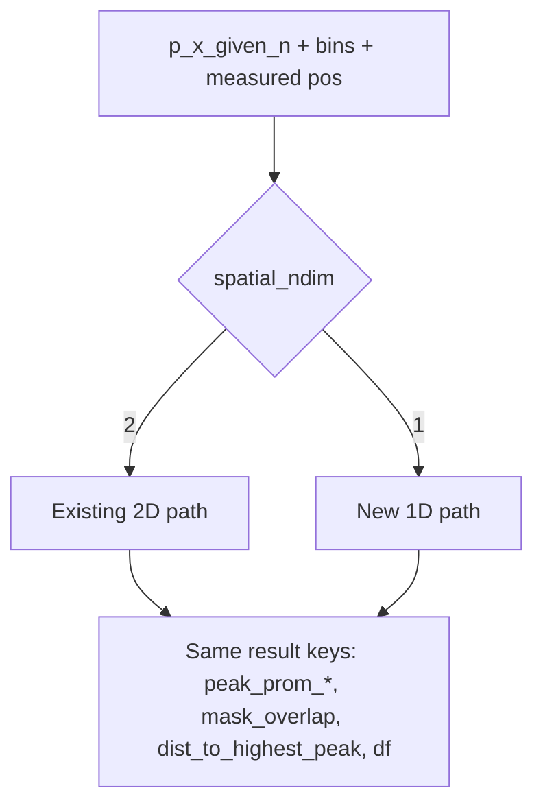

# Generalize DecodingLocalityMeasures for 1D (preserve 2D)

## Scope

Target: [`DecodingLocalityMeasures`](h:\TEMP\Spike3DEnv_ExploreUpgrade\Spike3DWorkEnv\pyPhoPlaceCellAnalysis\src\pyphoplacecellanalysis\General\Pipeline\Stages\ComputationFunctions\MultiContextComputationFunctions\PredictiveDecodingComputations.py) (~L568–1471) and the **minimal** `SparseGaussianVolume` extensions required for 1D measured-position Gaussians.

**Default contract (chosen):**
- **2D (unchanged):** posterior `(n_x, n_y, n_contexts, n_t)` or per-context `(n_x, n_y, n_t)`; measured `(t → x,y)`; `ybin` / `ybin_centers` required.
- **1D (new):** posterior `(n_x, n_contexts, n_t)` or per-context `(n_x, n_t)`; measured `(t → x)` (prefer `lin_pos` if present else `x`); `ybin` / `ybin_centers` may be `None`.
- Detection: `spatial_ndim` from posterior shape / explicit field; **never** coerce 1D into fake `(n_x, 1)` for peak prominence (use existing `PeakPromenence.compute_1d_dt_posterior_peak_promenences`).

## Implementation order

1. **Write and land 2D regression unittests against current code** (must pass before any algorithm edits).
2. Implement 1D generalization with 2D branches preserving today’s logic.
3. Add 1D tests; re-run the full 2D regression suite.

## Preserve 2D exactly

- Leave `init_from_decode_result` logic, shapes, and sigma defaults as-is for 2D inputs.
- In shared methods, branch with early `if self.spatial_ndim == 2:` (or local equivalent) that keeps today’s code; 1D lives in the other branch.
- Do **not** change 2D cutoffs, axes `(0,1)` reductions, or `PeakPromenence.compute_2d_dt_posterior_peak_promenences` usage on the 2D path.
- Bump `_VersionedResultMixin_version` only if serialized field defaults change in a load-breaking way; prefer optional defaults (`ybin=None`) so old pickles still load as 2D.

## Field / property changes

On `DecodingLocalityMeasures`:
- Add `spatial_ndim: int = serialized_attribute_field(default=2)` (or infer-only property if pickle noise is a concern; prefer explicit field set at init).
- Allow `ybin` / `ybin_centers` to be `Optional` with default `None`.
- `n_total_pos_bins`: `len(xbin_centers)` when 1D; `len(x)*len(y)` when 2D.
- `new_positions`: `(n_t, 2)` for 2D; `(n_t, 1)` for 1D — so gaussian builder shares a “last axis = coords” convention without breaking 2D `(n_t, 2)`.
- `measured_positions_df`: 2D path unchanged (`x`,`y` + `binned_x/y`); 1D path dropna on `t` + `x`/`lin_pos`, bin with `xbin` only.

## Init

- Keep [`init_from_decode_result`](h:\TEMP\Spike3DEnv_ExploreUpgrade\Spike3DWorkEnv\pyPhoPlaceCellAnalysis\src\pyphoplacecellanalysis\General\Pipeline\Stages\ComputationFunctions\MultiContextComputationFunctions\PredictiveDecodingComputations.py) **2D-only** (pseudo2D continuous decode + `x,y` interpolator) — no behavior change for current PredictiveDecoding callers.
- Add `init_from_1d_decode_result(...)`:
  - Inputs: pipeline (for `pos_df`), a continuous/`DecodedFilterEpochsResult` or already-extracted `p_x_given_n` with shape `(n_x, n_contexts, n_t)` or `(n_x, n_t)`, `xbin`/`xbin_centers`, `epoch_names`, optional `sigma`.
  - Interpolate measured position along **1D** (`lin_pos` if column exists else `x`) onto `time_window_centers`.
  - Set `spatial_ndim=1`, `ybin=ybin_centers=None`.

## Core algorithm branching

### `perform_build_normalized_outputs`
- 2D: keep squeeze `[:, :, epoch_idx, :]` and `nansum` over `(0, 1)`.
- 1D: if `p_x_given_n.ndim == 3` treat as `(n_x, n_contexts, n_t)` → slice `[:, epoch_idx, :]`; renormalize with `nansum` over axis `0` only. If already `(n_x, n_t)` and single context, wrap as one-entry dict.

### `SparseGaussianVolume` (extend, don’t fork class)
Add 1D builder + ops used by locality:
- `build_from_positions_1d(xbin_centers, new_positions_1d, sigma)` → clear `shape=(n_x, n_t)` and 1D-aware `multiply_mask_*` / `marginal_sums` (return `marg_x` only; `marg_y=None`).
- `_build_sampled_pos_with_gaussian_spread` on `DecodingLocalityMeasures` dispatches to 2D vs 1D builder.
- 2D `build_from_positions` left untouched.

### `compute_locality_measures_for_posterior`
Make **dimension-aware** (still a classmethod; same return key set):
- Infer ndim from `a_p_x_given_n`: `(n_x, n_y, n_t)` → 2D; `(n_x, n_t)` → 1D. If `ybin_centers is None`, force 1D.
- **2D branch:** today’s body (2D peak prom, `axis=(0,1)`, 2D COM distance).
- **1D branch:**
  - Peak masks via `PeakPromenence.compute_1d_dt_posterior_peak_promenences(a_p_x_given_n, alpha=alpha_list)` → masks `(n_x, n_t)`.
  - `peak_prom_num_bins` / Focality / Peakiness: reduce over axis `0` only; `n_total_pos_bins = len(xbin_centers)`.
  - Spatial distance: 1D COM along `xbin_centers` only; `max_possible_distance = ptp(xbin_centers)`.
  - `mask_overlap` / gaussian multiply: use 1D sparse volume API.
- Keep output keys identical (`peak_prom_*`, `mask_overlap`, `dist_to_highest_peak`, optional `debug`) so `perform_build_locality_measures_df` and downstream filters keep working.

### `perform_build_locality_measures_df` / `rebuild_locality_measures_df`
- `mask_overlap` aggregation: 2D `nansum(..., (0,1)) / (nx*ny)`; 1D `nansum(..., 0) / nx`.
- Non-local boolean rule (`dist_to_highest_peak >= 0.4` & `mask_overlap < 0.1`) stays the same numerically (already fraction-based).

### `perform_compute_on_load` / `downsampling_spatial_data`
- Sigma default: 2D `max(x_step,y_step)*5`; 1D `x_step*5`.
- Downsample: 2D unchanged; implement a small 1D downsample path (`factors=(k,)`, `axes=(0,)`).

## Call sites (minimal)

- Existing PredictiveDecoding construction via `init_from_decode_result` — **no change**.
- Document 1D usage on the class docstring: build from continuous 1D / BATCH-style `(n_x, n_t)` + `xbin`.
- Wiring into 1D PLI quality metrics is out of scope for this change.

---

## Tests — 2D regression suite (do first)

New file: [`tests/test_decoding_locality_measures_2d.py`](h:\TEMP\Spike3DEnv_ExploreUpgrade\Spike3DWorkEnv\pyPhoPlaceCellAnalysis\tests\test_decoding_locality_measures_2d.py).

Goal: lock **current** 2D behavior with deterministic synthetic fixtures so any accidental change during 1D work fails CI/local pytest immediately. Prefer direct imports; if `PredictiveDecodingComputations` import is too heavy in the test env, use the same AST class-extraction pattern as `test_position_like_posterior_scoring_1d.py` / `test_bapun_clusterless_decoder_resolution.py`, extracting `SparseGaussianVolume` and `DecodingLocalityMeasures` (keep `@classmethod`).

### Shared fixtures (module-level helpers)

- Fixed RNG seed (`np.random.default_rng(0)`).
- Small grid: `n_x=12`, `n_y=10`, `n_t=8`, `n_contexts=2`.
- `xbin_centers` / `ybin_centers` from linspace (cm-scale); matching edges via `get_bin_edges` if needed.
- **Peaked posterior:** 2D Gaussian blob per time bin, renormalized over `(x,y)`.
- **Diffuse / near-uniform posterior:** renormalized over `(x,y)`.
- **Two-context stack:** `(n_x, n_y, 2, n_t)` with different peak locations per context.
- **Measured positions:** `new_positions` shape `(n_t, 2)` tracking the peaked-context COM (or a known offset for distance tests).
- Fixed `sigma` (e.g. `2.0 * mean bin step`).

### A. `SparseGaussianVolume` (2D)

- `build_from_positions` returns `shape==(n_x, n_y, n_t)`.
- Peak of each time slice is near the corresponding measured `(x,y)` (argmax within ~1–2 bins).
- `to_dense()` matches sparse multiply semantics: `vol * ones_like` densifies to same support.
- `marginal_sums()` shapes `(n_x, n_t)` and `(n_y, n_t)`; finite; sum over both ≈ sum of dense volume per `t`.
- `multiply_mask_threshold_to_int` / `multiply_mask_threshold_sum_spatial`: identity-mask vs all-false mask; sum_spatial equals `nansum(..., axis=(0,1))` of the int mask product.
- Values below sparsity threshold are zero in sparse data (compression_ratio > 1 on peaked Gaussians).

### B. `perform_build_normalized_outputs` (2D)

- Input `(n_x, n_y, n_contexts, n_t)` + `epoch_names` of length `n_contexts`.
- Output dict keys == `epoch_names`; each value shape `(n_x, n_y, n_t)`.
- Each time bin renormalizes: `nansum(p[:,:,t], axis=(0,1)) ≈ 1` (or 0 for all-zero bins if any).
- Context slice isolation: context `i` mass comes only from `p_x_given_n[:,:,i,:]`.

### C. `compute_locality_measures_for_posterior` (2D) — contract + numeric freeze

Run on peaked and diffuse synthetics **with and without** `gaussian_volume`.

**Key / shape contract (always):**
- Required keys without gaussian: at least `peak_prom_num_bins`, `peak_prom_Focality`, `peak_prom_Peakiness`, `peak_prom_num_peaks` (when peaks found).
- With gaussian: also `mask_overlap`, `peak_prom` (int volume/mask product), `dist_to_highest_peak`.
- With `enable_debug_outputs=True`: `debug` dict containing `peak_prom_masks_dict` / promenence tuples.
- All time-series arrays length `n_t`.
- `peak_prom_Focality` in `[0, 1]`; `dist_to_highest_peak` in `[0, 1]` when present.
- `n_total_pos_bins` default == `n_x * n_y`.

**Behavioral inequalities (robust, not brittle):**
- Peaked vs diffuse (same bins/`alpha_list`): peaked has **lower** mean Focality and **higher** mean Peakiness (where finite).
- Measured position colocated with posterior peak → `dist_to_highest_peak` mean **smaller** than when measured position is offset to the opposite corner of the arena.
- `mask_overlap` higher when gaussian is centered on the posterior mass than when offset.

**Frozen numeric baseline (strict regression):**
- After fixtures are finalized, capture golden arrays (or a small set of summary scalars: mean/std of Focality, Peakiness, dist, mask_overlap) from **current** code into the test file as constants (or `np.savez` under `tests/fixtures/decoding_locality_2d_baseline.npz`).
- Assert `np.allclose(..., rtol=1e-5, atol=1e-6)` (or exact for int masks) against that baseline.
- Document in the test module docstring: “regenerate baseline only intentionally when 2D math is deliberately changed.”

### D. `perform_build_locality_measures_df` (2D)

- Builds a DataFrame indexed by time with column `t` == `time_window_centers`.
- Expands per-context measure columns as `{measure}_{epoch_name}`.
- Skips raw `peak_prom` volume column (current `continue` behavior).
- `mask_overlap_*` columns are **fractions** (after `(0,1)` sum / `nx*ny`), length `n_t`, values in `[0, 1]`.
- With a minimal `paradigm_epochs_df` covering all `t`, adds `correct_paradigm_epoch` and `is_non_local_period`; non-local rule matches current thresholds (`dist >= 0.4` and `mask_overlap < 0.1`) for the active epoch rows.

### E. Instance integration smoke (2D, no pipeline)

Construct `DecodingLocalityMeasures(..., defer_compute_on_init=True, spatial fields + p_x_given_n + new_positions + epoch_names)` then:
- `perform_compute_on_load()` sets `sigma` from bin steps when unset (`max(x_step,y_step)*5`).
- `compute()` returns a non-empty `locality_measures_df` with expected columns for both epoch names.
- `n_total_pos_bins == n_x * n_y`.
- Round-trip: `rebuild_locality_measures_df()` matches `compute()` column set.

### F. What not to require in 2D unittests

- Full `init_from_decode_result` against a live pipeline / HDF5 (too heavy); optional `@pytest.mark.integration` later.
- Exact bit-identity of PeakPromenence internals beyond the frozen baseline of **this** class’s outputs.
- GUI helpers (`add_non_local_PBE_non_moving_epochs_to_intervals_timeline`).

---

## Tests — 1D suite (after implementation)

New file: [`tests/test_decoding_locality_measures_1d.py`](h:\TEMP\Spike3DEnv_ExploreUpgrade\Spike3DWorkEnv\pyPhoPlaceCellAnalysis\tests\test_decoding_locality_measures_1d.py):
- Synthetic 1D peaked vs diffuse: Focality/Peakiness/num_peaks finite; peaked has higher Peakiness / lower Focality.
- Shape dispatch: `(n_x, n_t)` uses 1D path; `(n_x, n_y, n_t)` stays on 2D path.
- `n_total_pos_bins` / mask_overlap normalization for 1D.
- Re-run `test_decoding_locality_measures_2d.py` and confirm green.

## Files

- Primary implementation: [`PredictiveDecodingComputations.py`](h:\TEMP\Spike3DEnv_ExploreUpgrade\Spike3DWorkEnv\pyPhoPlaceCellAnalysis\src\pyphoplacecellanalysis\General\Pipeline\Stages\ComputationFunctions\MultiContextComputationFunctions\PredictiveDecodingComputations.py) — `SparseGaussianVolume` + `DecodingLocalityMeasures`.
- Tests first: [`tests/test_decoding_locality_measures_2d.py`](h:\TEMP\Spike3DEnv_ExploreUpgrade\Spike3DWorkEnv\pyPhoPlaceCellAnalysis\tests\test_decoding_locality_measures_2d.py) (+ optional `tests/fixtures/decoding_locality_2d_baseline.npz`).
- Tests after: [`tests/test_decoding_locality_measures_1d.py`](h:\TEMP\Spike3DEnv_ExploreUpgrade\Spike3DWorkEnv\pyPhoPlaceCellAnalysis\tests\test_decoding_locality_measures_1d.py).
- Leverage existing: [`PeakPromenence.compute_1d_dt_posterior_peak_promenences`](h:\TEMP\Spike3DEnv_ExploreUpgrade\Spike3DWorkEnv\pyPhoPlaceCellAnalysis\src\pyphoplacecellanalysis\External\peak_prominence2d.py) / `compute_2d_dt_posterior_peak_promenences`.
