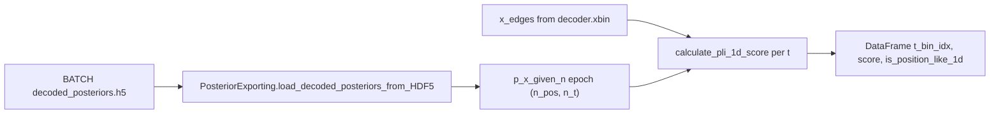

# 1D Position-Like Posterior Scoring (separate from 2D PLI)

## Context

- **2D path (unchanged):** [`calculate_pli_score`](h:\TEMP\Spike3DEnv_ExploreUpgrade\Spike3DWorkEnv\pyPhoPlaceCellAnalysis\src\pyphoplacecellanalysis\SpecificResults\PendingNotebookCode.py) expects `(n_x, n_y)`, `x_edges` + `y_edges`, entropy norm `log(n_x n_y)`, locality σ = 20% of **arena diagonal**, cutoffs `0.42` / `0.7`.
- **BATCH H5 layout:** [`PosteriorExporting.load_decoded_posteriors_from_HDF5`](h:\TEMP\Spike3DEnv_ExploreUpgrade\Spike3DWorkEnv\pyPhoPlaceCellAnalysis\src\pyphoplacecellanalysis\Pho2D\data_exporting.py) returns `out_dict[decoder_name][epochs_name][field]` as **lists of epoch arrays**. Stored `p_x_given_n` comes from `marginal_x.p_x_given_n` in [`SingleEpochDecodedResult.to_hdf`](h:\TEMP\Spike3DEnv_ExploreUpgrade\Spike3DWorkEnv\pyPhoPlaceCellAnalysis\src\pyphoplacecellanalysis\Analysis\Decoder\reconstruction.py) — typical kdiba directional decode shape **`(n_pos_bins, n_time_bins)`** per epoch (see [`Figure5._process_result`](h:\TEMP\Spike3DEnv_ExploreUpgrade\Spike3DWorkEnv\pyPhoPlaceCellAnalysis\src\pyphoplacecellanalysis\SpecificResults\PhoDiba2023Paper.py) asserting `(n_decoders, n_pos, n_t)` when stacked).
- **H5 does not store `xbin` edges** — only `n_xbins` on epoch groups. Docstring must show supplying `xbin` from the session decoder / pipeline (e.g. `a_decoder.xbin` with `len(xbin)-1 == p_x_given_n.shape[0]`), not inferring edges from `n_xbins` alone (see commented caveat in PhoDiba2023Paper ~5466).



## API design (all on existing class)

Add **1D-prefixed classmethods** on [`PositionLikePosteriorScoring`](h:\TEMP\Spike3DEnv_ExploreUpgrade\Spike3DWorkEnv\pyPhoPlaceCellAnalysis\src\pyphoplacecellanalysis\SpecificResults\PendingNotebookCode.py) (~7436). Do **not** route 2D callers through these methods.

| Method | Role |
|--------|------|
| `calculate_pli_1d_score(posterior_1d, x_edges, ...)` | Core score for one time bin; input `(n_pos,)` or `(n_pos, 1)` |
| `_normalize_posterior_1d_stack(...)` | Private: accept `(n_pos, n_t)`, `(n_pos,)`, reject `(n_pos, n_y)` with `n_y > 1` with explicit error pointing to 2D API |
| `compute_and_plot_posterior_stack_1d(posterior_stack, x_edges, ...)` | Loop time axis; optional 1D line/stack plots (mirror 2D method structure, tags `1D`) |
| `score_h5_loaded_decoder_epochs_1d(h5_out_dict, decoder_name, epochs_name, x_edges, ...)` | Convenience over loaded dict: score every epoch in the list, return per-epoch DataFrames + optional concat |
| `get_pli_1d_quality_label(score)` | Parallel labels using **1D cutoffs** |

**New class-level constants (separate from 2D):**

- `position_like_score_cutoff_1d`
- `high_quality_score_cutoff_1d`
- `sigma_tolerated_track_length_percent_1d = 0.20` (analogous role to 2D’s 20% diagonal, but **track length** `max(x_edges)-min(x_edges)`)

**1D score math (mirror 2D structure, different geometry):**

1. Same peak-relative noise floor + renormalize as 2D.
2. **Sharpness:** `max_entropy = log(n_pos)` (not `log(n_pos * n_y)`).
3. **Locality:** 1D RMS from MAP in cm: `rms = sqrt(sum(P * dx^2))` with `dx = (i - map_i) * bin_w_cm`.
4. **Composite:** keep `w_sharpness=0.4`, `w_locality=0.6` unless calibration suggests otherwise.

Update the **class docstring** with two sections: `## 2D PLI (default)` (existing Colab example) and `## 1D PLI (linear track / BATCH H5)` with a full copy-paste example (below).

## Threshold calibration (determine “reasonable” 1D cutoffs)

Implement a **calibration helper** (can be a `@classmethod` `calibrate_1d_pli_cutoffs_from_h5_files(...)` or a small function in the same class block used only from tests/notebooks):

1. **Synthetic anchors** (in unit tests): uniform posterior → score near 0; single-bin delta → score near 1; narrow Gaussian → monotonic between.
2. **Empirical on real BATCH exports** (run once during implementation, record results in docstring):
   - Load 3–5 representative `(decoded_posteriors).h5` files (same pattern as [`LoadedPosteriorContainer`](h:\TEMP\Spike3DEnv_ExploreUpgrade\Spike3DWorkEnv\pyPhoPlaceCellAnalysis\src\pyphoplacecellanalysis\Pho2D\data_exporting.py) / PhoDiba2023Paper loop).
   - For each file, score **all time bins** for `ripple` and `laps` (one decoder at a time, e.g. `long_LR`) using matching `xbin` from a loaded pipeline decoder or documented session `xbin`.
   - **Target operating point:** choose `position_like_score_cutoff_1d` so ~**same pass rate on laps** as 2D’s `0.42` achieves on comparable 2D decodes (or, if 2D laps scores unavailable, use **upper quartile of lap scores** as “position-like” and **median of ripple scores** as “ambiguous” boundary).
   - Set `high_quality_score_cutoff_1d` ~ **90th percentile of lap scores** (parallel to 2D HQ intent).

Document in the class docstring:

- Final chosen numeric cutoffs and the session files used to derive them.
- Explicit warning: **do not use 2D cutoffs (`0.42` / `0.7`) on 1D scores** — entropy normalization and σ scale differ.

*(If no local H5 files exist in dev env, commit cutoffs from synthetic + one pinned test fixture `.h5` or document “defaults pending calibration” and set conservative placeholders with `TODO` only in code comments, not in user-facing docstring.)*

## Docstring usage example (BATCH H5)

Embed in `PositionLikePosteriorScoring` docstring (adapt paths to your `collected_outputs`):

```python
from pathlib import Path
import numpy as np
from pyphoplacecellanalysis.Pho2D.data_exporting import PosteriorExporting
from pyphoplacecellanalysis.SpecificResults.PendingNotebookCode import PositionLikePosteriorScoring

load_path = Path("K:/scratch/collected_outputs/2024-11-26_Lab-...-(decoded_posteriors).h5")
out_dict, _meta = PosteriorExporting.load_decoded_posteriors_from_HDF5(load_path=load_path, debug_print=False)

decoder_name = "long_LR"
epochs_name = "ripple"  # or "laps"
epoch_idx = 0
p_x_given_n = out_dict[decoder_name][epochs_name]["p_x_given_n"][epoch_idx]  # (n_pos, n_t)

# Must match decode binning (not stored in H5):
x_edges = np.array(...)  # len(x_edges) == n_pos + 1, e.g. from directional decoder .xbin

scoring_df = PositionLikePosteriorScoring.compute_and_plot_posterior_stack_1d(
    p_x_given_n, x_edges=x_edges, should_plot_results=False,
)
# scoring_df columns: t_bin_idx, score, sharpness, locality, rms_cm, is_position_like_1d
```

Also document **`score_h5_loaded_decoder_epochs_1d`** for batch scoring all ripples in one file.

## Cross-documentation on 2D class

- Add a short note at top of existing 2D `calculate_pli_score` / `filter_to_position_like_epochs_only` docstrings: “For `(n_pos, n_time)` BATCH 1D posteriors, use `*_1d` methods instead.”
- Add `@function_attributes` tags including `'1D'` on new methods; keep existing `'2D'` tags on 2D paths.

## Tests

New file [`tests/test_position_like_posterior_scoring_1d.py`](h:\TEMP\Spike3DEnv_ExploreUpgrade\Spike3DWorkEnv\pyPhoPlaceCellAnalysis\tests\test_position_like_posterior_scoring_1d.py):

- Synthetic uniform / delta / Gaussian on fake `x_edges`.
- Shape guards: `(n_pos, n_t)` OK; `(n_x, n_y, n_t)` raises with message to use 2D API.
- Stack method row count equals `n_t`.
- Optional: if a small fixture H5 is added under `tests/fixtures/`, one integration test loading via `PosteriorExporting` (skip if file missing).

## Out of scope (unless you ask later)

- Wiring 1D PLI into [`PredictiveDecodingComputations`](h:\TEMP\Spike3DEnv_ExploreUpgrade\Spike3DWorkEnv\pyPhoPlaceCellAnalysis\src\pyphoplacecellanalysis\General\Pipeline\Stages\ComputationFunctions\MultiContextComputationFunctions\PredictiveDecodingComputations.py) or batch completion helpers (still 2D).
- Persisting `xbin` into future H5 exports (separate enhancement).

## Files to touch

- Primary: [`PendingNotebookCode.py`](h:\TEMP\Spike3DEnv_ExploreUpgrade\Spike3DWorkEnv\pyPhoPlaceCellAnalysis\src\pyphoplacecellanalysis\SpecificResults\PendingNotebookCode.py) — new 1D methods + expanded class docstring + 2D cross-refs.
- New: [`tests/test_position_like_posterior_scoring_1d.py`](h:\TEMP\Spike3DEnv_ExploreUpgrade\Spike3DWorkEnv\pyPhoPlaceCellAnalysis\tests\test_position_like_posterior_scoring_1d.py).
