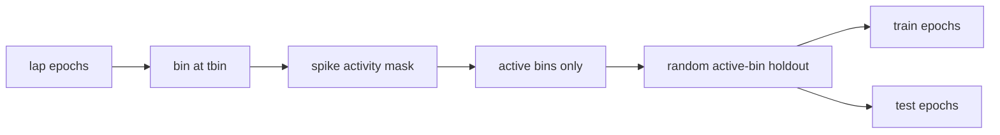

# Active-bin-first train/test split

## Problem

Today [`compute_train_test_split_laps_decoders`](h:/TEMP/Spike3DEnv_ExploreUpgrade/Spike3DWorkEnv/pyPhoPlaceCellAnalysis/src/pyphoplacecellanalysis/General/Pipeline/Stages/ComputationFunctions/MultiContextComputationFunctions/DirectionalPlacefieldGlobalComputationFunctions.py) splits each lap by **wall-clock duration** via [`EpochHelpers.split_epochs_into_training_and_test`](h:/TEMP/Spike3DEnv_ExploreUpgrade/Spike3DWorkEnv/NeuroPy/neuropy/core/epoch.py) (~6255–6257). Low-firing masking happens **later** at decode/eval in `_do_custom_decode_epochs`, so test intervals can include inactive bins that become NaN.

## Approach

**Active-bin holdout (matches the existing docstring about omitting ~1/10 of time bins):**

1. Bin each lap at `laps_decoding_time_bin_size`.
2. Mark bins active with the same spike-count rules as pos-err (`min_num_spikes_per_bin_to_be_considered_active`, `min_num_unique_active_neurons_per_time_bin`).
3. **Drop inactive bins** from the candidate set.
4. Randomly assign ~`(1 - training_data_portion)` of **active** bins to test; rest to train.
5. Merge contiguous same-label bins into epoch rows (keep `lap_id` / identity cols).

Do **not** call the existing duration-based `split_into_training_and_test` on filtered intervals for the default `train_test_full_lap=False` path — that API uses `min(start)/max(stop)` per `lap_id` and would re-include inactive gaps.

For `train_test_full_lap=True`: still hold out whole laps by count, then **restrict each held-out lap’s test epochs to its active bins only** (and train laps to active bins only).

## Implementation

### 1. Helper in `TrainTestLapsSplitting` (same file as compute)

Add something like `cls.split_laps_active_bins_into_train_test(laps_df, spikes_df, time_bin_size, training_data_portion, ..., train_test_full_lap=False)` that:

- Uses `spikes_df.spikes.compute_unit_time_binned_spike_counts_and_mask*` / window-interval variant (same path as [`_subfn_compute_low_firing_mask_rgba_for_time_bin_container`](h:/TEMP/Spike3DEnv_ExploreUpgrade/Spike3DWorkEnv/pyPhoPlaceCellAnalysis/src/pyphoplacecellanalysis/General/Pipeline/Stages/ComputationFunctions/MultiContextComputationFunctions/DirectionalPlacefieldGlobalComputationFunctions.py) ~10755).
- Returns `(train_df, test_df)` with `start`/`stop`/`lap_id`/identity columns.
- Skips laps with zero active bins (or empty test if too few active bins).

### 2. Wire into `compute_train_test_split_laps_decoders`

Replace the `a_laps_df.epochs.split_into_training_and_test(...)` call (~6257) with the new helper when spike-filter kwargs are provided.

New args (defaults match pos-err): `spikes_df`, `laps_decoding_time_bin_size`, `should_filter_inactive_bins_before_split=True`, `min_num_spikes_per_bin_to_be_considered_active=1`, `min_num_unique_active_neurons_per_time_bin=1`.

### 3. Wire into `_split_train_test_laps_data` (`directional_train_test_split`)

In [`_split_train_test_laps_data`](h:/TEMP/Spike3DEnv_ExploreUpgrade/Spike3DWorkEnv/pyPhoPlaceCellAnalysis/src/pyphoplacecellanalysis/General/Pipeline/Stages/ComputationFunctions/MultiContextComputationFunctions/DirectionalPlacefieldGlobalComputationFunctions.py) (~9198):

- Resolve `spikes_df` via `get_proper_global_spikes_df(owning_pipeline_reference, ...)`.
- Resolve `laps_decoding_time_bin_size` from computation kwargs / merged-decoders config / same default used by pos-err (`0.025`).
- Pass mask + bin kwargs into `compute_train_test_split_laps_decoders`.

### 4. Parameters

Extend [`directional_train_test_split_Parameters`](h:/TEMP/Spike3DEnv_ExploreUpgrade/Spike3DWorkEnv/pyPhoPlaceCellAnalysis/src/pyphoplacecellanalysis/General/Model/SpecificComputationParameterTypes.py) (~404) with the new fields so batch/config can set them.

### 5. Downstream

Keep post-decode masking in `_do_custom_decode_epochs` as a safety net (should become near-no-op for test bins).

Force-recompute `directional_train_test_split` when regenerating figures/pos-err (`export_train_test_pos_err` already does; figure `--only` is compute-if-missing — note that existing TrainTestSplit pickles must be force-recomputed to pick up this behavior).

## Files

- [`DirectionalPlacefieldGlobalComputationFunctions.py`](h:/TEMP/Spike3DEnv_ExploreUpgrade/Spike3DWorkEnv/pyPhoPlaceCellAnalysis/src/pyphoplacecellanalysis/General/Pipeline/Stages/ComputationFunctions/MultiContextComputationFunctions/DirectionalPlacefieldGlobalComputationFunctions.py) — helper + `compute_train_test_split_laps_decoders` + `_split_train_test_laps_data`
- [`SpecificComputationParameterTypes.py`](h:/TEMP/Spike3DEnv_ExploreUpgrade/Spike3DWorkEnv/pyPhoPlaceCellAnalysis/src/pyphoplacecellanalysis/General/Model/SpecificComputationParameterTypes.py) — parameter fields
