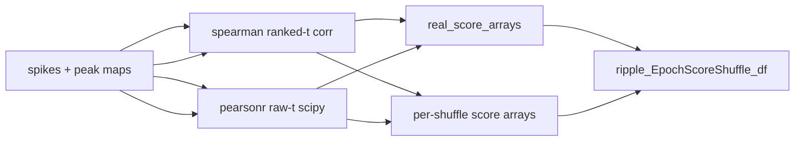

# Add `pearsonr` to EpochScoreShuffle output

## Chosen metric

Use **Simple PF PearsonR** (column name `pearsonr`): `scipy.stats.pearsonr(t_rel_seconds, {decoder}_pf_peak_x).statistic` on **unranked** spike times — same semantics as [`DirectionalPseudo2DDecodersResult._perform_compute_simple_spike_time_v_pf_peak_x_by_epoch`](h:\TEMP\Spike3DEnv_ExploreUpgrade\Spike3DWorkEnv\pyPhoPlaceCellAnalysis\src\pyphoplacecellanalysis\General\Pipeline\Stages\ComputationFunctions\MultiContextComputationFunctions\DirectionalPlacefieldGlobalComputationFunctions.py).

Do **not** use RankOrder `_subfn_calculate_correlations(method='pearson')` (that ranks times first and would largely duplicate existing `spearman`).

Downstream is already primed: [`SHUFFLE_TRANSFER_METRIC_NAMES`](h:\TEMP\Spike3DEnv_ExploreUpgrade\Spike3DWorkEnv\pyPhoPlaceCellAnalysis\src\pyphoplacecellanalysis\SpecificResults\PhoDiba2023Paper.py) includes `'pearsonr'`.



## 1. Register extreme mode

In [`SequenceBasedComputations.py`](h:\TEMP\Spike3DEnv_ExploreUpgrade\Spike3DWorkEnv\pyPhoPlaceCellAnalysis\src\pyphoplacecellanalysis\General\Pipeline\Stages\ComputationFunctions\MultiContextComputationFunctions\SequenceBasedComputations.py):

```204:206:src/pyphoplacecellanalysis/General/Pipeline/Stages/ComputationFunctions/MultiContextComputationFunctions/SequenceBasedComputations.py
SCORE_EXTREME_MODE: Dict[str, str] = {
    'wcorr': 'abs_greater',
    'spearman': 'abs_greater',
```

Add `'pearsonr': 'abs_greater'` next to `spearman`. This also makes `prepare_epoch_score_shuffle_transfer_columns` emit `best_overall_pearsonr_z` once z-columns exist.

## 2. Compute `pearsonr` from the same prepared spikes as spearman

Extend the existing spike-prep path (~644–704) so one prepare pass yields both metrics:

- Keep spike preparation in `compute_shuffle_spearman_score_arrays` (or lightly rename docstring to mention both).
- Add `_pearsonr_arrays_from_prepared_spikes_df` (or generalize the helper) that, per epoch/decoder:
  - drops NaNs on `t_rel_seconds` / `{decoder}_pf_peak_x`
  - returns NaN if fewer than 2 points
  - else `pearsonr(t, peak_x).statistic`
- Have the compute function return `{'spearman': ..., 'pearsonr': ...}` so call sites get both without a second spike prep.

## 3. Wire into real + shuffle scoring

- `_ensure_real_score_arrays` (~707–725): after the spearman call, `real_score_arrays.update(...)` will already include `pearsonr` if the compute fn returns both; adjust the try/except warn text to mention both.
- `_shuffle_and_decode_scores` (~1129–1132): same — `a_shuffle_score_arrays.update(spearman_arrays)` already merges whatever keys are returned.
- Bump `DecodedEpochScoreShuffle` result version (`2026.11.09_0` → `2026.11.11_0`) and class docstring to list `pearsonr`.

No change needed in `build_all_shuffles_dataframes`: the loop over `real_score_arrays` already emits `{metric}_{decoder}` plus `_z` / `_p` / `_n_extreme` for every non-wcorr metric.

## 4. Overlay parity (small)

In [`PhoDiba2023Paper.py`](h:\TEMP\Spike3DEnv_ExploreUpgrade\Spike3DWorkEnv\pyPhoPlaceCellAnalysis\src\pyphoplacecellanalysis\SpecificResults\PhoDiba2023Paper.py) (~117–119): append `'pearsonr_z'` and `'best_overall_pearsonr_z'` to `SHUFFLE_OVERLAY_KEYS`, and `'pearsonr_z'` to `DEFAULT_OVERLAY_INCLUDED_COLUMNS` (mirror `spearman_z`). No notebook edits.

## 5. Tests

Update [`tests/test_epoch_score_shuffle.py`](h:\TEMP\Spike3DEnv_ExploreUpgrade\Spike3DWorkEnv\pyPhoPlaceCellAnalysis\tests\test_epoch_score_shuffle.py):

- Include `pearsonr` in `_make_shuffle_object` fake score arrays.
- Expect `pearsonr` in `post_compute_all_metrics` / wide-DF column asserts (alongside `spearman`).
- Add a small unit test that `_pearsonr_arrays_from_prepared_spikes_df` returns ~±1 on the existing perfect mono / anti-mono prepared-spike fixtures.
- Assert `SCORE_EXTREME_MODE['pearsonr'] == 'abs_greater'`.

## Out of scope

- Rank-order `*_pearson` / `*_pearson_Z` columns
- Recomputing historical exported CSVs
- Changing Simple PF computation in `DirectionalPlacefieldGlobalComputationFunctions.py`