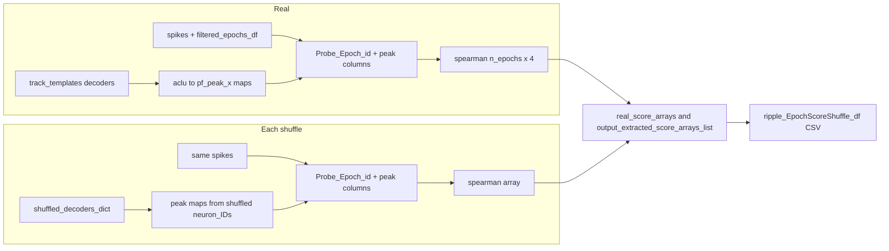

# Add `spearman` to EpochScoreShuffle

## Context

[`DecodedEpochScoreShuffle`](h:\TEMP\Spike3DEnv_ExploreUpgrade\Spike3DWorkEnv\pyPhoPlaceCellAnalysis\src\pyphoplacecellanalysis\General\Pipeline\Stages\ComputationFunctions\MultiContextComputationFunctions\SequenceBasedComputations.py) already stacks arbitrary metrics in `real_score_arrays` / `output_extracted_score_arrays_list` and exports `{spearman}_{decoder}`, `{spearman}_z_{decoder}`, etc. via `build_all_shuffles_dataframes` → `export_csvs`. No changes needed in [`AcrossSessionHelpers.prepare_epoch_score_shuffle_transfer_columns`](h:\TEMP\Spike3DEnv_ExploreUpgrade\Spike3DWorkEnv\pyPhoPlaceCellAnalysis\src\pyphoplacecellanalysis\SpecificResults\AcrossSessionResults.py) once `spearman` is added to `SCORE_EXTREME_MODE`.

**Definition (your choice):** Rank-order Spearman from [`RankOrderAnalyses._subfn_calculate_correlations`](h:\TEMP\Spike3DEnv_ExploreUpgrade\Spike3DWorkEnv\pyPhoPlaceCellAnalysis\src\pyphoplacecellanalysis\General\Pipeline\Stages\ComputationFunctions\MultiContextComputationFunctions\RankOrderComputations.py) (`method='spearman'`: dense rank of `t_rel_seconds`, correlate with `{decoder}_pf_peak_x`), using **all spikes** in each filtered replay epoch.

**Null alignment:** Peak maps come from **real** `track_templates` decoders (real scores) or **shuffled** 1D decoders after `_shuffle_pf1D_decoder` (each shuffle), *not* the legacy within-epoch aclu permutation from `rank_order_shuffle_analysis`.

## Implementation (primary file)

All core logic in [`SequenceBasedComputations.py`](h:\TEMP\Spike3DEnv_ExploreUpgrade\Spike3DWorkEnv\pyPhoPlaceCellAnalysis\src\pyphoplacecellanalysis\General\Pipeline\Stages\ComputationFunctions\MultiContextComputationFunctions\SequenceBasedComputations.py).

### 1. Registry and version

- Add to `SCORE_EXTREME_MODE`: `'spearman': 'abs_greater'` (same tail as `wcorr`).
- Bump `result_version` / `_VersionedResultMixin_version` (e.g. `2026.11.09_0`).

### 2. New helpers on `DecodedEpochScoreShuffle`

- **`_decoder_dict_to_aclu_peak_map_dict(decoders_dict, peak_mode='CoM')`** — mirror [`TrackTemplates.get_decoder_aclu_peak_map_dict`](h:\TEMP\Spike3DEnv_ExploreUpgrade\Spike3DWorkEnv\pyPhoPlaceCellAnalysis\src\pyphoplacecellanalysis\General\Pipeline\Stages\ComputationFunctions\MultiContextComputationFunctions\DirectionalPlacefieldGlobalComputationFunctions.py) using `dict(zip(decoder.neuron_IDs, decoder.peak_tuning_curve_center_of_masses))` per decoder name.

- **`_prepare_spikes_for_spearman_scoring(track_templates, spikes_df, active_epochs_df, decoder_aclu_peak_map_dict)`** — minimal reuse of the simple-PF path:
  - Slice spikes to `track_templates.any_decoder_neuron_IDs`.
  - Add `Probe_Epoch_id` via `active_epochs_df` + `label` (same pattern as [`_perform_compute_simple_spike_time_v_pf_peak_x_by_epoch`](h:\TEMP\Spike3DEnv_ExploreUpgrade\Spike3DWorkEnv\pyPhoPlaceCellAnalysis\src\pyphoplacecellanalysis\General\Pipeline\Stages\ComputationFunctions\MultiContextComputationFunctions\DirectionalPlacefieldGlobalComputationFunctions.py)).
  - Attach `{decoder}_pf_peak_x` via `RankOrderAnalyses._subfn_build_all_pf_peak_x_columns(..., override_decoder_aclu_peak_map_dict=peak_map_dict, _MODERN_INTERNAL_SHUFFLE=False)` so shuffled maps apply without within-epoch aclu shuffle.

- **`compute_shuffle_spearman_score_arrays(...)`** (classmethod) — groupby `Probe_Epoch_id`, apply `RankOrderAnalyses._subfn_calculate_correlations(..., method='spearman')`, build `(n_epochs, n_decoders)` array ordered to match `active_epochs_df` row order (reindex by epoch `label` / `Probe_Epoch_id`).

### 3. Wire real and shuffled paths

- **`_ensure_real_score_arrays`**: Refactor so **Spearman does not depend** on `real_decoder_ripple_filter_epochs_decoder_result_dict`. Compute when `('spearman' not in real_score_arrays)` and `track_templates`, `active_spikes_df`, `filtered_epochs_df` are set. Keep heuristic/radon behind existing decode-dict guard.

- **`_shuffle_and_decode_scores`**: After `shuffled_decoders_dict` is built (reuse same `spikes_df` as decode), compute shuffled peak map dict, call `compute_shuffle_spearman_score_arrays`, set `a_shuffle_score_arrays['spearman'] = ...` every iteration (always on, like `wcorr`; no new batch flag unless you want radon-style gating later).

- **`init_from_templates`**: After real decode is stored, call `_ensure_real_score_arrays` once (or invoke spearman computation inline) so export works before any new shuffles are run.

### 4. Pipeline entry (optional kwargs)

- Default: always compute spearman. If you want symmetry with radon, add `enable_spearman_shuffle_scoring: bool = True` on `DecodedEpochScoreShuffle`, thread through `compute_shuffles` and [`perform_epoch_score_shuffle_analysis`](h:\TEMP\Spike3DEnv_ExploreUpgrade\Spike3DWorkEnv\pyPhoPlaceCellAnalysis\src\pyphoplacecellanalysis\General\Pipeline\Stages\ComputationFunctions\MultiContextComputationFunctions\SequenceBasedComputations.py) only if batch configs need to disable it. **Recommendation:** ship always-on first (minimal API).

## Tests

Extend [`tests/test_epoch_score_shuffle.py`](h:\TEMP\Spike3DEnv_ExploreUpgrade\Spike3DWorkEnv\pyPhoPlaceCellAnalysis\tests\test_epoch_score_shuffle.py):

- Unit: synthetic spikes + epoch labels + known peak maps → `compute_shuffle_spearman_score_arrays` shape and finite values where expected.
- Integration: add `spearman` to `_make_shuffle_object` / wide DF test — assert columns `spearman_long_LR`, `spearman_z_long_LR`, `spearman_p_long_LR`, `spearman_n_extreme_long_LR`, and `post_compute_all_metrics` includes `spearman`.
- `_ensure_real_score_arrays`: can populate `spearman` when decode dict is `None` if spikes/epochs/templates present (new small test).

## Recompute / export (manual after merge)

Existing pickles will not have per-shuffle `spearman` until recomputed:

- Run `perform_epoch_score_shuffle_analysis` with `drop_previous_result_and_compute_fresh=True` (or batch `should_purge_existing_shuffled_result=True`) + `compute_and_export_session_epoch_score_shuffles_completion_function`.

Downstream notebooks using `LoadedScoreShufflesDataframeAccessor.process_loaded_shuffles` will auto-discover `spearman` p/z columns after CSV reload.

## Out of scope (this task)

- Raw Pearson (`pearson` / `pf_peak_x_pearsonr`) — separate metric later if needed.
- Legacy `rank_order_shuffle_analysis` container — unchanged.
