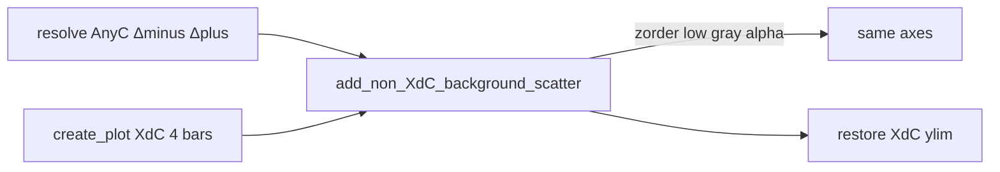

# Non-XdC as Faint Background Series

## Locked decisions
- No inset axes
- Scatter points only (no AnyC mean bars)
- Map 2 AnyC series onto 4 XdC bar x-positions by epoch:
  - AnyC Δ− behind bars 0 and 2 (LxC Δ−, SxC Δ−)
  - AnyC Δ+ behind bars 1 and 3 (LxC Δ+, SxC Δ+)
- Keep kwarg name `include_non_XdC_cells_as_inset` (default `False`); behavior becomes overlay, not inset
- Y-limits stay driven by XdC (capture/restore ylim after adding AnyC so extremes do not expand the axis)
- Data plumbing (`build_shell_object_for_plot`, `_resolve_AnyC_bar_results`) stays as-is

## Changes — [`PhoDiba2023Paper.py`](h:\TEMP\Spike3DEnv_ExploreUpgrade\Spike3DWorkEnv\pyPhoPlaceCellAnalysis\src\pyphoplacecellanalysis\SpecificResults\PhoDiba2023Paper.py)

1. **Replace** `add_non_XdC_inset` with `add_non_XdC_background_scatter(ax, anyc_bar_results, width=0.3, ...)`:
   - Read `y_minus`, `y_plus` from the 2 `SingleBarResult`s
   - For each main bar index `i in 0..3`, pick `y = y_minus if i in (0, 2) else y_plus`
   - Scatter with jitter `x[i] + U(-width/2, width/2)`, style: gray `color=(0.5,0.5,0.5)`, `alpha=0.12`, `s=10`, `zorder=1`, `marker='.'`
   - No bars, labels, or title
   - `ylim0 = ax.get_ylim()` before scatter; `ax.set_ylim(ylim0)` after
   - Return list of scatter artists; store on container as `plot_objects['anyc_background_scatter']`

2. **Update** `display`:
   - When `include_non_XdC_cells_as_inset` is True, call the new helper on `_fig_2_theta_out.ax` / `_fig_2_replay_out.ax` instead of `add_non_XdC_inset`
   - Ensure XdC bars/scatter sit above: set existing bars/scatter `zorder` to `>= 2` if needed (or rely on draw order + AnyC `zorder=1`)
   - Docstring: describe faint background series, not inset

3. **Delete** inset-only code paths (inset bounds, inset title, muted inset bars)

## Unchanged
- [`AcrossSessionResults.py`](h:\TEMP\Spike3DEnv_ExploreUpgrade\Spike3DWorkEnv\pyPhoPlaceCellAnalysis\src\pyphoplacecellanalysis\SpecificResults\AcrossSessionResults.py): flag + shell AnyC fields (`Fig2_*_AnyC_FR`) — only docstring wording if it still says “inset plot”
- Main 4-bar layout, stats overlays, connection lines (AnyC not included in those)
