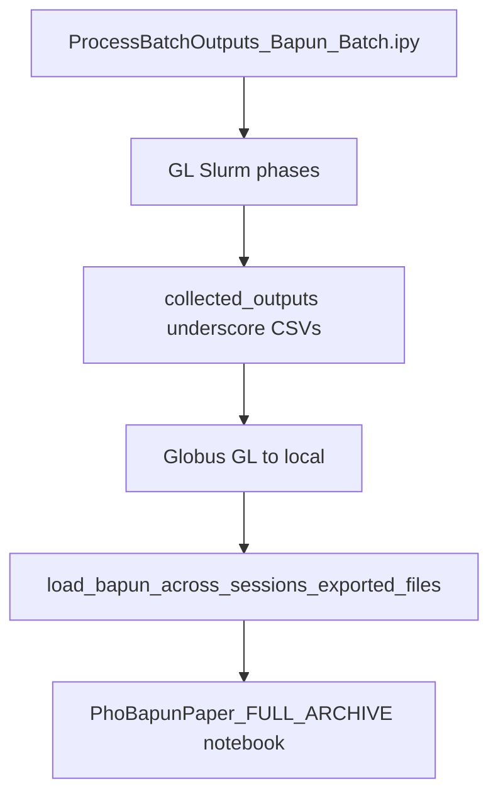

# Bapun End-to-End Batch + Post-Batch Archive Notebook

## Locked decisions

- **Do not rename** existing Bapun CSV exports (`*_bapun_train_test_decoder_error.csv`, etc.).
- **Add a Bapun-specific loader** that globs and parses those underscore filenames.
- Post-batch notebook focus: **across-session train/test position error** + **TwoNovel context-decoder accuracy** (OpenField vs TwoNovel split). Do **not** port Diba long/short / `t_delta` / `P_Short` figures.
- GL posture: keep current session list and `continued_run → final_run → figure_run`; bump `BATCH_DATE_TO_USE`; fix compute-phase freeze bug.

## 1. GL batch readiness — [`ProcessBatchOutputs_Bapun_Batch.ipy`](h:/TEMP/Spike3DEnv_ExploreUpgrade/Spike3DWorkEnv/Spike3D/ProcessBatchOutputs_Bapun_Batch.ipy)

- Bump `BATCH_DAY_DATE` to today's run stamp and keep `BATCH_DATE_TO_USE = f'{BATCH_DAY_DATE}_Bapun_GL'`.
- On compute phases (`continued_run` / `final_run`), set `should_freeze_pipeline_updates=False` so compute/save actually run. Keep freeze `True` only for pure figure generation if needed. Matches [`2026-09-14_GreatlakesBatchRunInstructions.md`](h:/TEMP/Spike3DEnv_ExploreUpgrade/Spike3DWorkEnv/Spike3D/2026-09-14_GreatlakesBatchRunInstructions.md).
- Keep enabled completions: generalized decode export, Bapun train/test error, clusterless + Spyglass clusterless pickles; figure-phase Bapun plot helpers.
- Keep session set as-is (OpenField RatJ/K/N/S/U + TwoNovel RatJ/K; RatS/U TwoNovel commented).
- Leave auto-submit off by default; ensure `submit_*.sh` manifests and printed `sbatch` lines remain the primary GL entry.

## 2. Bapun across-session loader — [`AcrossSessionResults.py`](h:/TEMP/Spike3DEnv_ExploreUpgrade/Spike3DWorkEnv/pyPhoPlaceCellAnalysis/src/pyphoplacecellanalysis/SpecificResults/AcrossSessionResults.py)

Add helpers next to `load_across_sessions_exported_files` / `parse_filename` (do **not** force Bapun files through KDIBA `-(file_type)` parsing):

- `parse_bapun_collected_output_filename(path)` — parse `{BATCH_DATE}-{session_stem}_bapun_{file_type}.csv` into `(export_datetime, session_stem, file_type)` for:
  - `bapun_train_test_decoder_error`
  - `bapun_train_test_decoder_error_agg`
  - `bapun_context_decoder_laps`
  - `bapun_context_decoder_summary_agg`
- `find_bapun_collected_output_csv_files(collected_outputs_directory, cuttoff_date=...)` — glob `*_bapun_train_test_decoder_error*.csv` and `*_bapun_context_decoder_*.csv`, apply cutoff, keep most-recent per `(session_stem, file_type)`.
- `load_bapun_across_sessions_exported_files(...)` — read CSVs, concat into:
  - `bapun_train_test_decoder_error_df`
  - `bapun_train_test_decoder_error_agg_df`
  - `bapun_context_decoder_laps_df`
  - `bapun_context_decoder_summary_agg_df`
  Annotate each row with `session_stem`, `animal`, `session_name`, `experiment_type` (`OpenField` vs `TwoNovel` from session_name), and `export_datetime`.
- Optional thin wrapper on `AcrossSessionHelpers` for notebook discoverability.

Leave KDIBA `train_test_pos_err*` / `_new_process_csv_files` path unchanged.

## 3. Post-batch archive notebook

Create [`Spike3D/EXTERNAL/PhoBapunPaperBook/PhoBapunPaper_FULL_ARCHIVE_2026-11-27.ipynb`](h:/TEMP/Spike3DEnv_ExploreUpgrade/Spike3DWorkEnv/Spike3D/EXTERNAL/PhoBapunPaperBook/PhoBapunPaper_FULL_ARCHIVE_2026-11-27.ipynb) modeled on the Diba archive **ingest shell only**:

1. **Setup / paths** — same `known_collected_outputs_paths` + `find_first_extant_path`; `TODAY_DAY_DATE` / `cuttoff_date` aligned to the new Bapun GL batch tag.
2. **Load** — call `load_bapun_across_sessions_exported_files`; inventory missing sessions vs batch `included_session_contexts`.
3. **Quality / coverage** — table of which sessions have train/test vs context CSVs; OpenField vs TwoNovel counts.
4. **Figure A — Train/test position error** — session×maze heatmap and box/strip of `abs_err_cm_median_median` (plus 1D/2D cols when present); split OpenField (`roam`/`sprinkle`/`maze`) vs TwoNovel (`maze1`/`maze2`).
5. **Figure B — Context decoder (TwoNovel)** — overall + per-maze `% correct` from `summary_agg`; optional confusion / lap timeline from `laps` CSV.
6. **Figure C — Sorted vs clusterless** — only if clusterless train/test CSVs or figure exports are present for the same batch date; otherwise inventory note.
7. **Export** — write concatenated across-session CSVs under `collected_outputs/../across_sessions/` with the Bapun batch date prefix.

Skip Diba-only sections: FAT/P_Short, delta-aligned scatters, ripple score/wcorr merges, AcrossSessionTables long/short FRI, experience novelty ranks.

## 4. Verification

- Unit/smoke: parse sample filenames matching current export pattern; reject KDIBA parenthesized names; most-recent selection keeps one row per `(session, file_type)`.
- Dry-run loader against local `collected_outputs` if any Bapun CSVs already exist (empty-ok).
- After GL run + Globus pull: notebook cells 1–2 load without `parse_filename` WARN spam and produce non-empty train/test agg panels for completed sessions.
