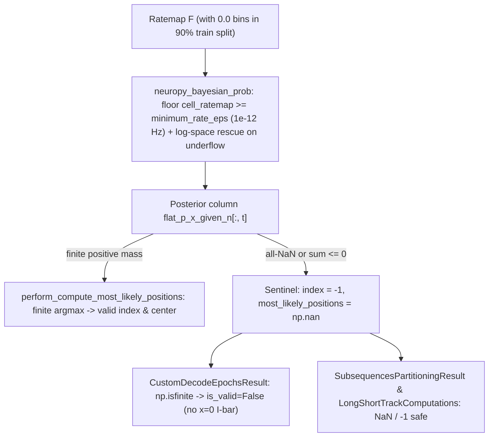

# Fix Zero-Sum Posterior Snapping to `xbin_centers[0]` and Harden Downstream `NaN`/`-1` Consumers

## Root Cause Summary
1. **Hard zeros in `F` under train/test splits**: `Pf1D._compute_tuning_map` ([NeuroPy/neuropy/analyses/placefields.py](h:/TEMP/Spike3DEnv_ExploreUpgrade/Spike3DWorkEnv/NeuroPy/neuropy/analyses/placefields.py)) leaves zero-occupancy / zero-spike spatial bins at exact `0.0`. In `ZhangReconstructionImplementation.neuropy_bayesian_prob` ([pyPhoPlaceCellAnalysis/src/pyphoplacecellanalysis/Analysis/Decoder/reconstruction.py](h:/TEMP/Spike3DEnv_ExploreUpgrade/Spike3DWorkEnv/pyPhoPlaceCellAnalysis/src/pyphoplacecellanalysis/Analysis/Decoder/reconstruction.py)), a single spike (`n_i > 0`) at a bin where `cell_ratemap == 0.0` multiplies the entire spatial likelihood by `0.0`, collapsing the posterior column to `0.0 / 0.0 = NaN` (or underflowing `float64` across many cells/spikes).
2. **`np.argmax` on all-`NaN` columns**: `BasePositionDecoder.perform_compute_most_likely_positions` calls `np.argmax(flat_p_x_given_n, axis=0)`, which returns `0` on all-`NaN` columns (and on partial-`NaN` columns!), causing `BasePositionDecoder.decode` to emit `xbin_centers[0]` as a finite valid position.
3. **Downstream unmasked assumptions**: Introducing `most_likely_positions = np.nan` and `most_likely_position_indicies = -1` matches `DecodedFilterEpochsResult.mask_computed_DecodedFilterEpochsResult_by_time_bin_inclusion_masks`, but unguarded callers that index `xbin_centers[-1]` / `F[-1]` or assert `np.all(positions >= 0)` in `heuristic_replay_scoring.py` would wrap around or crash.



## Planned Changes

### 1. Add Firing-Rate Floor and Underflow Rescue in `ZhangReconstructionImplementation.neuropy_bayesian_prob`
- **File**: [pyPhoPlaceCellAnalysis/src/pyphoplacecellanalysis/Analysis/Decoder/reconstruction.py](h:/TEMP/Spike3DEnv_ExploreUpgrade/Spike3DWorkEnv/pyPhoPlaceCellAnalysis/src/pyphoplacecellanalysis/Analysis/Decoder/reconstruction.py) (`lines 293-401`, `3135`)
- Add optional parameter `minimum_rate_eps: float = 1e-12` to `ZhangReconstructionImplementation.neuropy_bayesian_prob` (and `minimum_rate_eps: float = 1e-12` attribute default in `BasePositionDecoder.adding_default_values_for_missing_fields` so pickled decoders work seamlessly).
- Inside the per-cell loop (`lines 351-356`), keep the existing whole-cell `if np.sum(cell_ratemap) == 0:` uniform fallback first, then clamp per-bin rates when `minimum_rate_eps` is positive:
  ```python
  if (minimum_rate_eps is not None) and (minimum_rate_eps > 0.0):
      cell_ratemap = np.maximum(cell_ratemap, float(minimum_rate_eps))
  ```
  - Preserves exact equality between `use_flat_computation_mode=True` and `False` (`test_pho_custom_position_decoder.py`) and leaves silent-cell inhibition `exp(-tau * 1e-12)` unchanged to machine precision.
- Before dividing `posterior /= col_sums`, check for any zero-sum columns caused by `float64` product underflow (`col_sums == 0.0`) when `minimum_rate_eps > 0` and inputs are finite; recompute only those underflowed columns in max-shifted log-space (`n * log(tau * F_eff) - gammaln(n + 1) - tau * F_eff`) so large-`n_i` bins (e.g. `use_single_time_bin_per_epoch=True`) also normalize cleanly instead of dividing `0.0 / 0.0`.

### 2. Safe MAP Index & Position Lookup Across All Decoders (Fix 1)
- **Files**:
  - [pyPhoPlaceCellAnalysis/src/pyphoplacecellanalysis/Analysis/Decoder/reconstruction.py](h:/TEMP/Spike3DEnv_ExploreUpgrade/Spike3DWorkEnv/pyPhoPlaceCellAnalysis/src/pyphoplacecellanalysis/Analysis/Decoder/reconstruction.py) (`lines 2617-2627`, `3140-3154`, `3675-3682`)
  - [pyPhoPlaceCellAnalysis/src/pyphoplacecellanalysis/Analysis/Decoder/reconstruction_dst.py](h:/TEMP/Spike3DEnv_ExploreUpgrade/Spike3DWorkEnv/pyPhoPlaceCellAnalysis/src/pyphoplacecellanalysis/Analysis/Decoder/reconstruction_dst.py) (`lines 432-444`)
  - [pyPhoPlaceCellAnalysis/src/pyphoplacecellanalysis/Analysis/Decoder/rtc_clusterless_decoder.py](h:/TEMP/Spike3DEnv_ExploreUpgrade/Spike3DWorkEnv/pyPhoPlaceCellAnalysis/src/pyphoplacecellanalysis/Analysis/Decoder/rtc_clusterless_decoder.py) (`lines 190-195`)
  - [pyPhoPlaceCellAnalysis/src/pyphoplacecellanalysis/Analysis/Decoder/spyglass_clusterless_decoder.py](h:/TEMP/Spike3DEnv_ExploreUpgrade/Spike3DWorkEnv/pyPhoPlaceCellAnalysis/src/pyphoplacecellanalysis/Analysis/Decoder/spyglass_clusterless_decoder.py) (`lines 210-215`)
  - [pyPhoPlaceCellAnalysis/src/pyphoplacecellanalysis/General/Pipeline/Stages/ComputationFunctions/MultiContextComputationFunctions/DirectionalPlacefieldGlobalComputationFunctions.py](h:/TEMP/Spike3DEnv_ExploreUpgrade/Spike3DWorkEnv/pyPhoPlaceCellAnalysis/src/pyphoplacecellanalysis/General/Pipeline/Stages/ComputationFunctions/MultiContextComputationFunctions/DirectionalPlacefieldGlobalComputationFunctions.py) (`lines 4218-4228`)
- Update `BasePositionDecoder.perform_compute_most_likely_positions`:
  - Replace `NaN` entries with `-np.inf` for `np.argmax` so partial-`NaN` columns still pick the true finite peak rather than index `0`.
  - Identify undefined time columns where `~np.any(np.isfinite(flat_p_x_given_n), axis=0) | (np.nansum(flat_p_x_given_n, axis=0) <= 0.0)`.
  - Unravel using `0` on invalid columns, then set `most_likely_position_flat_indicies[invalid_t_mask] = -1` and `most_likely_position_indicies[:, invalid_t_mask] = -1`.
- Add classmethod `BasePositionDecoder.perform_lookup_most_likely_positions(cls, most_likely_position_indicies: np.ndarray, xbin_centers: np.ndarray, ybin_centers: Optional[np.ndarray] = None, ndim: int = 1) -> np.ndarray`:
  - Clamps negative indices to `0` during `xbin_centers` / `ybin_centers` indexing (preventing `-1` wraparound to `xbin_centers[-1]`), converts to `float`, masks `< 0` entries to `np.nan` **before** `np.squeeze` (handling `num_time_windows == 1` 0D scalar safely without `IndexError`), and returns the exact shapes expected for 1D and 2D decoders.
- Route all 4 decoder classes (`BasePositionDecoder.decode`, `BayesianPlacemapPositionDecoderDST.decode`, `ClusterlessRTCPositionDecoder._format_decoder_posterior_outputs`, `SpyglassClusterlessDecoder._format_decoder_posterior_outputs`) and both `split_pseudo2D_result_to_1D_result` sites through `perform_compute_most_likely_positions` + `perform_lookup_most_likely_positions`.

### 3. Harden Downstream Consumers Against `NaN` Positions and `-1` Indices
- **Heuristic Replay & Shuffle Scoring** ([pyPhoPlaceCellAnalysis/src/pyphoplacecellanalysis/Analysis/Decoder/heuristic_replay_scoring.py](h:/TEMP/Spike3DEnv_ExploreUpgrade/Spike3DWorkEnv/pyPhoPlaceCellAnalysis/src/pyphoplacecellanalysis/Analysis/Decoder/heuristic_replay_scoring.py)):
  - `SequenceScoringComputations.total_distance_traveled` (`lines 2489-2499`): filter `positions` to finite values before checking `len < 2`, `assert np.all(finite_positions >= 0)`, and summing `np.abs(np.diff(finite_positions, n=1))`.
  - `SequenceScoringComputations.track_coverage_score` (`lines 2505-2528`): filter `positions` to finite values before `len < 2` and `np.min`/`np.max` so `mseq_tcov` and `np.lexsort` ranking keys stay finite.
  - `SubsequencesPartitioningResult.find_value_equiv_groups` (`lines 559-587`): skip non-finite (`np.nan`) entries so undefined bins are neither counted as valid non-repeated bins nor allowed to poison `initial_v`.
  - `SubsequencesPartitioningResult.partition_subsequences_ignoring_repeated_similar_positions` (`lines 616-668`): track `last_finite_pos` so `NaN` bins defer splitting without resetting `prev_accum_dir` (preserving monotonic ramps across single-bin `NaN` gaps while still splitting true direction reversals across `NaN`s; bit-for-bit identical when all inputs are finite).
  - `new_simple_split_main_subsequence_on_max_jump_distance` (`line 1154`) and `_subfn_main_rank_jump_split_scalars` (`line 1437`): evaluate `np.diff` across finite non-intrusion positions so jumps > `max_jump_distance_cm` across a `NaN` bin still split properly.
  - `SubsequencesPartitioningResult._compute_position_changes_info_df` (`line 1639`): guard `np.where(np.isfinite(pos_diff), np.sign(pos_diff), 0).astype(int)` to eliminate `RuntimeWarning` / `INT_MIN` cast corruption.
  - `_compute_stddev_of_diff` (`line 125`): use `np.nanstd` over finite diffs.
  - `HeuristicReplayScoring.compute_pho_heuristic_replay_scores` (`lines 3364-3369`): when `use_bin_units_instead_of_realworld=True`, convert `most_likely_position_indicies_list[an_epoch_idx]` to `float` and map `< 0` to `np.nan`.
- **Expected Firing-Rate Lookups** ([pyPhoPlaceCellAnalysis/src/pyphoplacecellanalysis/General/Pipeline/Stages/ComputationFunctions/MultiContextComputationFunctions/LongShortTrackComputations.py](h:/TEMP/Spike3DEnv_ExploreUpgrade/Spike3DWorkEnv/pyPhoPlaceCellAnalysis/src/pyphoplacecellanalysis/General/Pipeline/Stages/ComputationFunctions/MultiContextComputationFunctions/LongShortTrackComputations.py)):
  - In `compute_measured_vs_expected_firing_rates` (`line 2686`) and `simpler_compute_measured_vs_expected_firing_rates` (`line 2737`), guard negative indices (`idx < 0`) so invalid time bins produce `np.nan` expected firing rates instead of indexing `F[-1]`.

### 4. Unit Tests
- Add targeted unit tests in [pyPhoPlaceCellAnalysis/tests/test_decoders.py](h:/TEMP/Spike3DEnv_ExploreUpgrade/Spike3DWorkEnv/pyPhoPlaceCellAnalysis/tests/test_decoders.py) and [pyPhoPlaceCellAnalysis/tests/test_heuristic_sequence_partitioning.py](h:/TEMP/Spike3DEnv_ExploreUpgrade/Spike3DWorkEnv/pyPhoPlaceCellAnalysis/tests/test_heuristic_sequence_partitioning.py):
  - Out-of-field spike (`F[x, cell] == 0.0`) with co-active in-field cells recovers the true peak with `minimum_rate_eps=1e-12` (and matches between flat and full modes).
  - All-`NaN` and zero-sum posterior columns (including `num_time_windows == 1` and 2D decoders) yield `most_likely_position_indicies == -1` and `most_likely_positions` as `np.nan` (never `xbin_centers[0]` or `xbin_centers[-1]`).
  - `SubsequencesPartitioningResult` and `compute_shuffle_scalar_scores` handle embedded `NaN`s and all-`NaN` sequences without `AssertionError`, `RuntimeWarning`, or `INT_MIN` cast artifacts.