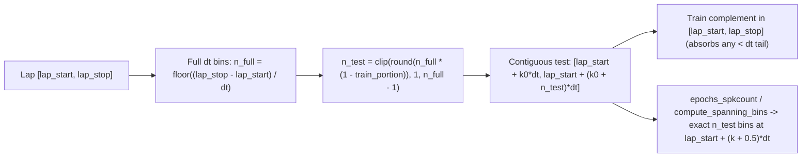

# Align Within-Lap Train/Test Split to Decoding Time Bins

## Root Cause
1. When `should_filter_inactive_bins_before_split=False`, [`TrainTestLapsSplitting.compute_train_test_split_laps_decoders`](h:/TEMP/Spike3DEnv_ExploreUpgrade/Spike3DWorkEnv/pyPhoPlaceCellAnalysis/src/pyphoplacecellanalysis/General/Pipeline/Stages/ComputationFunctions/MultiContextComputationFunctions/DirectionalPlacefieldGlobalComputationFunctions.py) calls `a_laps_df.epochs.split_into_training_and_test(...)` without `laps_decoding_time_bin_size`.
2. [`EpochHelpers.split_epochs_into_training_and_test`](h:/TEMP/Spike3DEnv_ExploreUpgrade/Spike3DWorkEnv/NeuroPy/neuropy/core/epoch.py) (`lines 637-749`) and [`EpochHelpers.sample_random_period_from_epoch`](h:/TEMP/Spike3DEnv_ExploreUpgrade/Spike3DWorkEnv/NeuroPy/neuropy/core/epoch.py) (`lines 592-633`) sample a continuous `np.random.uniform(epoch_start, epoch_stop)` timestamp and continuous duration `total_epoch_duration * training_data_portion`, leaving `test_start` unsnapped from `lap_start + k * dt`.
3. When [`epochs_spkcount`](h:/TEMP/Spike3DEnv_ExploreUpgrade/Spike3DWorkEnv/NeuroPy/neuropy/analyses/decoders.py) (`lines 606-615`) later bins `[test_start, test_stop]`, [`compute_spanning_bins`](h:/TEMP/Spike3DEnv_ExploreUpgrade/Spike3DWorkEnv/NeuroPy/neuropy/utils/mixins/binning_helpers.py) (`line 483`) uses `np.arange(start, stop + step, step)`, which is both anchored at `test_start` and vulnerable to IEEE-754 `+1` ULP overshoot (`m + 1` bins instead of `m`) when `stop - start == m * step` exactly.



## Planned Changes

### 1. Bin-aligned within-lap split in `NeuroPy`
File: [`NeuroPy/neuropy/core/epoch.py`](h:/TEMP/Spike3DEnv_ExploreUpgrade/Spike3DWorkEnv/NeuroPy/neuropy/core/epoch.py)

- Thread optional `time_bin_size: Optional[float] = None` through:
  - `EpochHelpers.sample_random_period_from_epoch` (`line 592`) and top-level deprecated wrapper (`line 50`)
  - `EpochHelpers.split_epochs_into_training_and_test` (`line 637`) and top-level deprecated wrapper (`line 57`)
  - `EpochsAccessor.split_into_training_and_test` (`line 1677`)
  - `Epoch.split_into_training_and_test` (`line 2463`)
- When `time_bin_size is not None and float(time_bin_size) > 0` and `train_test_full_lap=False`:
  - Compute full `dt`-width bins in `[lap_start, lap_stop]`:
    ```python
    dt: float = float(time_bin_size)
    n_full_bins: int = int(np.floor(((lap_stop - lap_start) / dt) + 1e-9))
    ```
  - If `n_full_bins <= 1`: assign the entire `[lap_start, lap_stop]` to `train` (skip emitting a `< dt` test fragment; guard `pd.concat(test_rows)` when `test_rows` is empty).
  - If `n_full_bins >= 2`:
    - Round the held-out test count to the nearest integer number of time bins (`n_train_bins = n_full_bins - n_test_bins`):
      ```python
      n_test_bins: int = int(np.round(n_full_bins * (1.0 - float(training_data_portion))))
      n_test_bins = min(max(n_test_bins, 1), n_full_bins - 1)
      ```
    - Draw a contiguous `n_test_bins`-bin test window starting at integer bin index `k_test_start = np.random.randint(0, n_full_bins - n_test_bins + 1)`:
      - `test_start = lap_start + (k_test_start * dt)`
      - `test_stop = lap_start + ((k_test_start + n_test_bins) * dt)`
    - Emit the single contiguous test interval `[test_start, test_stop]` (`duration == n_test_bins * dt`) and emit its exact complement inside `[lap_start, lap_stop]` as 1 or 2 `train` intervals (`[lap_start, test_start]` if `k_test_start > 0`, `[test_stop, lap_stop]` if `test_stop < lap_stop - 1e-12`). Any `< dt` remainder at `lap_stop` stays in `train`, so `sum(train_durations) + sum(test_durations) == lap_duration` holds while every test bin has full width `dt`.
- When `time_bin_size is None`, preserve existing continuous behavior for backwards compatibility.

### 2. Float-safe exact-multiple bin edges in `compute_spanning_bins` & `epochs_spkcount`
Files:
- [`NeuroPy/neuropy/utils/mixins/binning_helpers.py`](h:/TEMP/Spike3DEnv_ExploreUpgrade/Spike3DWorkEnv/NeuroPy/neuropy/utils/mixins/binning_helpers.py) (`lines 480-490`)
- [`NeuroPy/neuropy/analyses/decoders.py`](h:/TEMP/Spike3DEnv_ExploreUpgrade/Spike3DWorkEnv/NeuroPy/neuropy/analyses/decoders.py) (`line 606`)

- In `compute_spanning_bins` (`bin_size` mode), replace `np.arange(start, end + xstep, xstep)` with integer bin-count multiplication so exact multiples `span == m * xstep` (with IEEE-754 ULP jitter) always produce `m` bins (`m + 1` edges) rather than overshooting to `m + 1` bins, while non-multiples still span past `end` identically to before:
  ```python
  xstep = float(bin_size)
  span = float(curr_variable_extents[1]) - float(curr_variable_extents[0])
  n_bins = max(1, int(np.ceil((span / xstep) - 1e-9))) if (span > 0.0) else 1
  xbin = float(curr_variable_extents[0]) + (np.arange(n_bins + 1, dtype=float) * xstep)
  xnum_bins = len(xbin)
  ```
- In `epochs_spkcount` (`line 606`), use `if epoch_duration < (bin_size - 1e-9):` so a 1-bin test epoch (`epoch_duration == dt - 1e-15`) takes the standard `compute_spanning_bins` path.

### 3. Pass `laps_decoding_time_bin_size` from `TrainTestLapsSplitting` (and prevent `< dt` tail test bins in active-bin mode)
Files:
- [`pyPhoPlaceCellAnalysis/src/pyphoplacecellanalysis/General/Pipeline/Stages/ComputationFunctions/MultiContextComputationFunctions/DirectionalPlacefieldGlobalComputationFunctions.py`](h:/TEMP/Spike3DEnv_ExploreUpgrade/Spike3DWorkEnv/pyPhoPlaceCellAnalysis/src/pyphoplacecellanalysis/General/Pipeline/Stages/ComputationFunctions/MultiContextComputationFunctions/DirectionalPlacefieldGlobalComputationFunctions.py) (`lines 6269-6328`, `line 6451`)
- [`pyPhoPlaceCellAnalysis/src/pyphoplacecellanalysis/SpecificResults/PendingNotebookCode.py`](h:/TEMP/Spike3DEnv_ExploreUpgrade/Spike3DWorkEnv/pyPhoPlaceCellAnalysis/src/pyphoplacecellanalysis/SpecificResults/PendingNotebookCode.py) (`lines 19229-19237`, `lines 19257-19402`)

- In `TrainTestLapsSplitting.compute_train_test_split_laps_decoders` (`line 6451`), pass `time_bin_size=float(laps_decoding_time_bin_size)` to `a_laps_df.epochs.split_into_training_and_test(...)`.
- In `TrainTestLapsSplitting.split_laps_active_bins_into_train_test` (`train_test_full_lap=False`, `lines 6280-6325`), restrict held-out `test` selection to full-width (`np.isclose(bin_stops - bin_starts, time_bin_size)`) active bins when `>= 2` full active bins exist, keeping any trailing `< dt` active sliver in `train` so active-bin mode also never produces a shifted `< dt` test bin center.
- In `PendingNotebookCode.compute_train_test_split_epochs_decoders` / `_bapun_split_maze_train_test_decoder`, add optional `laps_decoding_time_bin_size: Optional[float] = None` and forward `time_bin_size=laps_decoding_time_bin_size`.

## Verification
- Run a focused Python test verifying that for arbitrary `(lap_start, lap_stop)` floats, `dt in (0.025, 0.050, 0.075)`, and `training_data_portion = 0.9`:
  - `n_test_bins == clip(round(n_full_bins * 0.1), 1, n_full_bins - 1)`
  - Every test interval has `(test_start - lap_start) / dt` and `(test_stop - lap_start) / dt` equal to exact integers
  - Decoding the whole lap vs decoding `test_epochs` via `epochs_spkcount` produces **identical** `time_bin_container.centers` (`np.allclose(..., atol=1e-12)`) with zero extra boundary bins and `sum(train.duration) + sum(test.duration) == lap_duration`.