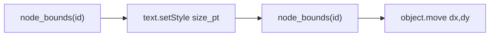

# Centered text font resize in `vectorcraft_scripting`

## Problem

Calling VectorCraft [`text.setStyle`](https://github.com/storytold/vectorcraft) with a larger `size` changes glyph layout and the type object's **geometric bounds** (`document.inspect` / `document.node` → `bounds`). For point type and many justified labels, the bounds center shifts, so text appears to “drift” even when it should stay visually centered in a layout slot.

The package already has bounds helpers ([`bounds_xywh`](h:\TEMP\Spike3DEnv_ExploreUpgrade\Spike3DWorkEnv\Spike3D\EXTERNAL\VectorCraft_Scripting\src\vectorcraft_scripting\find.py)) and [`LiveVectorCraft.node_bounds`](h:\TEMP\Spike3DEnv_ExploreUpgrade\Spike3DWorkEnv\Spike3D\EXTERNAL\VectorCraft_Scripting\src\vectorcraft_scripting\live.py) (wraps `document.node` summary bounds). There is **no** text helper yet.

## Approach



For each type object id:

1. **Snapshot** `before = live.node_bounds(id)` and compute center  
   `cx = x + width/2`, `cy = y + height/2` (reuse a small nested helper in the new module).
2. **Apply font size** — `live.execute('text.setStyle', {'ids': [id], 'size': float(size_pt)})`  
   (VectorCraft accepts `size` in document points; optional passthrough kwargs later e.g. `leading='auto'` if needed).
3. **Re-read bounds** `after = live.node_bounds(id)`, new center, then  
   `dx = cx - after_cx`, `dy = cy - after_cy`.
4. **Re-center** — if either delta is non-zero, `live.execute('object.move', {'ids': [id], 'dx': dx, 'dy': dy})`.
5. **Return** per-id result dict: `id`, `size_pt`, `dx`, `dy`, `bounds_before`, `bounds_after`, plus any `overflow` / `warning` keys from the `text.setStyle` reply.

**Undo:** do not open `undo_group` inside the helper (same pattern as [`place_file`](h:\TEMP\Spike3DEnv_ExploreUpgrade\Spike3DWorkEnv\Spike3D\EXTERNAL\VectorCraft_Scripting\src\vectorcraft_scripting\live.py)); callers wrap with `live.undo_group(...)`.

**Validation (fail loud):**

- Assert each id is a type object: `kind` from `live.get_node(id, summary=True)` should be `'Type'` (panel label used by [`ObjectQuery`](h:\TEMP\Spike3DEnv_ExploreUpgrade\Spike3DWorkEnv\Spike3D\EXTERNAL\VectorCraft_Scripting\src\vectorcraft_scripting\find.py) / `document.find`).
- Assert `size_pt > 0`.

**Area type / fixed frames:** bounds are often the frame box; center may already match and `object.move` becomes a no-op. Overflow after resize is surfaced from the engine reply (`overflow: [id…]`).

**Not in scope:** relative `scale` / `delta_pt` (you chose absolute `size_pt` only), range-level styling (`text.setRangeStyle`), or `type.size.increase` (preference-step increments only).

## New API

Add [`text.py`](h:\TEMP\Spike3DEnv_ExploreUpgrade\Spike3DWorkEnv\Spike3D\EXTERNAL\VectorCraft_Scripting\src\vectorcraft_scripting\text.py):

```python
def set_text_font_size_centered(live: LiveVectorCraft, ids: Sequence[Any], size_pt: float) -> List[Dict[str, Any]]:
```

- Accept a single id or sequence; normalize to a list and process **one id at a time** (each object needs its own center correction).
- Nested `_subfn_bounds_center(xywh: Dict[str, float]) -> Tuple[float, float]` for center math (single caller → nested per package convention).

Wire exports in [`__init__.py`](h:\TEMP\Spike3DEnv_ExploreUpgrade\Spike3DWorkEnv\Spike3D\EXTERNAL\VectorCraft_Scripting\src\vectorcraft_scripting\__init__.py) and add one row to the Live helpers table in [`README.md`](h:\TEMP\Spike3DEnv_ExploreUpgrade\Spike3DWorkEnv\Spike3D\EXTERNAL\VectorCraft_Scripting\README.md) with a short example:

```python
with live.undo_group("Bump axis labels"):
    set_text_font_size_centered(live, label_ids, size_pt=14)
```

## Verification (manual, live app)

With VectorCraft running `--control` and a document containing point or area type:

1. Record `node_bounds(id)` center before/after on one label; center should match within floating tolerance (~1e-6 pt).
2. Confirm visible position stays aligned with surrounding art (e.g. figure axis labels in the PhoDiba artboard workflow).
3. Import smoke: `from vectorcraft_scripting import set_text_font_size_centered` (note: full package import currently requires pandas because [`layers.py`](h:\TEMP\Spike3DEnv_ExploreUpgrade\Spike3DWorkEnv\Spike3D\EXTERNAL\VectorCraft_Scripting\src\vectorcraft_scripting\layers.py) imports pandas at module level — pre-existing; no change unless you want lazy import fixed separately).

No notebook edits unless you ask to call the helper from [`VectorCraft_Scripting.ipynb`](h:\TEMP\Spike3DEnv_ExploreUpgrade\Spike3DWorkEnv\Spike3D\EXTERNAL\VectorCraft_Scripting\notebooks\VectorCraft_Scripting.ipynb) after implementation.
