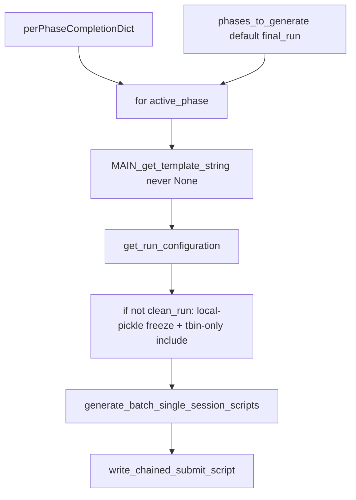

# Port chained execution into qclus1246789

Edit only [ProcessBatchOutputs_qclus1246789_Only.ipy](h:\TEMP\Spike3DEnv_ExploreUpgrade\Spike3DWorkEnv\Spike3D\ProcessBatchOutputs_qclus1246789_Only.ipy). Do not change qclus12 or helpers.

Default stays **75ms incremental `final_run` only**. The 3-phase list is a one-line uncomment. Do not apply local-pickle freeze or the tbin-only include list on `clean_run` if that phase is later enabled.

Keep qclus1246789 identity: qclu `[1,2,4,6,7,8,9]`, 0.075 bins, `_tbin_75ms`, `_GL` date, SPIKE3D_REPO_ROOT venv, `should_generate_run_notebooks=True`, 75ms completion kwargs (`enable_save_pipeline_pkl=False`, sweep `[0.075]`, `force_recompute_all_decoding=False`, `save_hdf=True`).



## 1. Imports and phase list

Add the qclus12 chain imports:

```python
from pyphoplacecellanalysis.General.Batch.pythonScriptTemplating import build_session_phase_script_map, write_chained_submit_script, write_all_retry_from_phase_scripts, print_chain_status_hint
```

Replace `active_phase = ProcessingScriptPhases.final_run` with:

```python
phases_to_generate = [ProcessingScriptPhases.final_run]
# phases_to_generate = [ProcessingScriptPhases.clean_run, ProcessingScriptPhases.continued_run, ProcessingScriptPhases.final_run]
batch_execution_target: str = 'slurm'  # GL default; 'linux_standalone' for Lab bash
```

## 2. Per-phase completion map (replace, not merge)

Replace the flat `phase_any_run_custom_user_completion_functions_dict` with a map like qclus12. **`final_run` keeps the current 75ms five-function set.** Add clean/continued entries so uncommenting the 3-phase list does not dump those onto every stage:

- `clean_run`: `kdiba_session_post_fixup_completion_function` only
- `continued_run`: sweep, eval, generalized decode, `save_custom` (no wcorr)
- `final_run`: sweep, eval, wcorr, generalized decode, `save_custom` (today’s tbin-only dict)

Delete the pre-loop `get_custom_user_completion_functions_dict` / `MAIN_get_template_string` / `get_run_configuration` block (~241–250).

## 3. Lift suffix/kwargs off `active_phase_dict`

Mirror qclus12: `override_custom_pickle_suffix`, `included_qclu_values`, `minimum_inclusion_fr_Hz`, `base_job_suffix`, `shared_batch_session_completion_handler_kwargs`, `force_recompute_override_computation_kwargs_dict`, `override_parameters_flat_keypaths_dict`, `custom_user_completion_function_override_kwargs_dict` as **shared** vars (keep 75ms kwargs as they are now, including `save_custom` `enable_save_pipeline_pkl=False` and sweep `[0.075]`).

Keep the 75ms include/force-recompute lists as named constants, applied inside the loop only for non-`clean_run`:

```python
_tbin_only_extended_computations_include_includelist = ['pf_computation', 'split_to_directional_laps', 'merged_directional_placefields', ...]
_tbin_only_force_recompute_override_computations_includelist = ['merged_directional_placefields', 'directional_decoders_decode_continuous', ...]
```

## 4. Generation loop + chained submit

Copy qclus12’s `for active_phase in phases_to_generate` body:

- Look up `phase_any_run_custom_user_completion_functions_dict_dict.get(active_phase, {})` and call `MAIN_get_template_string` with that explicit dict (never `None`)
- `get_run_configuration(...)`
- If not `clean_run`: set tbin-only include list, tbin-only force-recompute list, `should_save_local_pipeline_pkl=False`, `skip_save_on_initial_load=True`
- If `clean_run`: leave phase defaults (pickle write allowed)
- Shared suffix/kwargs; `job_suffix = f"{base_job_suffix}_{phase_job_suffix}"`
- `create_slurm_scripts=(batch_execution_target == 'slurm')`, `create_non_slurm_bash_scripts=(batch_execution_target == 'linux_standalone')`
- Keep `should_generate_run_notebooks=True`
- Collect `phase_collections` / `phases_ordered_names`

After the loop: destination summary (if `clean_run` not in the list, keep “local pickle is load-only”; otherwise use qclus12’s clean-writes text). Then `write_chained_submit_script` / retry scripts like qclus12 (`slurm` vs `bash` from `batch_execution_target`). Keep `_try_copy_to_clipboard`. Keep the existing GL venv block (no Lab probe swap).

Scratch staging stays once, before the loop, using shared `override_custom_pickle_suffix` / `decoding_time_bin_filename_suffix`.