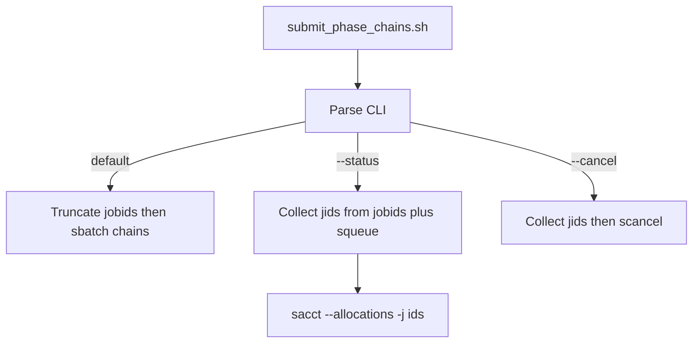

# Unified `--cancel` / `--status` on `submit_phase_chains*.sh`

## Behavior

Generated **Slurm** submit scripts will accept:

```bash
bash submit_phase_chains_<stamp>.sh            # submit (default; truncates .jobids then sbatch)
bash submit_phase_chains_<stamp>.sh --status   # print this chain's jobs
bash submit_phase_chains_<stamp>.sh --cancel   # scancel remaining jobs in this chain
```

`--cancel` and `--status` are mutually exclusive. Unknown args / `--help` print usage and exit.

**Critical:** today's script truncates `.jobids` at the top (`: > "$JOBIDS_FILE"`). CLI dispatch must run **before** that, so `--cancel`/`--status` never wipe recorded ids.

`--status` is **this chain only** (not a user-wide 2-hour `sacct`). Job ids come from the same sources cancel already uses: sibling `.jobids` plus live `squeue` rows whose Command matches sbatch paths in this script / `.json`. Then:

```bash
SLURM_TIME_FORMAT=standard \
sacct --allocations --jobs="$jid_csv" \
      --format=Start,JobID,State,Elapsed,JobName%100,ExitCode
```

All states (PENDING/RUNNING/COMPLETED/FAILED/CANCELLED), not `--state=COMPLETED`. If `.jobids` is missing/empty and nothing is queued, print that the chain has not been submitted (or already finished) and exit 0.

`--cancel` keeps the current safe `scancel` loop (continue if already gone).

Bash (`linux_standalone`) and PowerShell backends do not get these flags (no Slurm job ids). Retry scripts are unchanged.



## Code changes

Main work is in [`pythonScriptTemplating.py`](h:\TEMP\Spike3DEnv_ExploreUpgrade\Spike3DWorkEnv\pyPhoPlaceCellAnalysis\src\pyphoplacecellanalysis\General\Batch\pythonScriptTemplating.py):

- Extract the cancel-script body into module-level bash-line helpers used by the Slurm submit script, e.g. `_subfn_slurm_collect_chain_jids_lines()`, `_subfn_slurm_cancel_mode_lines()`, `_subfn_slurm_status_mode_lines()`, `_subfn_slurm_cli_dispatch_lines()`.
- In `write_chained_submit_script` Slurm branch: emit header comments for `--cancel`/`--status`, parse args first, dispatch those modes and `exit`, then (submit only) truncate `.jobids` and run the existing sbatch chains.
- Stop calling `write_cancel_phase_chain_script`; **delete that function**.
- Update the public-API comment block and `print_chain_status_hint` to:

```text
bash submit_phase_chains_<stamp>.sh --status
bash submit_phase_chains_<stamp>.sh --cancel
```

Notebook print blocks currently invent a sibling cancel path. Update both:

- [`ProcessBatchOutputs_qclus1246789_Only.ipy`](h:\TEMP\Spike3DEnv_ExploreUpgrade\Spike3DWorkEnv\Spike3D\ProcessBatchOutputs_qclus1246789_Only.ipy) (~721)
- [`ProcessBatchOutputs_qclus12_Only.ipy`](h:\TEMP\Spike3DEnv_ExploreUpgrade\Spike3DWorkEnv\Spike3D\ProcessBatchOutputs_qclus12_Only.ipy) (~614)

Replace `_cancel_path` with:

```python
print(f"Cancel remaining jobs: bash '{chained_submit_path}' --cancel")
print(f"Chain status: bash '{chained_submit_path}' --status")
```

Existing `cancel_phase_chains_*.sh` files on disk are leftover from older generates; they will not be deleted by this change. Regenerating scripts is required before `--cancel`/`--status` exist on a given stamp.
