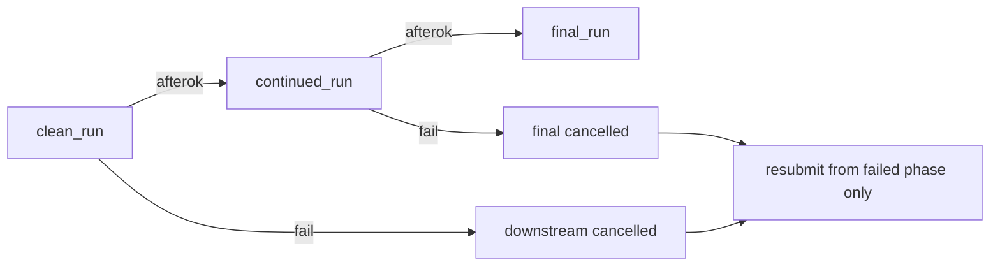

# Per-session chained phase submit (failure-safe)

## Pilot target (locked)

Apply chained mode to [`ProcessBatchOutputs_qclus12_Only.ipy`](h:\TEMP\Spike3DEnv_ExploreUpgrade\Spike3DWorkEnv\Spike3D\ProcessBatchOutputs_qclus12_Only.ipy) **first**. Leave [`ProcessBatchOutputs_qclus1246789_Only.ipy`](h:\TEMP\Spike3DEnv_ExploreUpgrade\Spike3DWorkEnv\Spike3D\ProcessBatchOutputs_qclus1246789_Only.ipy) unchanged until qclus12 has been validated on GL; then port the same pattern.

## Why not reuse Bapun / test_all

Do **not** port [`ProcessBatchOutputs_Bapun_Batch.ipy`](h:\TEMP\Spike3DEnv_ExploreUpgrade\Spike3DWorkEnv\Spike3D\ProcessBatchOutputs_Bapun_Batch.ipy) or [`ProcessBatchOutputs_test_all_script_phases.ipy`](h:\TEMP\Spike3DEnv_ExploreUpgrade\Spike3DWorkEnv\Spike3D\ProcessBatchOutputs_test_all_script_phases.ipy) as the driver. Both hardcode `should_freeze_pipeline_updates=True` on compute phases, which renders `saving_mode=SKIP_SAVING` / `should_compute=False` in the template — so continued/final would not compute or save. They also use a **global** `wait_for_slurm_jobs` barrier. Leave those files alone.

Keep each qclus script’s own params as source of truth (qclus12: `qclu_[1, 2]` / frateThresh_2.0; qclus1246789 later: its matching suffix/kwargs). Do not copy Bapun’s freeze=True.

## Failure model (locked)



- Use `--dependency=afterok:<prev_jobid>` so a failed phase **cancels** later phases for that session only (no wasted final after a dead continued).
- Successful earlier phases already wrote pickles (`clean_run` always saves; non-freeze continued/final use `TEMP_THEN_OVERWRITE` / `IF_CHANGED`). Those pickles stay on disk.
- Resume = resubmit **from the failed phase onward** for that session (no re-clean if clean succeeded).
- Never put all three phases inside one Slurm job (12h walltime risk; loses per-phase retry).

## Implementation

### 1. Shared helpers in [`pythonScriptTemplating.py`](h:\TEMP\Spike3DEnv_ExploreUpgrade\Spike3DWorkEnv\pyPhoPlaceCellAnalysis\src\pyphoplacecellanalysis\General\Batch\pythonScriptTemplating.py)

Add small, testable helpers (not a giant `process_all_phases`):

- `submit_slurm_script(path) -> int` — `sbatch --parsable`, parse job id
- `build_session_phase_script_map(phase_collections: Dict[str, BatchScriptsCollection]) -> Dict[session_key, Dict[phase_name, Path]]` — align `output_slurm_scripts['run']` lists by session index/order from `included_session_contexts`
- `write_chained_submit_script(session_phase_scripts, out_path, phases_ordered)` — bash that for each session does:
  ```bash
  jid=$(sbatch --parsable '…_Clean.sh')
  jid=$(sbatch --parsable --dependency=afterok:$jid '…_Continued.sh')
  jid=$(sbatch --parsable --dependency=afterok:$jid '…_Final.sh')
  ```
  Also write a JSON manifest: session → phase → script path (no job ids until submit).
- `write_retry_from_phase_script(manifest, session_key, start_phase, out_path)` — chain only `start_phase` and later phases for one session (or a list). Used after inspecting `sacct`.
- `print_chain_status_hint()` — short printed `sacct`/`squeue` commands; no long-lived login-node poller.

Default dependency mode: **`afterok` only**.

### 2. Extend [`ProcessBatchOutputs_qclus12_Only.ipy`](h:\TEMP\Spike3DEnv_ExploreUpgrade\Spike3DWorkEnv\Spike3D\ProcessBatchOutputs_qclus12_Only.ipy) (pilot)

Minimal change to this lower-risk script first:

1. Replace single `active_phase = …` with:
   ```python
   phases_to_generate = [
       ProcessingScriptPhases.clean_run,
       ProcessingScriptPhases.continued_run,
       ProcessingScriptPhases.final_run,
   ]
   ```
2. Factor the existing “build `active_phase_dict` + `generate_batch_single_session_scripts` + print sbatch” block into a loop over `phases_to_generate`, reusing the **same** qclus12 suffix/kwargs setup already in the file (do not copy Bapun’s freeze=True).
3. After all phases generated, call `write_chained_submit_script(...)` under `scripts_output_path` (e.g. `submit_phase_chains_<BATCH_DATE_TO_USE>.sh` + matching `.json` manifest).
4. Keep today’s flat per-phase `sbatch` print as a fallback; primary copy-to-clipboard becomes the chained submit script path.
5. Do **not** auto-`sbatch` from the generator by default (GL login-node / paste workflow stays).

`should_freeze_pipeline_updates` stays whatever the current qclus12 script sets (today: not forced True on compute phases).

### 3. Retry workflow (documented in script comments + Greatlakes instructions)

When a session’s continued fails:

1. `sacct -j <ids>` → identify failed phase.
2. Run generated `retry_from_continued_<session>.sh` (or regenerate via helper with `start_phase=continued_run`).
3. Clean pickle untouched; only continued (+ final) requeue.

Update [`2026-09-14_GreatlakesBatchRunInstructions.md`](h:\TEMP\Spike3DEnv_ExploreUpgrade\Spike3DWorkEnv\Spike3D\2026-09-14_GreatlakesBatchRunInstructions.md) for the **qclus12** path: generate once → `bash submit_phase_chains_….sh` → retry from failed phase.

### 4. Port to qclus1246789 (after validation)

Once qclus12 chained submit has been exercised on GL (scripts generate, chains submit, a failed phase can be retried without re-running clean):

- Apply the same loop + emit pattern to [`ProcessBatchOutputs_qclus1246789_Only.ipy`](h:\TEMP\Spike3DEnv_ExploreUpgrade\Spike3DWorkEnv\Spike3D\ProcessBatchOutputs_qclus1246789_Only.ipy), keeping that file’s own pickle/completion kwargs.
- Do not change qclus1246789 until that validation step.

## Out of scope

- Fixing/refactoring Bapun or test_all drivers
- Auto-polling login-node controller
- Collapsing phases into one job
- Changing phase computation lists / pickle semantics
- Editing qclus1246789 in the pilot pass
