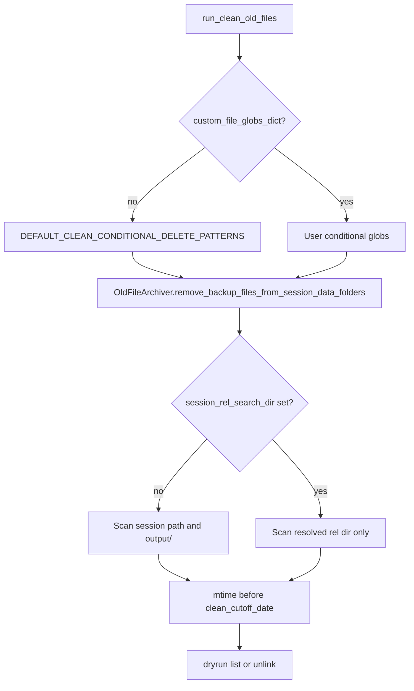

# Custom conditional globs for `run_clean_old_files`

## Goal

Enable IPython/CLI usage like your export inventory snippet, but for **conditional delete by mtime**:

```python
deleted_file_list, _ = pbcr.run_clean_old_files(
    ctx,
    clean_cutoff_date=cutoff,
    custom_file_globs_dict={'h5': '**/*.h5', 'csv': '**/*.csv', 'pkl': '**/*.pkl'},
    session_rel_search_dir='output/',  # or '' / '/' for session root
)
```

When `custom_file_globs_dict` is provided, it **replaces** built-in conditional patterns (per your choice). **Always-delete** patterns (`*.pkltmp`, `*.pkl.bak`) stay as today.

## Semantics (align with copy helper, differ on cutoff)

| Aspect | `_copy_exported_files_from_session_folder_to_collected_outputs` | Cleanup path |
|--------|-------------------------------------------------------------------|--------------|
| Globs | `custom_file_globs_dict` | Same dict shape → `conditional_delete_patterns` |
| Search root | `session_rel_search_dir` (default `'output/'`) | Same resolution logic |
| Cutoff | Export filename parsing + `find_most_recent_files` | **Filesystem mtime** vs `clean_cutoff_date` (existing `OldFileArchiver` behavior) |

Reuse the same `_rel` normalization as in [`AcrossSessionResults.py`](h:/TEMP/Spike3DEnv_ExploreUpgrade/Spike3DWorkEnv/pyPhoPlaceCellAnalysis/src/pyphoplacecellanalysis/SpecificResults/AcrossSessionResults.py) (~5078–5083): strip `'/'`, `''` and `'.'` → session root; else `session.path / rel`.

## Code changes

### 1. [`OldFileArchiver.remove_backup_files_from_session_data_folders`](h:/TEMP/Spike3DEnv_ExploreUpgrade/Spike3DWorkEnv/pyPhoPlaceCellAnalysis/src/pyphoplacecellanalysis/SpecificResults/AcrossSessionResults.py)

Add optional parameters:

- `session_rel_search_dir: Optional[str] = None`
- Document that when **set**, all glob collection (always + conditional) runs only under the resolved folder per session.
- When **None**, preserve current behavior: scan **`a_folder.path`** and **`a_folder.output_folder`** separately (backward compatible).

Implementation sketch inside the per-session loop:

```python
def _search_folders_for_session(a_folder) -> List[Path]:
    if session_rel_search_dir is None:
        return [a_folder.path, a_folder.output_folder]
    return [_resolve_session_search_folder(a_folder.path, session_rel_search_dir)]

for search_folder in _search_folders_for_session(a_folder):
    if not search_folder.is_dir():
        continue
    session_always_files += collect_files(search_folder, always_delete_patterns, 'always')
    session_conditional_files += collect_files(search_folder, conditional_delete_patterns, 'conditional')
```

- **Dedupe** before delete: `all_files_to_delete = list(dict.fromkeys(...))` so `**` globs from session root cannot delete the same path twice when legacy dual-search is used.
- Move `always_delete_patterns` / `conditional_delete_patterns` default initialization **outside** the `for a_folder` loop (small bugfix: defaults are currently re-bound inside the loop only when `None`).

Update the classmethod docstring with an example using custom globs + `session_rel_search_dir='output/'`.

### 2. [`run_clean_old_files`](h:/TEMP/Spike3DEnv_ExploreUpgrade/Spike3DWorkEnv/Spike3D/PostBatchCopyResults.py)

- Extract current conditional dict to a module-level constant, e.g. `DEFAULT_CLEAN_CONDITIONAL_DELETE_PATTERNS` (the dict at lines 770–781).
- Extend signature:

```python
def run_clean_old_files(
    ctx: PostBatchCopyContext,
    archive_collected_outputs: bool = False,
    clean_cutoff_date: Optional[datetime] = None,
    custom_file_globs_dict: Optional[Dict[str, str]] = None,
    session_rel_search_dir: Optional[str] = None,
) -> Tuple[list, Optional[Path]]:
```

- If `custom_file_globs_dict is not None`: pass it as `conditional_delete_patterns`; else pass `DEFAULT_CLEAN_CONDITIONAL_DELETE_PATTERNS`.
- Pass `session_rel_search_dir` through to `OldFileArchiver`.
- Log which mode is active (defaults vs custom globs, search dir).

Optional CLI (same PR, low cost): `--clean-session-rel-search-dir` and repeatable `--clean-conditional-glob desc:pattern` building a dict for `main()` → `run_clean_old_files`. Skip if you prefer IPython-only for v1.

### 3. Docs: [`2026-09-14_GreatlakesBatchRunInstructions.md`](h:/TEMP/Spike3DEnv_ExploreUpgrade/Spike3DWorkEnv/Spike3D/2026-09-14_GreatlakesBatchRunInstructions.md)

- Update the cleanup cell (~196–214) to show `custom_file_globs_dict` + `session_rel_search_dir='output/'`, **`is_dryrun=True`** for exploration, and note that mtime cutoff differs from the export `cuttoff_date` above.
- Cross-link: export snippet finds/copies; cleanup snippet deletes (with `--execute` / `is_dryrun=False` only when intentional).

## Safety notes (document, do not auto-enforce)

- `session_rel_search_dir='/'` or `''` with `'**/*.pkl'` can match `loadedSessPickle` at session root; prefer `'output/'` to avoid touching session-root pickles unless intended.
- `'**/*.h5'` under session root includes everything under `output/`; use `'output/'` + `'*.h5'` or `'**/*.h5'` under `output/` only to avoid scanning raw-adjacent tree.
- Conditional delete requires `clean_cutoff_date`; unchanged from today.

## Verification

- Dry-run IPython on one machine: `custom_file_globs_dict={'h5': '*.h5'}`, `session_rel_search_dir='output/'`, cutoff in the future → empty list; cutoff in the past → only old H5 under `output/`.
- Dry-run without new kwargs → same candidate set as before (regression).
- Confirm dedupe: legacy dual search + a non-recursive pattern does not list duplicates.


