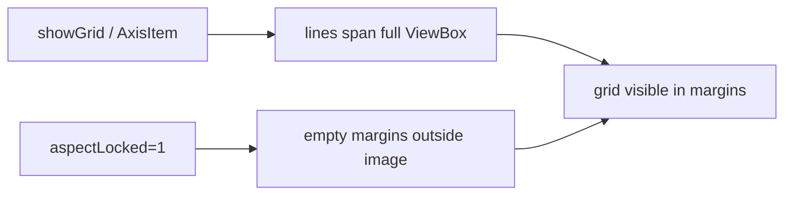

# Clip grid lines to matrix bounds

## Cause

In [`BinnedImageRenderingWindow.py`](h:\TEMP\Spike3DEnv_ExploreUpgrade\Spike3DWorkEnv\pyPhoPlaceCellAnalysis\src\pyphoplacecellanalysis\GUI\PyQtPlot\BinnedImageRenderingWindow.py), `_add_bin_ticks` enables axis grids via:

```python
plot_item.showGrid(x=True, y=True, alpha=grid_opacity)
```

PyQtGraph’s AxisItem grid always extends tick lines across the **entire ViewBox**. With `setAspectLocked(True, ratio=1)`, the view is often larger than the image in one axis, so gray grid lines spill into the empty black region outside the white `matrixBoundaryRectItem`.



## Fix

Keep axis tick labels; replace ViewBox-spanning `showGrid` with finite lines clipped to the matrix rect already computed in `_build_binned_imageItem` (`x_min`/`x_max`/`y_min`/`y_max`).

### 1. Disable axis grid in `_add_bin_ticks`

Remove (or no-op) `plot_item.showGrid(...)` so ticks/labels remain but lines no longer fill the ViewBox.

### 2. Add bounded grid helper on `BasicBinnedImageRenderingHelpers`

New classmethod (e.g. `_add_bounded_bin_grid`) that:
- Takes `plot_item`, bounds, and `grid_opacity`
- Draws vertical lines at integer bin edges `x_min .. x_max`, each spanning only `[y_min, y_max]`
- Draws horizontal lines at `y_min .. y_max`, each spanning only `[x_min, x_max]`
- Uses one `QGraphicsPathItem` (or equivalent) with a semi-transparent pen matching current opacity
- Returns the item for storage/cleanup

### 3. Attach grid in `_build_binned_imageItem`

After the existing white boundary rect is created (~lines 139–146), call the helper with `local_plots_data` bounds and `params.grid_opacity`, and store on `local_plots` (e.g. `local_plots.binGridItem`).

Result: grid cells only inside the white rectangle; empty margins stay black with no grid.