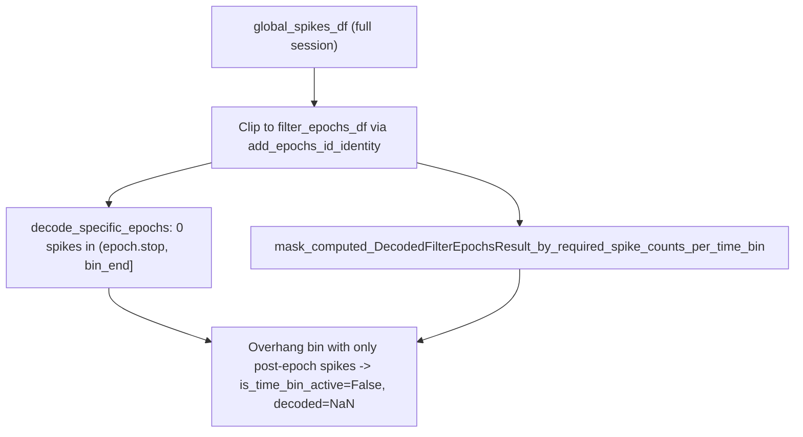

# Fix Overhanging Zero-Spike Bin Masking in `_do_custom_decode_epochs`

## Root Cause
In `_do_custom_decode_epochs` ([pyPhoPlaceCellAnalysis/src/pyphoplacecellanalysis/General/Pipeline/Stages/ComputationFunctions/MultiContextComputationFunctions/DirectionalPlacefieldGlobalComputationFunctions.py](h:/TEMP/Spike3DEnv_ExploreUpgrade/Spike3DWorkEnv/pyPhoPlaceCellAnalysis/src/pyphoplacecellanalysis/General/Pipeline/Stages/ComputationFunctions/MultiContextComputationFunctions/DirectionalPlacefieldGlobalComputationFunctions.py)), `pfND_Decoder.decode_specific_epochs(...)` clips spikes strictly to `[epoch.start, epoch.stop]` via `add_epochs_id_identity` before calling `epochs_spkcount`, whose final spanning bin `a_time_bin_edges[-1]` can overhang past `epoch.stop`. However, `_do_custom_decode_epochs` then passes the unclipped `deepcopy(global_spikes_df)` into `decoder_result.mask_computed_DecodedFilterEpochsResult_by_required_spike_counts_per_time_bin(...)` ([pyPhoPlaceCellAnalysis/src/pyphoplacecellanalysis/Analysis/Decoder/reconstruction.py](h:/TEMP/Spike3DEnv_ExploreUpgrade/Spike3DWorkEnv/pyPhoPlaceCellAnalysis/src/pyphoplacecellanalysis/Analysis/Decoder/reconstruction.py)). Any spike occurring in the overhanging `(epoch.stop, a_time_bin_edges[-1]]` interval marks that bin `is_time_bin_active = True` even though the decoder decoded `0` spikes (emitting the unmasked zero-spike silence prior peak).



## Planned Changes

### 1. Clip `global_spikes_df` to `epochs_to_decode_df` for the spike-count mask in `_do_custom_decode_epochs`
- **File**: [pyPhoPlaceCellAnalysis/src/pyphoplacecellanalysis/General/Pipeline/Stages/ComputationFunctions/MultiContextComputationFunctions/DirectionalPlacefieldGlobalComputationFunctions.py](h:/TEMP/Spike3DEnv_ExploreUpgrade/Spike3DWorkEnv/pyPhoPlaceCellAnalysis/src/pyphoplacecellanalysis/General/Pipeline/Stages/ComputationFunctions/MultiContextComputationFunctions/DirectionalPlacefieldGlobalComputationFunctions.py) (`line 47` and `lines 5700-5708`)
- Merge `add_epochs_id_identity` into the existing `from neuropy.utils.mixins.time_slicing import TimeColumnAliasesProtocol` import on line 47:
  ```python
  from neuropy.utils.mixins.time_slicing import TimeColumnAliasesProtocol, add_epochs_id_identity
  ```
- Inside `if should_mask_by_required_spike_counts:` in `_do_custom_decode_epochs`, clip a copy of `global_spikes_df` to `ensure_dataframe(decoder_result.filter_epochs)` using the same `add_epochs_id_identity` semantics used in `BasePositionDecoder._build_decode_specific_epochs_result_shell` (handling empty spike or epoch DataFrames cleanly and dropping the temporary epoch ID column), then pass `spikes_df=clipped_global_spikes_df` into `mask_computed_DecodedFilterEpochsResult_by_required_spike_counts_per_time_bin`:
  ```python
  if should_mask_by_required_spike_counts:
      filter_epochs_df: pd.DataFrame = ensure_dataframe(decoder_result.filter_epochs).reset_index(drop=True)
      clipped_global_spikes_df: pd.DataFrame = deepcopy(global_spikes_df)
      if (len(clipped_global_spikes_df) > 0) and (len(filter_epochs_df) > 0):
          clipped_global_spikes_df = add_epochs_id_identity(clipped_global_spikes_df, filter_epochs_df, epoch_id_key_name='_custom_decode_temp_epoch_id', epoch_label_column_name=None, no_interval_fill_value=-1)
          clipped_global_spikes_df = clipped_global_spikes_df[clipped_global_spikes_df['_custom_decode_temp_epoch_id'] != -1].drop(columns=['_custom_decode_temp_epoch_id'])
      elif len(filter_epochs_df) == 0:
          clipped_global_spikes_df = clipped_global_spikes_df.iloc[0:0].copy()
      decoder_result, _mask_index_tuple = decoder_result.mask_computed_DecodedFilterEpochsResult_by_required_spike_counts_per_time_bin(spikes_df=clipped_global_spikes_df,
                                                                                                                                       min_num_spikes_per_bin_to_be_considered_active=min_num_spikes_per_bin_to_be_considered_active,
                                                                                                                                       min_num_unique_active_neurons_per_time_bin=min_num_unique_active_neurons_per_time_bin,
                                                                                                                                       masked_bin_fill_mode=masked_bin_fill_mode,
                                                                                                                                       included_neuron_ids=pfND_Decoder.neuron_IDs)
      is_time_bin_active_list, _inactive_mask_list, _all_time_bin_indicies_list, _last_valid_indices_list = _mask_index_tuple ## only non-masked bins should enter position-error terms
  ```

### 2. Add Regression Unit Test
- **File**: [pyPhoPlaceCellAnalysis/tests/test_decoders.py](h:/TEMP/Spike3DEnv_ExploreUpgrade/Spike3DWorkEnv/pyPhoPlaceCellAnalysis/tests/test_decoders.py)
- Add a unit test verifying that for an epoch `[0.0, 0.10]` decoded with `decoding_time_bin_size = 0.075` (so bin 0 is `[0.0, 0.075]` and overhanging bin 1 is `[0.075, 0.150]`), when spikes occur at `t = 0.03` (inside bin 0) and `t = 0.12` (outside `epoch.stop = 0.10`, inside the overhanging part of bin 1), `_do_custom_decode_epochs` masks bin 1 as inactive (`is_time_bin_active == False`, `most_likely_positions` is `NaN`, and `is_valid == False` in the per-bin comparison DataFrame).
