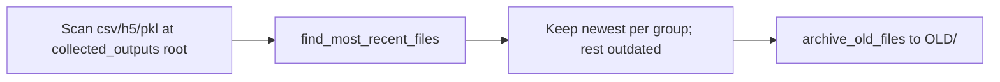

# Collected-outputs outdated-version cleanup

## Approach

Add **one** `@classmethod` on [`OldFileArchiver`](h:\TEMP\Spike3DEnv_ExploreUpgrade\Spike3DWorkEnv\pyPhoPlaceCellAnalysis\src\pyphoplacecellanalysis\SpecificResults\AcrossSessionResults.py) that discovers parsable exports, keeps the newest file per logical group, and archives the rest via existing `archive_old_files`. Nest discovery/diff steps as `_subfn_*` inside that method. Do **not** add new top-level module functions in `AcrossSessionResults.py` or `PostBatchCopyResults.py`.



## Changes

### 1. `OldFileArchiver.cleanup_outdated_collected_outputs` in [`AcrossSessionResults.py`](h:\TEMP\Spike3DEnv_ExploreUpgrade\Spike3DWorkEnv\pyPhoPlaceCellAnalysis\src\pyphoplacecellanalysis\SpecificResults\AcrossSessionResults.py)

Place immediately after `archive_old_files` (~line 3732).

- Signature (single-line preferred): `(cls, collected_outputs_directory, *, include_csv=True, include_h5=True, include_pkl=True, keep_n_most_recent=1, is_dry_run=True, debug_print=False) -> Tuple[List[Path], Path]`
- Nested `_subfn_collect_export_paths`: call existing `find_csv_files` / `find_HDF5_files` / `find_pkl_files` with `recurrsive=False` (root only); drop paths under `OLD/`; dedupe.
- Call existing `find_most_recent_files(..., cuttoff_date=None, should_print_unparsable_filenames=False)` to get `all_parsed_df`.
- Rank within groups `['session', '_comparable_custom_replay_name', 'file_type', 'decoding_time_bin_size_str']` by `export_datetime` descending; keep ranks `< keep_n_most_recent`; everything else is outdated.
- Unparsable names never enter the DF → left untouched (copydicts, filelists).
- Call `cls.archive_old_files(...)` with the outdated list; return `(outdated_paths, archive_folder)`.
- Locked defaults: non-recursive root scan; `keep_n=1`; archive (not delete); no cutoff filter (session-folder cutoff stays orthogonal).

### 2. Wire stub in [`PostBatchCopyResults.py`](h:\TEMP\Spike3DEnv_ExploreUpgrade\Spike3DWorkEnv\Spike3D\PostBatchCopyResults.py) `run_clean_old_files`

Replace the empty-list branch (~1049–1053) with:

```python
outdated_paths, archive_folder = OldFileArchiver.cleanup_outdated_collected_outputs(
    collected_outputs_directory=ctx.collected_outputs_path, is_dry_run=ctx.is_dryrun, debug_print=ctx.debug_print)
```

Update `--archive-collected-outputs` help to say it archives superseded dated exports into `collected_outputs/OLD/`.

### 3. Out of scope

- No notebook edits
- No new CLI flag (reuse `--archive-collected-outputs`)
- No recursive dated-subfolder scan
- No changes to session-folder backup deletion path
