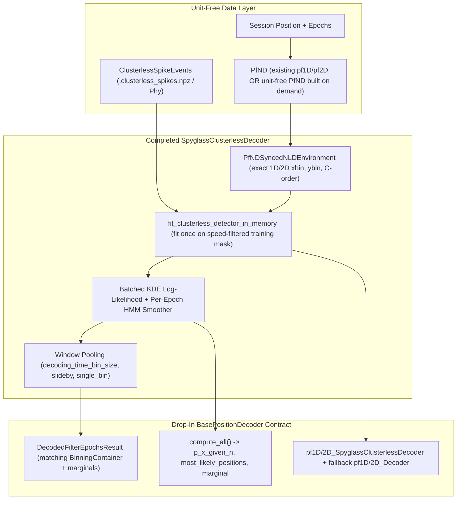

# Complete Clusterless CA1 Position Decoding Implementation

## 1. Existing Implementations & Reference Literature Choice

### Existing Workspace Implementations Audited
- **Portable Sparse Spike/Mark Layer**: `ClusterlessSpikeEvents` in [NeuroPy/neuropy/core/clusterless_spike_events.py](h:/TEMP/Spike3DEnv_ExploreUpgrade/Spike3DWorkEnv/NeuroPy/neuropy/core/clusterless_spike_events.py) extracts all detected Kilosort/Phy spikes and peak-channel `pc_features.npy` waveform marks without using `spike_clusters.npy`, saving to `{session_name}.clusterless_spikes.npz`.
- **Attempt 1 (`ClusterlessRTCPositionDecoder`)**: [pyPhoPlaceCellAnalysis/src/pyphoplacecellanalysis/Analysis/Decoder/rtc_clusterless_decoder.py](h:/TEMP/Spike3DEnv_ExploreUpgrade/Spike3DWorkEnv/pyPhoPlaceCellAnalysis/src/pyphoplacecellanalysis/Analysis/Decoder/rtc_clusterless_decoder.py) and [rtc_clusterless_adapters.py](h:/TEMP/Spike3DEnv_ExploreUpgrade/Spike3DWorkEnv/pyPhoPlaceCellAnalysis/src/pyphoplacecellanalysis/Analysis/Decoder/rtc_clusterless_adapters.py), backed by `Eden-Kramer-Lab/replay_trajectory_classification` (`v1.4.1`). Materializes dense 1 kHz `(n_time, n_marks, n_electrodes)` arrays, mutates `self.multiunits` in-place when masking silent electrodes, uses 2-state `ClusterlessClassifier` with sticky `Uniform` transitions, drops multi-spikes in coarse windows, and unravels 2D Fortran-flattened posteriors in C-order.
- **Attempt 2 (`SpyglassClusterlessDecoder`)**: [pyPhoPlaceCellAnalysis/src/pyphoplacecellanalysis/Analysis/Decoder/spyglass_clusterless_decoder.py](h:/TEMP/Spike3DEnv_ExploreUpgrade/Spike3DWorkEnv/pyPhoPlaceCellAnalysis/src/pyphoplacecellanalysis/Analysis/Decoder/spyglass_clusterless_decoder.py) and [spyglass_clusterless_adapters.py](h:/TEMP/Spike3DEnv_ExploreUpgrade/Spike3DWorkEnv/pyPhoPlaceCellAnalysis/src/pyphoplacecellanalysis/Analysis/Decoder/spyglass_clusterless_adapters.py), backed by `LorenFrankLab/non_local_detector` (`v0.6.9`). Currently refits from scratch on every `decode()` and every epoch in `decode_specific_epochs()`, runs full-session 500 Hz `predict()` during `__init__`, skips 1D, lacks a `PfND`-synced `Environment`, scrambles 2D/time axes in `nld_posterior_to_p_x_given_n`, and ignores `decoding_time_bin_size` / `slideby` / `use_single_time_bin_per_epoch`.

### Best Reference Repository from CA1 Literature
- **Primary Reference**: [LorenFrankLab/non_local_detector](https://github.com/LorenFrankLab/non_local_detector) (Denovellis, Gillespie, Eden & Frank; engine of [LorenFrankLab/spyglass](https://github.com/LorenFrankLab/spyglass) `spyglass.decoding.v1.clusterless`, succeeding [Eden-Kramer-Lab/replay_trajectory_classification](https://github.com/Eden-Kramer-Lab/replay_trajectory_classification) from Denovellis et al. 2021 *eLife* 10:e64505 and Kloosterman et al. 2014 mark-process KDE decoding).
- **Why**: Operates directly on sparse per-electrode `spike_times` and `spike_waveform_features` (no dense 1 kHz tensor, exact multi-spike Poisson mark log-likelihood via `segment_sum`), supports 1D and 2D spatial grids, continuous (`ClusterlessDecoder`) and continuous+fragmented (`ContFragClusterlessClassifier`) HMM dynamics, and fits once while predicting over arbitrary intervals.

---

## 2. Implementation Details

### Phase 1: Complete `spyglass_clusterless_adapters.py` (1D+2D Grid Sync, Fit-Once/Predict-Many, Exact Posterior & Windowing)
**File**: [pyPhoPlaceCellAnalysis/src/pyphoplacecellanalysis/Analysis/Decoder/spyglass_clusterless_adapters.py](h:/TEMP/Spike3DEnv_ExploreUpgrade/Spike3DWorkEnv/pyPhoPlaceCellAnalysis/src/pyphoplacecellanalysis/Analysis/Decoder/spyglass_clusterless_adapters.py)

- **1D & 2D `PfNDSyncedNLDEnvironment`**:
  - Subclass `non_local_detector.environment.Environment` to align `edges_`, `place_bin_centers_`, and `centers_shape_` directly to `pf.xbin` (1D: `(n_x,)`) and `(pf.xbin, pf.ybin)` (2D: `(n_x, n_y)` with `indexing="ij"`), avoiding NLD's `+2` outer boundary ring in 2D and fixing NLD's `is_track_interior is not None` bug while building `is_track_boundary_`, `track_graphDD`, and `distance_between_nodes_`.
- **Unit-Free `PfND` Builder (`build_unitfree_pfnd_from_session`)**:
  - Build a valid 0-neuron 1D or 2D `PfND` from `sess.position`, `epochs`, and `PlacefieldComputationParameters` (computing linearized position if `ndim == 1` and missing, speed-filtered occupancy, and `xbin`/`ybin`) whenever `pf1D`/`pf2D` were not precomputed.
- **Speed-Filtered Training Mask & Electrode Filtering**:
  - Update `SpyglassClusterlessDecodingParameters` to add `model_type: str = "cont_frag"` (`"cont_frag"` -> `ContFragClusterlessClassifier`, `"continuous"` -> `ClusterlessDecoder`), `waveform_std: float = 24.0`, `position_std: float = 6.0`, `block_size: int = 1000` (avoiding 400+ GiB XLA spikes from NLD's `10_000` default), `use_pf_speed_thresh_for_training: bool = True`, `sync_environment_to_pf: bool = True`, and `state_index_for_posterior: Optional[int] = None`.
  - Update `pfnd_to_spyglass_position_info` to support 1D (`lin_pos` / `x`) as well as 2D (`x`, `y`), and `build_is_training_mask` to intersect `encoding_interval` with `_pfnd_speed_filtered_training_intervals(pf)` when `pf` is provided.
  - Add `filter_active_training_electrodes(spike_times, spike_waveform_features, is_training_intervals)` returning compact `(filtered_times, filtered_features, kept_electrode_indices)` so electrodes with zero spikes inside the training mask cannot produce `0/0 = NaN` in `gpi_models`.
- **Split `fit_clusterless_detector_in_memory` and `predict_clusterless_detector_in_memory`**:
  - `fit_clusterless_detector_in_memory(...) -> ClusterlessDetector`: fits the detector **once** without running `predict()` over the training interval.
  - `predict_clusterless_epochs_in_memory(...)`:
    - Evaluates `kde_distance(interior_place_bin_centers, electrode_encoding_positions)` **once per electrode** across a batch of epochs and computes `block_estimate_log_joint_mark_intensity` only on spikes inside the target intervals.
    - Bins spike log-intensities onto exact fine left/right bin edges (`dt = 1.0 / sampling_frequency`) via `np.searchsorted` + `segment_sum` (eliminating NLD `0.6.9`'s `get_spike_time_bin_ind` bug where the last time bin receives zero spikes and single-bin `squeeze()` drops the `time` axis).
    - Runs `classifier._predict(time=fine_centers, log_likelihoods=epoch_ll)` per epoch so each epoch starts cleanly from `classifier.initial_conditions_`, then projects/averages fine posteriors onto any requested `(window_starts, window_stops)` (`decoding_time_bin_size`, `slideby`, or `use_single_time_bin_per_epoch=True`) using overlap weights and column normalization.
  - Keep `run_clusterless_decoder_in_memory` intact as a thin `fit` + `predict` wrapper for backward compatibility with existing notebooks and tests.
- **Fix C-Order 1D/2D Posterior Conversion**:
  - Fix `nld_spatial_posterior`, `nld_posterior_to_p_x_given_n`, `nld_posterior_flat_p_x_given_n`, and `_scatter_nld_posterior_to_pf_grid` to preserve `"time"` on length-1 outputs, handle 1D `"position"` and 2D `("x_position", "y_position")` via explicit axis transposition `(*spatial_dims, "time")`, and flatten/reshape strictly in **C-order** (`order="C"`).

### Phase 2: Complete `SpyglassClusterlessDecoder` as a Drop-In `BasePositionDecoder`
**File**: [pyPhoPlaceCellAnalysis/src/pyphoplacecellanalysis/Analysis/Decoder/spyglass_clusterless_decoder.py](h:/TEMP/Spike3DEnv_ExploreUpgrade/Spike3DWorkEnv/pyPhoPlaceCellAnalysis/src/pyphoplacecellanalysis/Analysis/Decoder/spyglass_clusterless_decoder.py)

- **Fit-Once Lifecycle**:
  - `_ensure_fitted_classifier()` calls `fit_clusterless_detector_in_memory(...)` **only** when `self.classifier is None`, storing `self.kept_electrode_indices`.
  - Stateless `decode(...)` reuses `self._ensure_fitted_classifier()` and predicts without re-fitting or mutating `self.nld_results` / `self.decode_times`; accepts optional `decoding_interval` or explicit `(t_start, t_stop)` / `time_bin_size`.
- **Full `decode_specific_epochs` Parity**:
  - Change signature to `def decode_specific_epochs(self, spikes_df: Optional[pd.DataFrame] = None, filter_epochs=None, decoding_time_bin_size: float = 0.05, use_single_time_bin_per_epoch: bool = False, slideby: Optional[float] = None, debug_print=False) -> "DecodedFilterEpochsResult":` — **removing `assert (spikes_df is None)`** so any standard caller passing `spikes_df` works unchanged.
  - Build per-epoch `BinningContainer`s matching `epochs_spkcount` / `epochs_multiunits` (`use_single_time_bin_per_epoch`, `slideby < decoding_time_bin_size`, short-epoch handling, and `compute_spanning_bins`) so `len(time_bin_containers[i].centers) == nbins[i] == p_x_given_n_list[i].shape[-1]`.
  - Compute per-epoch spike counts per window in `spkcount` (instead of appending raw `self.spike_times` lists).
- **Drop-In Properties, C-Order Reshape, Marginals & Constructors**:
  - Switch `_reshape_output` and `_flatten_output` from `order='F'` to C-order (`order='C'`) to match `BasePositionDecoder.perform_compute_most_likely_positions` (`np.unravel_index`).
  - Provide `spikes_df` property returning `None`, `num_neurons` returning `0` (preventing `NotImplementedError` in generic logging/inspection), and `num_electrodes` returning active electrode count.
  - Update `compute_all(decoding_time_bin_size: Optional[float] = None, chunk_duration_sec: float = 300.0, debug_print: bool = True)` to chunk long sessions within `max_posterior_memory_gib`, compute forward-filled `revised_most_likely_positions`, and populate `revised_most_likely_positions_1D` on `self.marginal.x` (and `self.marginal.y` in 2D) so `DecoderPredictionError` display functions work in default `'corrected'` mode.
  - Add `SpyglassClusterlessDecoder.from_session(...)` to construct directly from a NeuroPy `DataSession` (using `sess.clusterless_spike_events` or `.clusterless_spikes.npz` and building a unit-free `PfND` if needed).
  - Add `__getstate__` / `__setstate__` to drop bulky `nld_results` while keeping sparse spike/mark arrays and configuration cleanly picklable.

### Phase 3: Apply Shared Drop-In & 2D-Indexing Fixes to `ClusterlessRTCPositionDecoder`
**Files**:
- [pyPhoPlaceCellAnalysis/src/pyphoplacecellanalysis/Analysis/Decoder/rtc_clusterless_decoder.py](h:/TEMP/Spike3DEnv_ExploreUpgrade/Spike3DWorkEnv/pyPhoPlaceCellAnalysis/src/pyphoplacecellanalysis/Analysis/Decoder/rtc_clusterless_decoder.py)
- [pyPhoPlaceCellAnalysis/src/pyphoplacecellanalysis/Analysis/Decoder/rtc_clusterless_adapters.py](h:/TEMP/Spike3DEnv_ExploreUpgrade/Spike3DWorkEnv/pyPhoPlaceCellAnalysis/src/pyphoplacecellanalysis/Analysis/Decoder/rtc_clusterless_adapters.py)

- Switch `rtc_posterior_flat_p_x_given_n`, `rtc_posterior_to_p_x_given_n`, `_reshape_output`, and `_flatten_output` from `order='F'` to C-order (`order='C'`) so 2D `most_likely_positions` matches `(x_position, y_position)`.
- Support single-state continuous `ClusterlessDecoder` (defaulting `rtc_model_type: str = "continuous"` with data-driven `estimate_movement_var` when `rtc_movement_var` is `None`, while preserving `"classifier"` option) so 2D decoding does not get stuck on stationary `Uniform()` state mass.
- Stop mutating `self.multiunits` in-place inside `_ensure_fitted_classifier()` (`rtc_clusterless_decoder.py` lines `360-361`) so multi-context evaluations retain consistent electrode axes across mazes.
- Remove `assert (spikes_df is None)` in `decode_specific_epochs(...)`, add `spikes_df -> None`, `num_neurons -> 0`, `num_electrodes`, `marginal.*.revised_most_likely_positions_1D` in `compute_all()`, and `ClusterlessRTCPositionDecoder.from_session(...)`.

### Phase 4: Minimal Outside-Decoder Changes for Standalone & Zero-Neuron Independence
Only minimal, surgical edits outside the decoder files:

1. **Standalone Pipeline Computation & Fallback Slot Population** — [DefaultComputationFunctions.py](h:/TEMP/Spike3DEnv_ExploreUpgrade/Spike3DWorkEnv/pyPhoPlaceCellAnalysis/src/pyphoplacecellanalysis/General/Pipeline/Stages/ComputationFunctions/DefaultComputationFunctions.py):
   - In `_perform_spyglass_clusterless_position_decoding_computation` (and `_perform_clusterless_position_decoding_computation`):
     - Enable **both 1D and 2D** in `_perform_spyglass_clusterless_position_decoding_computation` (removing the `pf.ndim < 2` skip).
     - Remove hard `input_requires` on `pf1D`/`pf2D`; if `computed_data.get('pf1D')` or `computed_data.get('pf2D')` is missing/`None`, build unit-free `pf1D`/`pf2D` on demand from `computation_result.sess` and `computation_result.computation_config.pf_params`.
     - When `populate_standard_decoder_keys_if_missing: bool = True` (default) and `computed_data.get('pf1D_Decoder')` / `computed_data.get('pf2D_Decoder')` is `None` (or `force_overwrite_standard_decoder_keys=True`), assign the clusterless decoders into `pf1D_Decoder` / `pf2D_Decoder` automatically.
   - In `_perform_position_decoding_computation` (line `131`): set `computation_result.computed_data['pf1D_Decoder'] = None` when `pf1D.ratemap.n_neurons == 0` (matching `pf2D_Decoder` at line `141`).

2. **Zero-Neuron Session & `PfND` Guards (3 Surgical Fixes in `NeuroPy`)**:
   - [NeuroPy/neuropy/core/session/dataSession.py](h:/TEMP/Spike3DEnv_ExploreUpgrade/Spike3DWorkEnv/NeuroPy/neuropy/core/session/dataSession.py) (`lines 121-128, 171-174`): return `0` from `n_neurons` when `self.neurons is None`, return an empty schema-complete spikes DataFrame (`['aclu', 't_seconds', 't', 't_rel_seconds', 'neuron_type']`) from `spikes_df` when `self.flattened_spiketrains is None`, and guard `None` on `neurons` / `flattened_spiketrains` in `time_slice()`.
   - [NeuroPy/neuropy/core/session/SessionSelectionAndFiltering.py](h:/TEMP/Spike3DEnv_ExploreUpgrade/Spike3DWorkEnv/NeuroPy/neuropy/core/session/SessionSelectionAndFiltering.py) (`lines 212-215`): include `'t_rel_seconds'` and `'neuron_type'` columns on the empty `filtered_spikes_df` when `source_neurons is None and has_clusterless_spike_events`.
   - [NeuroPy/neuropy/analyses/placefields.py](h:/TEMP/Spike3DEnv_ExploreUpgrade/Spike3DWorkEnv/NeuroPy/neuropy/analyses/placefields.py) (`lines 1214-1216`): shape empty `filtered_tuning_maps` / `filtered_unsmoothed_tuning_maps` as `np.empty((0, *occupancy.shape), dtype=float)` when 0 cells pass filtering so `ratemap.ndim == pf.ndim`.

3. **Multi-Context / Bapun Decoder Resolution Guards** — [PendingNotebookCode.py](h:/TEMP/Spike3DEnv_ExploreUpgrade/Spike3DWorkEnv/pyPhoPlaceCellAnalysis/src/pyphoplacecellanalysis/SpecificResults/PendingNotebookCode.py):
   - In `_resolve_maze_epoch_names_for_multi_context_eval` (`line 4065`): accept contexts having `pf2D_Decoder`, `pf2D_SpyglassClusterlessDecoder`, or `pf2D_ClusterlessDecoder`.
   - In `_resolve_bapun_position_decoder` (`lines 19205-19208`): prefer `pf{dim}_SpyglassClusterlessDecoder` before `pf{dim}_ClusterlessDecoder` when falling back from missing unit decoders.
   - In `build_contextual_pf2D_decoder` (`line 11390`) & `evaluate_context_decoder_performance` (`line 4370`): pass `setup_on_init=(contextual_pf2D.ratemap.n_neurons > 0)` so 0-neuron sessions do not fail before reaching clusterless context decoding, and use `is_clusterless_position_decoder(dec)` so both Spyglass and RTC clusterless decoders are supported.

---

## 3. Verification & Test Suite
- Expand [pyPhoPlaceCellAnalysis/tests/test_spyglass_clusterless_decoder.py](h:/TEMP/Spike3DEnv_ExploreUpgrade/Spike3DWorkEnv/pyPhoPlaceCellAnalysis/tests/test_spyglass_clusterless_decoder.py) with live (unmocked) `non_local_detector` 1D and 2D fit-once/predict-many tests:
  - Verify `classifier.fit` runs once across multiple `decode()` and multi-epoch `decode_specific_epochs()` calls.
  - Verify 2D non-square `(n_x != n_y)` posterior coordinate recovery (`most_likely_positions` accurately tracks synthetic 1D and 2D trajectories without X/Y transpose or C/F scrambling).
  - Verify `decode_specific_epochs` with `spikes_df` non-`None` DataFrame, contiguous coarse bins (`0.05 s`), sliding windows (`slideby=0.01 s`), and `use_single_time_bin_per_epoch=True` (`len(time_bin_containers[i].centers) == nbins[i] == p_x_given_n_list[i].shape[-1]`).
  - Verify standalone `SpyglassClusterlessDecoder.from_session(...)` and `_perform_spyglass_clusterless_position_decoding_computation` on a 0-neuron session (`sess.neurons = None`, no `pf_computation` or `position_decoding`).
- Update [pyPhoPlaceCellAnalysis/tests/test_rtc_clusterless_decoder.py](h:/TEMP/Spike3DEnv_ExploreUpgrade/Spike3DWorkEnv/pyPhoPlaceCellAnalysis/tests/test_rtc_clusterless_decoder.py) and [NeuroPy/tests/test_clusterless_spike_events.py](h:/TEMP/Spike3DEnv_ExploreUpgrade/Spike3DWorkEnv/NeuroPy/tests/test_clusterless_spike_events.py) to test 2D non-square C-order coordinate recovery, `spikes_df` tolerance in `decode_specific_epochs`, non-mutating `self.multiunits`, and 0-neuron session `time_slice` / `batch_filter_session` / `PfND`.