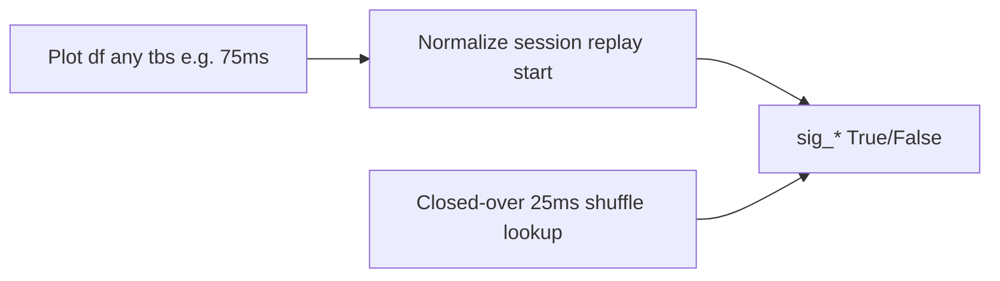

# Cross-tbin shuffle significance predicates

## Problem
Predicates from [`process_loaded_shuffles`](h:\TEMP\Spike3DEnv_ExploreUpgrade\Spike3DWorkEnv\pyPhoPlaceCellAnalysis\src\pyphoplacecellanalysis\SpecificResults\PhoDiba2023Paper.py) read z/p columns **on the plot df**. Those columns are merged with `time_bin_size` in the join ([`merge_epoch_score_shuffle_onto_fat_df`](h:\TEMP\Spike3DEnv_ExploreUpgrade\Spike3DWorkEnv\pyPhoPlaceCellAnalysis\src\pyphoplacecellanalysis\SpecificResults\AcrossSessionResults.py)), so 75ms plot rows have NaN spearman/pearsonr (and other) shuffle stats → all-False filters.

## Approach
Keep building predicates from the **source** shuffle config (`time_bin_size=0.025`). Change evaluation so each `sig_*` predicate **looks up** z/p/n_extreme values from the closed-over 25ms shuffle table by epoch identity, ignoring plot `time_bin_size`.



Join keys (no `time_bin_size`):
- `session_name` normalized (`_` → `-`)
- `custom_replay_name` via existing `_comparable_custom_replay_name`
- `start` as `round(to_numeric(start), 4)` (0.1 ms) to absorb float noise

Start column on the plot/target df: first present among `parent_epoch_start_t`, `epoch_start_t`, `ripple_start_t`, `start` (same order as FAT merge). Shuffle side always uses `start`.

Unmatched plot rows → not significant (`False`), same as today’s NaN behavior.

## Code changes (primary file)
[`PhoDiba2023Paper.py`](h:\TEMP\Spike3DEnv_ExploreUpgrade\Spike3DWorkEnv\pyPhoPlaceCellAnalysis\src\pyphoplacecellanalysis\SpecificResults\PhoDiba2023Paper.py) — `LoadedScoreShufflesDataframeAccessor`:

1. **Helpers** (classmethods near `process_loaded_shuffles`):
   - `_normalize_epoch_identity_columns(df, start_col=...)` → adds `_join_session`, `_join_replay`, `_join_start`
   - `_resolve_epoch_start_col(df)` → start-col pick order above
   - `_build_shuffle_significance_lookup(shuffle_df, transfer_cols)` → deduped right table keyed by the three join keys + transfer metric cols

2. **Rewrite `_subfn_any_significant` inside `process_loaded_shuffles`** to:
   - Left-align plot `df` rows to the closed-over lookup on the three keys
   - Pull the requested metric cols from the lookup (not from plot columns)
   - Apply existing `lt` / `eq` / `abs_ge` + NaN→False logic
   - Preserve index of the input `df`

   Exception: `high_shuffle_percentile_score` stays column-on-df (`best_overall_quantile`) — that is not EpochScoreShuffle.

3. **New** `diagnose_cross_time_bin_epoch_overlap(source_df, target_df, source_time_bin_size=0.025, target_time_bin_size=0.075, ...)`:
   - Build identity key sets for source (filtered to source tbs if column present) and target (filtered to target tbs if column present)
   - Return a summary `DataFrame` per `session_name` with: `n_source`, `n_target`, `n_matched`, `n_source_only`, `n_target_only`, `frac_target_matched`
   - Also return (or attach) optional detail frames: `source_only_epochs`, `target_only_epochs` with identity keys (+ `stop`/`duration` when present) for debugging exclusivity
   - `debug_print=True` prints global totals

4. **Extend `process_loaded_shuffles` signature**:
   - `target_plot_df: Optional[pd.DataFrame] = None`
   - `target_time_bin_size: Optional[float] = 0.075`
   - If `target_plot_df` is None and `kwargs` has `df_filter`, use `df_filter.active_plot_df` when available
   - After building predicates: if a target is available, run `diagnose_cross_time_bin_epoch_overlap` (source = filtered 25ms shuffle df, target = plot df), `display` summary, and include it in the return

5. **Return value**: keep backward-compatible 3-tuple unpack working by returning  
   `(predicates, discovered_shuffle_metrics_df, ripple_EpochScoreShuffle_df)`  
   and put overlap summary on `discovered_shuffle_metrics_df.attrs['cross_tbin_epoch_overlap_df']` plus detail keys in attrs. Also print/display the summary when target exists. Update the class docstring usage block accordingly.

## Notebook cell
Update the shuffle-predicates cell in [`PhoDibaPaper2024_FULL_ARCHIVE_2026-08-31.ipynb`](h:\TEMP\Spike3DEnv_ExploreUpgrade\Spike3DWorkEnv\Spike3D\EXTERNAL\PhoDibaPaper2024Book\PhoDibaPaper2024_FULL_ARCHIVE_2026-08-31.ipynb) to pass `target_plot_df` / `df_filter` when present and display:

```python
discovered_shuffle_metrics_df.attrs.get('cross_tbin_epoch_overlap_df')
```

No change to `included_shuffle_predicate_columns` names (`sig_spearman_z` etc. stay the same).

## Out of scope
- Do not change `merge_epoch_score_shuffle_onto_fat_df` same-tbs join.
- Do not recompute 75ms shuffles.
- Do not rename predicate keys with `_tbin025` suffixes (lookup is internal).
