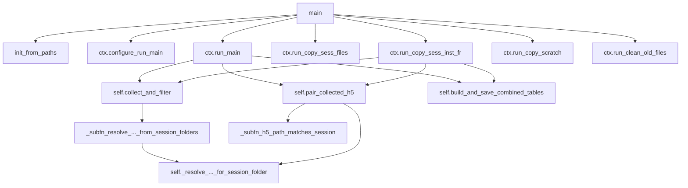

# Clean `PostBatchCopyContext` method refactor

## Goal

Make [`PostBatchCopyContext`](h:\TEMP\Spike3DEnv_ExploreUpgrade\Spike3DWorkEnv\Spike3D\PostBatchCopyResults.py) the single organized API for post-batch copy work: move `ctx`-taking functions onto the class, **delete excess top-level wrappers**, and **nest or promote helpers** so the class surface stays logical (not a dump of every former module `def`).

**Do not edit** [`PostBatchCopyResults.ipynb`](h:\TEMP\Spike3DEnv_ExploreUpgrade\Spike3DWorkEnv\Spike3D\PostBatchCopyResults.ipynb).

## Class surface (keep as methods)

Grouped with short section comments inside the class body:

**Bootstrap / config**
- `init_from_paths` (existing `@classmethod`)
- `configure_run_main` → mutates job-suffix fields, returns `self`

**H5 discovery / pairing / tables** (shared by `run_main` and inst-FR)
- `_decoding_time_bin_filename_suffix` (rename from `_decoding_time_bin_filename_suffix_for_ctx`)
- `_resolve_parameterized_pipeline_h5_for_session_folder(a_session_folder)` — **keep as method** (3 callers: collect path-resolver, pair fallback, `run_main` lambda)
- `pair_collected_h5_paths_to_sessions(h5_paths, included_session_contexts=None, batch_date_to_use=None)` — defaults to `self.included_session_contexts` / `self.batch_date_to_use`; drop optional `ctx=`
- `collect_and_filter_collected_h5_paths`
- `build_and_save_combined_tables` (rename from `build_and_save_combined_tables_for_ctx`)

**Run groups**
- `run_main`
- `run_copy_sess_files`
- `run_copy_sess_inst_fr_data_to_across_session_pkl`
- `run_copy_scratch_session_results_to_turbo`
- `run_clean_old_files`

## Cleanup: nest / promote / delete helpers

### Nest as `_subfn_*` (single caller only)

| Current top-level | Only caller | Action |
|---|---|---|
| `_resolve_parameterized_pipeline_h5_paths_from_session_folders` | `collect_and_filter_collected_h5_paths` | Nest as `_subfn_resolve_parameterized_pipeline_h5_paths_from_session_folders`; close over `self` |
| `_h5_path_matches_session` | `pair_collected_h5_paths_to_sessions` | Nest as `_subfn_h5_path_matches_session` |

### Promote to class `@staticmethod` (shared, no instance state)

| Helper | Callers | Action |
|---|---|---|
| `_normalize_job_suffix_str` | resolve H5 + collect filter | `@staticmethod` on class |
| `_print_copy_dict_summary` | `run_main`, scratch→turbo, copy sess files | `@staticmethod` on class |
| `_filter_copydict_by_source_mtime_cutoff` | scratch→turbo, copy sess files | `@staticmethod` on class |

Call as `self._normalize_job_suffix_str(...)` / `PostBatchCopyContext._print_copy_dict_summary(...)` consistently from methods.

### Delete (no thin aliases)

Remove these module-level names entirely after the move (no one-liner `def run_main(ctx): return ctx.run_main(...)` wrappers):

- `bootstrap_paths_and_sessions` (use `PostBatchCopyContext.init_from_paths`)
- `configure_run_main`, `run_main`, `run_copy_*`, `pair_collected_h5_paths_to_sessions`, `collect_and_filter_collected_h5_paths`, `build_and_save_combined_tables_for_ctx`

IPython usage becomes:

```python
import PostBatchCopyResults as pbcr
ctx = pbcr.PostBatchCopyContext.init_from_paths(...)
ctx = ctx.configure_run_main()
ctx.run_main()
# or still: pbcr.main(['--run-main', ...])
```

### Leave at module level (CLI only)

- `_parse_iso_date`, `_expand_session_file_glob_cli_values`
- `parse_args`, `main`
- Module constants (`DEFAULT_*`, `KNOWN_*`, dtype maps)

## Signature / call-site tightening

Inside class methods, prefer `self` defaults so callers drop boilerplate:

```python
# before
pair_collected_h5_paths_to_sessions(ctx.included_session_contexts, paths, batch_date_to_use=ctx.batch_date_to_use, ctx=ctx)
# after
self.pair_collected_h5_paths_to_sessions(paths)
```

`main()` dispatch:

```python
ctx = PostBatchCopyContext.init_from_paths(...)
ctx = ctx.configure_run_main()
ctx.run_main(...)
ctx.run_copy_sess_files(...)
ctx.run_copy_sess_inst_fr_data_to_across_session_pkl()
ctx.run_copy_scratch_session_results_to_turbo(...)
ctx.run_clean_old_files(...)
```

Update the module docstring IPython examples if they reference removed top-level `run_*` names (they currently use `pbcr.main([...])` — keep those; no new alias docs).

## Style constraints

- Two blank lines between class methods; one blank line between nested `_subfn_*` defs
- Single-line `def` signatures when ≤ 400 chars
- Preserve user comments; preserve `## END for ...` loop closers
- Minimal body rewrites — move/nest/rename only; no copy/filter behavior changes

## Target shape

```text
PostBatchCopyContext
  # bootstrap / config
  init_from_paths
  configure_run_main

  # shared helpers (staticmethod / private)
  _normalize_job_suffix_str          @staticmethod
  _print_copy_dict_summary           @staticmethod
  _filter_copydict_by_source_mtime_cutoff  @staticmethod
  _decoding_time_bin_filename_suffix
  _resolve_parameterized_pipeline_h5_for_session_folder

  # H5 pipeline
  pair_collected_h5_paths_to_sessions   # nests _subfn_h5_path_matches_session
  collect_and_filter_collected_h5_paths # nests _subfn_resolve_..._from_session_folders
  build_and_save_combined_tables

  # run groups
  run_main
  run_copy_sess_files
  run_copy_sess_inst_fr_data_to_across_session_pkl
  run_copy_scratch_session_results_to_turbo
  run_clean_old_files
```



## Out of scope

- Notebook cell migration to `ctx.*`
- Changing copy/delete/filter semantics
- Pruning “unused” imports
