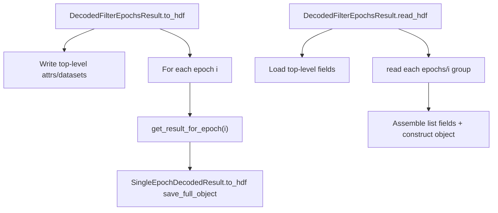

# DecodedFilterEpochsResult HDF round-trip

## Approach
Reuse the per-epoch loop from [`PosteriorExporting.save_decoded_posteriors_to_HDF5`](h:\TEMP\Spike3DEnv_ExploreUpgrade\Spike3DWorkEnv\pyPhoPlaceCellAnalysis\src\pyphoplacecellanalysis\Pho2D\data_exporting.py) (L814–890), but:
- write **object-level** fields that PosteriorExporting skips
- call `SingleEpochDecodedResult.to_hdf(..., save_full_object=True)` so each epoch is fully restorable
- implement matching `read_hdf` that rebuilds a valid `DecodedFilterEpochsResult`

Do **not** change `PosteriorExporting` in this pass (its IdentifyingContext key layout stays as-is).

## HDF layout under `key`
Top-level (under `key`):
- attrs: `decoding_time_bin_size`, `decoding_slideby` (omit or store sentinel if `None`), `num_filter_epochs`, `save_full_object`
- datasets: `nbins`; `pos_bin_edges` if not `None`; `epoch_description_list` as UTF-8 string array (empty OK)
- `filter_epochs`: pandas `DataFrame.to_hdf` / `pd.read_hdf` at `{key}/filter_epochs`

Per-epoch groups:
- `{key}/epochs/{i:0{pad}d}` written via existing [`SingleEpochDecodedResult.to_hdf`](h:\TEMP\Spike3DEnv_ExploreUpgrade\Spike3DWorkEnv\pyPhoPlaceCellAnalysis\src\pyphoplacecellanalysis\Analysis\Decoder\reconstruction.py) with `save_full_object=True` (or parent kwarg), `required_zero_padding=pad`

## Replace stubs at L1574 / L1584
In [`reconstruction.py`](h:\TEMP\Spike3DEnv_ExploreUpgrade\Spike3DWorkEnv\pyPhoPlaceCellAnalysis\src\pyphoplacecellanalysis\Analysis\Decoder\reconstruction.py):

### `to_hdf(self, file_path, key: str, ..., save_full_object: bool = True, **kwargs)`
- Match mixin-style `(file_path, key)` used elsewhere (e.g. `EpochComputationFunctions`).
- Accept open `h5py.File` **or** path/`Path` (open `a`/`w` as needed; only close if we opened).
- Ensure group `key` exists; write top-level fields above.
- Loop `i in range(num_filter_epochs)`:
  - `single = self.get_result_for_epoch(i)`
  - `single.to_hdf(f, key=f'{key}/epochs/{i:0{pad}d}', save_full_object=save_full_object, required_zero_padding=pad, ...)`

### `read_hdf(cls, file_path, key: str, **kwargs) -> DecodedFilterEpochsResult`
- Accept path or open file (close only if opened).
- Load top-level attrs/datasets + `filter_epochs` DataFrame.
- Enumerate sorted children of `{key}/epochs`, `SingleEpochDecodedResult.read_hdf` each.
- Assemble:
  - `p_x_given_n_list`, `most_likely_positions_list`, `most_likely_position_indicies_list`, `marginal_*_list`, `time_bin_containers`, `time_bin_edges`, `spkcount` from singles
  - prefer loaded `nbins` / `filter_epochs` / `epoch_description_list` from top-level; fall back to deriving `nbins` from singles and reconstructing a minimal epochs DF from `epoch_info_tuple`s if `filter_epochs` missing
- Return `cls(...)`.

## Tests
Add [`tests/test_DecodedFilterEpochsResult_hdf_roundtrip.py`](h:\TEMP\Spike3DEnv_ExploreUpgrade\Spike3DWorkEnv\pyPhoPlaceCellAnalysis\tests\test_DecodedFilterEpochsResult_hdf_roundtrip.py) mirroring the SingleEpoch suite:
- helper builds a small multi-epoch 1D `DecodedFilterEpochsResult` (2–3 epochs, different `nbins`)
- full round-trip: posteriors, nbins, filter_epochs columns, containers/centers, spkcount, `decoding_time_bin_size` / `decoding_slideby`, `pos_bin_edges`, `epoch_description_list`
- `save_full_object=False` omits per-epoch `p_x_given_n_full` / `spkcount` but still writes epoch groups
- open-handle read path
- import `SingleEpochDecodedResult` / reconstruction **before** `BinningContainer` to avoid the known NeuroPy circular import

## Files
- [`reconstruction.py`](h:\TEMP\Spike3DEnv_ExploreUpgrade\Spike3DWorkEnv\pyPhoPlaceCellAnalysis\src\pyphoplacecellanalysis\Analysis\Decoder\reconstruction.py) — replace stubs ~1574–1594
- new test file under [`pyPhoPlaceCellAnalysis/tests/`](h:\TEMP\Spike3DEnv_ExploreUpgrade\Spike3DWorkEnv\pyPhoPlaceCellAnalysis\tests)
