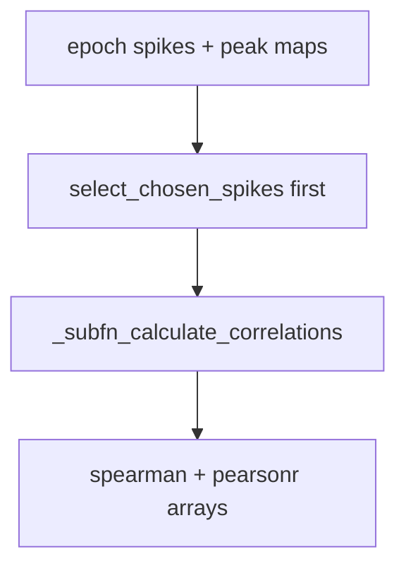

# Convert shuffle spearman/pearsonr to Diba / RankOrder style

## Chosen semantics

Match [`RankOrderAnalyses._subfn_calculate_correlations`](h:\TEMP\Spike3DEnv_ExploreUpgrade\Spike3DWorkEnv\pyPhoPlaceCellAnalysis\src\pyphoplacecellanalysis\General\Pipeline\Stages\ComputationFunctions\MultiContextComputationFunctions\RankOrderComputations.py) / `_compute_single_rank_order_shuffle`:

1. Chronological sort → **first spike per (`Probe_Epoch_id`, `aclu`)** via `select_chosen_spikes(..., rank_alignment='first')`
2. Dense-rank `t_rel_seconds`, then `.corr(..., method='spearman'|'pearson')` vs `{decoder}_pf_peak_x`
3. Keep shuffle export key **`pearsonr`** (already wired in `SCORE_EXTREME_MODE`, overlays, CSV). Internally map RankOrder column `{decoder}_pearson` → array key `pearsonr`.

Drop Simple-PF shuffle behavior (all spikes + unranked `scipy.stats.pearsonr`). Directional pipeline Simple PF on `filter_epochs['pearsonr']` is left unchanged; EpochScoreShuffle’s `pearsonr_*` / `pearsonr_z_*` become RankOrder-style only.

Peak maps stay **CoM** (same default as RankOrder `get_decoder_aclu_peak_map_dict()`).

## Implementation ([SequenceBasedComputations.py](h:\TEMP\Spike3DEnv_ExploreUpgrade\Spike3DWorkEnv\pyPhoPlaceCellAnalysis\src\pyphoplacecellanalysis\General\Pipeline\Stages\ComputationFunctions\MultiContextComputationFunctions\SequenceBasedComputations.py))

Replace the split helpers (~662–777) with one RankOrder-aligned path:

- Add `_rank_order_corr_arrays_from_prepared_spikes_df(prepared_spikes_df, active_epochs_df, decoder_names)` that:
  - sorts by `Probe_Epoch_id`, `t_rel_seconds`, `aclu`
  - calls `select_chosen_spikes(..., rank_alignment='first', time_variable_name_override='t_rel_seconds')` **once**
  - for each method in `('spearman', 'pearson')`, groupby + `_subfn_calculate_correlations`
  - fills `(n_epochs, n_decoders)` arrays; export keys `spearman` and `pearsonr` (read `{decoder}_pearson` for the latter)
- Slim `_spearman_arrays_from_prepared_spikes_df` / `_pearsonr_arrays_from_prepared_spikes_df` to thin wrappers that call the unified helper (or delete them and update call sites/tests to the unified name — prefer **one unified method** + thin wrappers only if tests already bind the old names)
- Update `compute_shuffle_spearman_score_arrays` docstring: both metrics are Diba/RankOrder-style; prepare spikes once, then unified corr
- Update `_ensure_real_score_arrays` comment (drop “Simple PF”)

No overlay list / `SCORE_EXTREME_MODE` changes needed (`pearsonr` key stays).

## Tests ([test_epoch_score_shuffle.py](h:\TEMP\Spike3DEnv_ExploreUpgrade\Spike3DWorkEnv\pyPhoPlaceCellAnalysis\tests\test_epoch_score_shuffle.py))

- Keep perfect mono / anti-mono ±1 checks for both metrics (still valid under RankOrder corr)
- Extend first-spike-only test to assert **both** `spearman` and `pearsonr` ignore late same-aclu spikes
- Replace Simple-PF wording; if `_pearsonr_arrays_from_prepared_spikes_df` remains as wrapper, keep its test but ensure it goes through first-spike + ranked-t Pearson

## Correctness review (post-change)

- **Diba match:** first-spike sequence + rank-order correlation to PF-peak template — yes for both metrics
- **Spearman vs Pearson here:** both use pre-ranked times in `_subfn_calculate_correlations`; Spearman ≈ classic rank-order; Pearson is RankOrder’s existing `*_pearson` companion (linear on ranks × peak_x), not raw-time Pearson
- **Shuffle null:** still cell-identity shuffle of decoder PF maps (EpochScoreShuffle), then re-score — not a rewrite of Diba’s per-event identity shuffle; leave that framework as-is
- **Naming caveat:** pipeline Simple PF `pearsonr` on decoder `filter_epochs` can still differ from shuffle `pearsonr_z`; document in the unified helper docstring only

## Out of scope

- Changing Directional Simple PF computation / `filter_epochs['pearsonr']`
- Renaming export key away from `pearsonr`
- Notebook edits
- Changing peak_mode from CoM to `'peaks'`