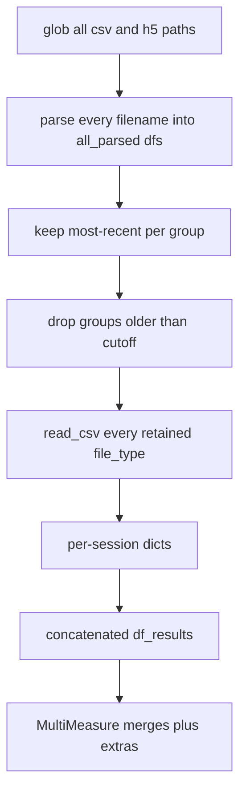

# Earlier filtering for across-session load RAM

## Verdict

**Irrelevant export CSV bodies are not loaded.** `pd.read_csv` runs only on rows in `most_recent_parsed_csv_files_df` after most-recent + cutoff selection in [`AcrossSessionResults.py`](h:/TEMP/Spike3DEnv_ExploreUpgrade/Spike3DWorkEnv/pyPhoPlaceCellAnalysis/src/pyphoplacecellanalysis/SpecificResults/AcrossSessionResults.py) (`find_most_recent_files` → `_new_process_csv_files`).

Your sense that unused files still hurt is still partly right, for different reasons:

- Older than cutoff / non-most-recent: **not** fully loaded, but still cost glob + double `parse_filename` + rows in `all_parsed_*_df`
- H5 in this function: **no** content load, but still glob + parse
- Every retained `file_type` after filter (marginals, pearson, wcorr, all_scores, FAT, shuffle, fig5, perfmnc, ...): **fully loaded** — main peak RAM
- Per-session dicts + concatenated dfs held together: duplicate of same data until GC

So directory growth slows discovery/CPU even when bodies are skipped, while peak RAM tracks how many sessions/file-types pass cutoff.

Key sites in [`AcrossSessionResults.py`](h:/TEMP/Spike3DEnv_ExploreUpgrade/Spike3DWorkEnv/pyPhoPlaceCellAnalysis/src/pyphoplacecellanalysis/SpecificResults/AcrossSessionResults.py):
- ~3157-3199: discover all CSV/H5, then load only `most_recent_parsed_csv_files_df`
- ~2592-2598: most-recent first, then cutoff (wrong order for cutoff intent)
- ~3445: `pd.read_csv(..., low_memory=False)` for each retained path
- ~3200 / ~3741: keep both `dict_results` and `df_results`

## Chosen fixes (library only; no notebook edits)

### 1. Filter by cutoff before most-recent selection

In `find_most_recent_files`, apply `export_datetime >= cuttoff_date` on `all_parsed_paths_df` **before** `get_only_most_recent_session_files`, and build the `sessions` dict from that cutoff-filtered set.

Effect: older-than-cutoff files no longer compete for most recent; groups keep the newest file that still meets the cutoff (better match for a cutoff filter).

### 2. Cheapen discovery parse

Replace the double `parse_filename(p)` list comprehension (~line 2536) with a single parse per path.

### 3. Drop duplicate in-memory copies after concat (largest RAM win)

In `load_across_sessions_exported_files`, stop unpacking/holding all of `dict_results` when only `df_results` is returned; `del dict_results` after unpacking `df_results`.

Inside `_new_process_csv_files`, after concatenations succeed, clear the source per-session dicts before return so peak drops sooner.

### 4. Skip H5 discovery unless requested

Add `include_h5: bool = False` to `load_across_sessions_exported_files` (paper cell only needs CSVs). When false, return empty H5 placeholders. Keep return-tuple shape stable.

### 5. Prefer FAT or classic time-bin, not both

FAT currently loads into `final_sessions_loaded_laps_time_bin_dict` with `allow_CONCAT_to_existing=True`. Prefer FAT when present for a session key; skip `laps_time_bin_marginals_df` for that same key (or load classic only if FAT missing). Prevents stacking two large representations into `all_sessions_laps_time_bin_df`.

## Out of scope

- Optional `load_file_types` allowlist (later if notebook only needs a subset)
- Archiving old files off disk (`OldFileArchiver`)
- Notebook cell / shuffle merge changes

## Validation

- Small dated-filename fixture: with cutoff, winner is newest **on or after cutoff**, not newest-overall-then-drop
- Confirm no `pd.read_csv` on excluded paths
- Smoke paper unpack path: same `df_results` structure; H5 tuple empty when `include_h5=False`
