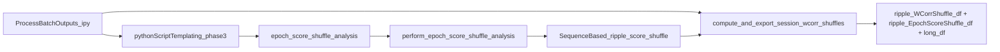

# Batch epoch-score shuffle generation

Replace `perform_wcorr_shuffle_analysis` / `wcorr_shuffle_analysis` in the **batch generator path** with a single name: `epoch_score_shuffle_analysis`. Do not list both names in any includelist (they are two registered functions that both write `SequenceBased`).

Keep the registered wrapper `perform_wcorr_shuffle_analysis` (short_name `wcorr_shuffle_analysis`) for old scripts. Do not rename the pickled ComputationKWargParameters field `wcorr_shuffle_analysis`.



## 1. Phase-3 default includelist

In [`pythonScriptTemplating.py`](h:/TEMP/Spike3DEnv_ExploreUpgrade/Spike3DWorkEnv/pyPhoPlaceCellAnalysis/src/pyphoplacecellanalysis/General/Batch/pythonScriptTemplating.py) `get_run_configuration`, change phase 3:

- `'perform_wcorr_shuffle_analysis'` → `'epoch_score_shuffle_analysis'`

This is the list every generated `final_run` script inherits unless a notebook overrides it.

## 2. Primary generator notebook

In [`ProcessBatchOutputs_qclus1246789_Only.ipy`](h:/TEMP/Spike3DEnv_ExploreUpgrade/Spike3DWorkEnv/Spike3D/ProcessBatchOutputs_qclus1246789_Only.ipy):

- `_tbin_dependent_force_recompute_override_computations_includelist`: replace `'perform_wcorr_shuffle_analysis'` with `'epoch_score_shuffle_analysis'` (force-recompute is intersected with the phase includelist, so the names must match).
- `force_recompute_override_computation_kwargs_dict` key: same new name, and pass flags:

```python
'epoch_score_shuffle_analysis': dict(
    num_shuffles=num_shuffles,
    drop_previous_result_and_compute_fresh=drop_previous_result_and_compute_fresh,  # keep True
    enable_heuristic_shuffle_scoring=True,
    enable_radon_shuffle_scoring=False,
),
```

- `override_parameters_flat_keypaths_dict`: keep the `wcorr_shuffle_analysis.*` prefix (that is still the serialized field). Add:

```python
'wcorr_shuffle_analysis.enable_heuristic_shuffle_scoring': True,
'wcorr_shuffle_analysis.enable_radon_shuffle_scoring': False,
'wcorr_shuffle_analysis.num_shuffles': num_shuffles,
```

- Completion kwargs: pass `num_shuffles` so export no longer hard-requires 700:

```python
'compute_and_export_session_wcorr_shuffles_completion_function': dict(
    should_skip_previous_saved_shuffles=True,
    with_data_name=None,
    num_shuffles=num_shuffles,
),
```

Leave `drop_previous_result_and_compute_fresh = True`. The validator only checks that `SequenceBased.wcorr_ripple_shuffle` exists, so old wcorr-only pickles would skip without a forced drop.

## 3. Export completion function uses batch `num_shuffles`

In [`batch_user_completion_helpers.py`](h:/TEMP/Spike3DEnv_ExploreUpgrade/Spike3DWorkEnv/pyPhoPlaceCellAnalysis/src/pyphoplacecellanalysis/General/Batch/BatchJobCompletion/UserCompletionHelpers/batch_user_completion_helpers.py) `compute_and_export_session_wcorr_shuffles_completion_function`:

- Add `num_shuffles: Optional[int] = None`.
- If `num_shuffles` is provided, use it for both `desired_total_num_shuffles` and `minimum_required_unique_num_shuffles`; otherwise keep the current 700 defaults.
- Pass `enable_heuristic_shuffle_scoring=True` into the existing `compute_shuffles(...)` calls.
- Do not rename the completion function. `export_csvs` already writes `ripple_WCorrShuffle_df`, `ripple_EpochScoreShuffle_df`, and `ripple_EpochScoreShuffle_long_df`.

## 4. Name alignment so force-recompute and kdiba-only filtering still work

- [`BatchCompletionHandler.py`](h:/TEMP/Spike3DEnv_ExploreUpgrade/Spike3DWorkEnv/pyPhoPlaceCellAnalysis/src/pyphoplacecellanalysis/General/Batch/BatchJobCompletion/BatchCompletionHandler.py) `_KDIBA_ONLY_EXTENDED_COMPUTATIONS`: add `'epoch_score_shuffle_analysis'` and `'perform_epoch_score_shuffle_analysis'`; keep the old names so leftover scripts still get dropped for non-kdiba sessions.
- [`pipeline_ipywidgets.py`](h:/TEMP/Spike3DEnv_ExploreUpgrade/Spike3DWorkEnv/pyPhoPlaceCellAnalysis/src/pyphoplacecellanalysis/GUI/IPyWidgets/pipeline_ipywidgets.py) phase map: `'perform_wcorr_shuffle_analysis'` → `'epoch_score_shuffle_analysis'` (still `final_run`).
- [`batch_completion_helpers.py`](h:/TEMP/Spike3DEnv_ExploreUpgrade/Spike3DWorkEnv/pyPhoPlaceCellAnalysis/src/pyphoplacecellanalysis/General/Batch/BatchJobCompletion/UserCompletionHelpers/batch_completion_helpers.py) `overwrite_replay_epochs_and_recompute`: change `computation_functions_name_includelist=['wcorr_shuffle_analysis']` to `['epoch_score_shuffle_analysis']` and add the heuristic/radon kwargs next to `num_shuffles` / `drop_previous_result_and_compute_fresh`.

## 5. Sibling generator notebooks (same kwargs key)

Mechanical key swap + heuristic flags + `num_shuffles=` on the completion dict, no behavior redesign:

- [`ProcessBatchOutputs.ipy`](h:/TEMP/Spike3DEnv_ExploreUpgrade/Spike3DWorkEnv/Spike3D/ProcessBatchOutputs.ipy)
- [`ProcessBatchOutputs_qclus12_Only.ipy`](h:/TEMP/Spike3DEnv_ExploreUpgrade/Spike3DWorkEnv/Spike3D/ProcessBatchOutputs_qclus12_Only.ipy)
- [`ProcessBatchOutputs_test_all_script_phases.ipy`](h:/TEMP/Spike3DEnv_ExploreUpgrade/Spike3DWorkEnv/Spike3D/ProcessBatchOutputs_test_all_script_phases.ipy)
- [`ProcessBatchOutputs_Bapun_Batch.ipy`](h:/TEMP/Spike3DEnv_ExploreUpgrade/Spike3DWorkEnv/Spike3D/ProcessBatchOutputs_Bapun_Batch.ipy)
- [`ProcessBatchOutputs_NWB_WMaze_Batch.ipy`](h:/TEMP/Spike3DEnv_ExploreUpgrade/Spike3DWorkEnv/Spike3D/ProcessBatchOutputs_NWB_WMaze_Batch.ipy)

## Out of scope

- Deleting the `WCorrShuffle` / `perform_wcorr_shuffle_analysis` aliases
- Renaming on-disk pickle/CSV filenames
- Changing `num_shuffles` from 128 in the qclus1246789 notebook
- Enabling radon (`enable_radon_shuffle_scoring` stays False)
