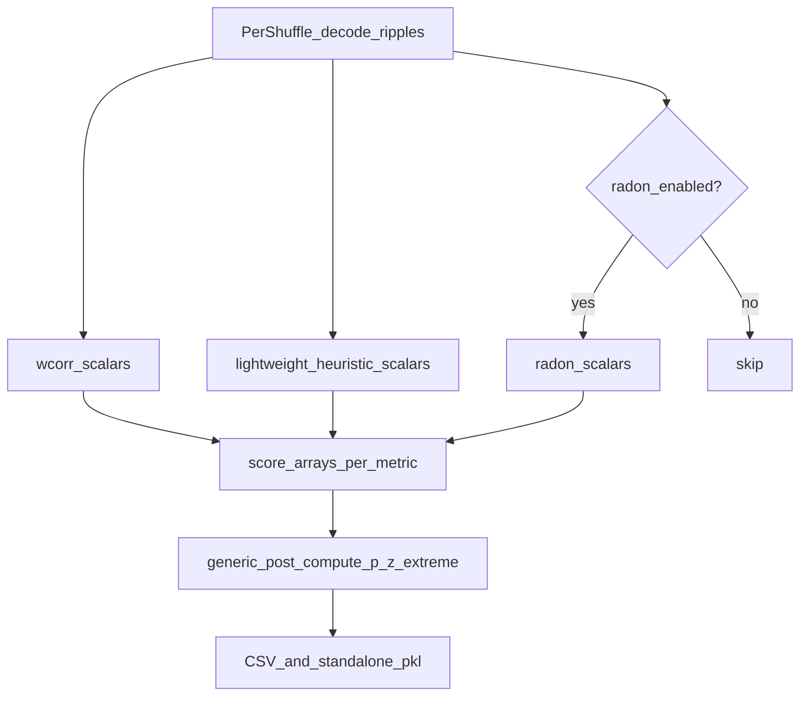

# Decoded-epoch multi-score shuffles

## Scope (committed)

- **In:** rename wcorr-centric types/APIs; add heuristic + optional radon scoring inside the shuffle loop; efficient scalar extraction; p/z/extreme stats + CSV/export on the renamed result; backward-compat aliases for old names and old pickles.
- **Out:** merging shuffle p/z into `DirectionalDecodersEpochsEvaluations` / `build_complete_all_scores_merged_df`; notebook mass-edits; renaming on-disk pickle/CSV filenames already written (parser keeps reading old names).

Defaults: `enable_heuristic_shuffle_scoring=True`, `enable_radon_shuffle_scoring=False`. Full decoded shuffle posteriors stay off by default (`enable_saving_entire_decoded_shuffle_result=False`).



## 1. Rename (with aliases)

Primary file: [`SequenceBasedComputations.py`](h:/TEMP/Spike3DEnv_ExploreUpgrade/Spike3DWorkEnv/pyPhoPlaceCellAnalysis/src/pyphoplacecellanalysis/General/Pipeline/Stages/ComputationFunctions/MultiContextComputationFunctions/SequenceBasedComputations.py).

| Old | New |
|-----|-----|
| `WCorrShuffle` | `DecodedEpochScoreShuffle` |
| `wcorr_ripple_shuffle` (container field) | `ripple_score_shuffle` |
| `perform_wcorr_shuffle_analysis` / short_name `wcorr_shuffle_analysis` | `perform_epoch_score_shuffle_analysis` / short_name `epoch_score_shuffle_analysis` |
| `ExportedWCorrShufflesPickleFilenameParser` | `ExportedEpochScoreShufflesPickleFilenameParser` |
| `finalize_output_shuffled_wcorr` | `finalize_output_shuffled_epoch_scores` |
| `output_extracted_result_wcorrs_list` | `output_extracted_score_dicts_list` (per-shuffle dict of metric → decoder DF) |
| `real_decoder_ripple_weighted_corr_arr` | keep as one entry under `real_score_arrays['wcorr']` |

**Keep unchanged (already general / export contracts):** global key `'SequenceBased'`, `SequenceBasedComputationsContainer` class name, on-disk discover glob that still matches `*_wcorr_ripple_shuffle_data_*.pkl`.

**Compat layer (required):**
- `WCorrShuffle = DecodedEpochScoreShuffle` module alias.
- Container property `wcorr_ripple_shuffle` → getter/setter forwarding to `ripple_score_shuffle`.
- Register both short_names (or thin wrapper `perform_wcorr_shuffle_analysis` calling the new method) so batch/`perform_specific_computation(..., ['wcorr_shuffle_analysis'])` keeps working.
- Bump `_VersionedResultMixin_version` / `result_version` on the shuffle class; `__setstate__` maps old field names → new.

Update call sites in library code (batch helpers, `Computation.py`, validators, tests). Leave Spike3D notebooks alone unless already in context.

## 2. Multi-metric storage model

Replace the wcorr-only list with a uniform structure on `DecodedEpochScoreShuffle`:

```python
# enabled_metrics: e.g. ['wcorr', 'travel', 'coverage', 'mseq_len', ..., 'radon_score']
real_score_arrays: Dict[str, NDArray]  # metric -> (n_epochs, n_decoders)
output_extracted_score_dicts_list: List[Dict[str, Dict[decoder, pd.DataFrame|Series]]]
# or List[Dict[str, NDArray]] shape (n_epochs, 4) per metric — prefer arrays after extract for memory
```

Per shuffle, after decode: compute enabled metrics → stack into arrays → append one entry; **discard** full `DecodedFilterEpochsResult` unless `enable_saving_entire_decoded_shuffle_result`.

Uniqueness (`ensure_all_shuffles_unique`) continues to use **wcorr** arrays as the shuffle identity key (stable, already used).

## 3. Efficient scoring in the shuffle loop

Hot path today: [`_shuffle_and_decode_wcorrs`](h:/TEMP/Spike3DEnv_ExploreUpgrade/Spike3DWorkEnv/pyPhoPlaceCellAnalysis/src/pyphoplacecellanalysis/General/Pipeline/Stages/ComputationFunctions/MultiContextComputationFunctions/SequenceBasedComputations.py) (~L698–765). Rename to `_shuffle_and_decode_scores` and:

**Decode efficiency**
- Reuse one `spikes_df` deepcopy outside the shuffle loop (or pass a shared frame); stop `deepcopy(spikes_df)` every iteration.
- Keep `skip_merged_decoding=True`.
- Leave `is_pre_compute_mode` off (known buggy); document as future work.

**Heuristic efficiency (do not call full `compute_all_heuristic_scores`)**

Add `HeuristicReplayScoring.compute_shuffle_heuristic_score_arrays(...)` in [`heuristic_replay_scoring.py`](h:/TEMP/Spike3DEnv_ExploreUpgrade/Spike3DWorkEnv/pyPhoPlaceCellAnalysis/src/pyphoplacecellanalysis/Analysis/Decoder/heuristic_replay_scoring.py):

1. Build **one** `SubsequencesPartitioningResult` per decoder×epoch (existing `_META_build_epoch_SubsequencesPartitioningResult`).
2. Extract partition scalars once (prefer a single forwardicity call + mseq columns; avoid running three forwardicity wrappers separately).
3. Compute non-partition scores (`travel`, `coverage`, `avg_jump_cm`, …) from MAP positions only.
4. **Skip** `compute_pho_heuristic_replay_scores` (OLDER path re-partitions — ~2× cost).
5. **Skip** mutating `filter_epochs`; return `Dict[metric, NDArray (n_epochs, 4)]` (or per-decoder thin DFs).
6. Share one `xbin_edges` / kwargs outside the epoch loop; disable partition debug step logging for shuffle calls.

**Radon**
- If enabled: call existing `compute_radon_transforms` / arbitrary-epoch helper; persist only `score` (and optionally `velocity`) as arrays; never neighbor extras.

## 4. Generic post-compute / dataframes / export

Factor wcorr-specific `post_compute` into:

`post_compute_metric(real_arr, shuffle_stack, extreme_mode) → p, z, n_more_extreme`

`extreme_mode` registry (on the shuffle class or a small constant dict):
- `wcorr`: `abs_greater` (current behavior)
- radon `score` and most heuristics that are “higher is better”: `greater`
- heuristics that are “lower is better” (e.g. `avg_jump_cm`, `travel` if treated as jumpiness): `less` — set explicitly from known score semantics when wiring the registry

`build_all_shuffles_dataframes` becomes multi-metric: real columns `{metric}_{decoder}`, z columns, plus a long shuffle DF with `metric`, `epoch_idx`, `shuffle_idx`, `decoder_idx`, `shuffle_value`.

`export_csvs` / `finalize_output_shuffled_epoch_scores`: keep exporting `ripple_WCorrShuffle_df` key for compat; also write a broader `ripple_EpochScoreShuffle_df` (or widen the existing DF with new columns). New standalone pickle names use `standalone_epoch_score_shuffle_data_only_*`; discover/load still accepts old `wcorr_*` filenames via the renamed parser.

## 5. Pipeline / batch wiring

- `perform_epoch_score_shuffle_analysis(..., enable_heuristic_shuffle_scoring=True, enable_radon_shuffle_scoring=False, num_shuffles=..., drop_previous_result_and_compute_fresh=...)`.
- Batch helpers in [`batch_completion_helpers.py`](h:/TEMP/Spike3DEnv_ExploreUpgrade/Spike3DWorkEnv/pyPhoPlaceCellAnalysis/src/pyphoplacecellanalysis/General/Batch/BatchJobCompletion/UserCompletionHelpers/batch_completion_helpers.py) / user helpers: pass the new flags; keep calling short_name `wcorr_shuffle_analysis` until batch lists are updated to `epoch_score_shuffle_analysis`.
- Validation probes that list `perform_wcorr_shuffle_analysis` get both names.

## 6. Implementation order

1. Add lightweight `compute_shuffle_heuristic_score_arrays` (+ optional radon extract helper).
2. Introduce multi-metric storage + generic `post_compute_metric` on a renamed class (can implement rename + storage together in `SequenceBasedComputations.py`).
3. Wire `_shuffle_and_decode_scores` with flags; decode DF reuse.
4. Compat aliases, version bump, pickle `__setstate__`.
5. Update batch finalize/export + library call sites + unit tests (`test_wcorr_shuffle_decoder.py`, pickling tests).

## Risk notes

- Old sessions without heuristic shuffle lists must load with empty heuristic stacks and still expose wcorr.
- Heuristic nulls increase CPU vs wcorr-only; lightweight path avoids the double-partition trap. Decode remains the dominant cost.
- Do not enable full posterior saving when heuristics are on (memory blow-up).
