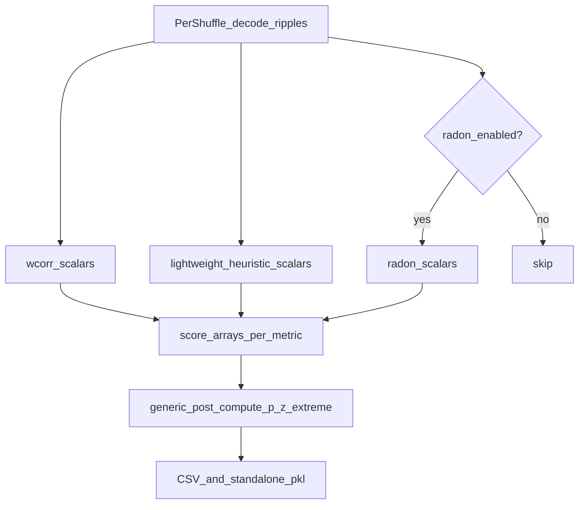

# Decoded-epoch multi-score shuffles

## Scope (committed)

- **In:** rename wcorr-centric types/APIs; add heuristic + optional radon scoring inside the shuffle loop; efficient scalar extraction; p/z/extreme stats + CSV/export on the renamed result; backward-compat aliases for old names and old pickles.
- **Out:** merging shuffle p/z into `DirectionalDecodersEpochsEvaluations` / `build_complete_all_scores_merged_df`; notebook mass-edits; renaming on-disk pickle/CSV filenames already written (parser keeps reading old names). Do **not** change cell-identity shuffle semantics in `_shuffle_pf1D_decoder`.

Defaults: `enable_heuristic_shuffle_scoring=True`, `enable_radon_shuffle_scoring=False`. Full decoded shuffle posteriors stay off by default (`enable_saving_entire_decoded_shuffle_result=False` — align the **class field** to False; today the field defaults True while `init_from_templates` / `perform_wcorr_shuffle_analysis` already pass False).



## Current baseline (2026-10-26)

None of the rename / multi-metric / heuristic-in-loop work is implemented. Live code is still wcorr-only `WCorrShuffle`. Several nearby pieces **have** landed and this plan must build on them.

**Primary file:** [`SequenceBasedComputations.py`](h:/TEMP/Spike3DEnv_ExploreUpgrade/Spike3DWorkEnv/pyPhoPlaceCellAnalysis/src/pyphoplacecellanalysis/General/Pipeline/Stages/ComputationFunctions/MultiContextComputationFunctions/SequenceBasedComputations.py)

| Piece | Status | Location |
|---|---|---|
| Class `WCorrShuffle`, container field `wcorr_ripple_shuffle` | live | L165–196, L1367–1385 |
| `perform_wcorr_shuffle_analysis` / short_name `wcorr_shuffle_analysis` | live | L1458–1535 |
| `ExportedWCorrShufflesPickleFilenameParser` + glob `*_wcorr_ripple_shuffle_data_*.pkl` | live | L71–117, L1154 |
| CSV key `ripple_WCorrShuffle_df` | live | `export_csvs` L1351 |
| `finalize_output_shuffled_wcorr` | live | `batch_completion_helpers.py` L746 |
| Cell-identity shuffle: permute `neuron_IDs`, leave `F` / ratemap | **done** | `_shuffle_pf1D_decoder` L389–458; tests in `tests/test_wcorr_shuffle_decoder.py` |
| Real (unshuffled) ripple decode always stored | **done** | `real_decoder_ripple_filter_epochs_decoder_result_dict` L187; built in `build_real_result` / `init_from_templates` L358–370 |
| Standalone pickle 5-tuple | **done** | `save_data` L1038–1066: `(wcorrs_list, real_wcorr_arr, shuffle_decoded_list, all_shuffles_wcorr_array, real_ripple_decode_dict)`; load accepts 3/4/5 |
| `active_spikes_df` stored on the object | **done but unused in loop** | set in `init_from_templates`; `_shuffle_and_decode_wcorrs` still `deepcopy(curr_active_pipeline.sess.spikes_df)` every shuffle (L755) |
| `_shuffle_and_decode_wcorrs` | still wcorr-only | L700–767; `is_pre_compute_mode=False` (known buggy) |
| `post_compute` / `build_all_shuffles_dataframes` | still wcorr-only, extreme = `abs_greater` | L834–1035 |
| `__setstate__` | restores pipeline/templates only; no field-name remap | L1247–1257 |
| Heuristic shuffle API | **missing** | `compute_all_heuristic_scores` still mutates `filter_epochs` and still calls OLDER `compute_pho_heuristic_replay_scores` (double partition) |
| `DecodedEpochScoreShuffle` / `epoch_score_shuffle_analysis` | **missing** | no symbols in the tree |

### Constraints to preserve (`_shuffle_pf1D_decoder`)

Do not revert this. The IndexError (`index 41` into length `33`) was ratemap positions applied to a shorter `neuron_IDs`. Current contract:

- Shuffle is **cell identity**: permute `neuron_IDs` into `shuffle_aclus` order; **do not** permute `F` or `pf.ratemap`.
- `shuffle_IDXs` from `build_shuffled_ids` indexes the **merged** decoder and is **not** applied on per-decoder shuffle. Each decoder rebuilds positions from its own `neuron_IDs` via `_positions_of_aclus`.
- Ratemap may be longer than `neuron_IDs`; never index `neuron_IDs` with ratemap positions.
- `F` stays `(n_flat_position_bins, n_neurons)` aligned with **pre-shuffle** columns. Reliability columns stay with `F`.
- Cells in `neuron_IDs` but absent from `shuffle_aclus` stay in original relative order (keeps `F` width).
- Tests in [`test_wcorr_shuffle_decoder.py`](h:/TEMP/Spike3DEnv_ExploreUpgrade/Spike3DWorkEnv/pyPhoPlaceCellAnalysis/tests/test_wcorr_shuffle_decoder.py) must keep passing after the rename (import via alias is fine).

### Shuffle-loop facts the original plan missed

- **Four 1D decoders** are shuffled from `track_templates.get_decoders_dict()` each iteration (correct — original templates).
- **Merged decoder** is shuffled **in place** on `alt_directional_merged_decoders_result` (L740), so shuffle *n* is a permutation of shuffle *n−1*. That object is unused because `skip_merged_decoding=True`. Drop the merged shuffle in `_shuffle_and_decode_scores`.
- `build_shuffled_ids` still uses the merged decoder’s `neuron_IDs` as the global permutation source (keep that; just do not apply it to the merged `F`).
- Reuse `self.active_spikes_df` (already stored) instead of `deepcopy(curr_active_pipeline.sess.spikes_df)` every shuffle.

## 1. Rename (with aliases)

| Old | New |
|-----|-----|
| `WCorrShuffle` | `DecodedEpochScoreShuffle` |
| `wcorr_ripple_shuffle` (container field) | `ripple_score_shuffle` |
| `perform_wcorr_shuffle_analysis` / short_name `wcorr_shuffle_analysis` | `perform_epoch_score_shuffle_analysis` / short_name `epoch_score_shuffle_analysis` |
| `ExportedWCorrShufflesPickleFilenameParser` | `ExportedEpochScoreShufflesPickleFilenameParser` |
| `finalize_output_shuffled_wcorr` | `finalize_output_shuffled_epoch_scores` |
| `output_extracted_result_wcorrs_list` | `output_extracted_score_dicts_list` (per-shuffle dict of metric → decoder DF/array) |
| `real_decoder_ripple_weighted_corr_arr` | keep as one entry under `real_score_arrays['wcorr']` |
| `real_decoder_ripple_filter_epochs_decoder_result_dict` | keep (already general; used to score real heuristics/radon without a second real decode) |

**Keep unchanged (already general / export contracts):** global key `'SequenceBased'`, `SequenceBasedComputationsContainer` class name, on-disk discover glob that still matches `*_wcorr_ripple_shuffle_data_*.pkl`. `_shuffle_pf1D_decoder` name and semantics.

**Compat layer (required):**
- `WCorrShuffle = DecodedEpochScoreShuffle` module alias.
- Container property `wcorr_ripple_shuffle` → getter/setter forwarding to `ripple_score_shuffle` (attrs field rename needs `__setstate__` because old pickles store `wcorr_ripple_shuffle`).
- Register both short_names (or thin wrapper `perform_wcorr_shuffle_analysis` calling the new method) so batch/`perform_specific_computation(..., ['wcorr_shuffle_analysis'])` keeps working. Also keep `wcorr_shuffle_analysis_Parameters` as an alias if the computation-config type is renamed.
- Bump `_VersionedResultMixin_version` / `result_version` on the shuffle class (today `"2024.05.30_0"`).
- `__setstate__` maps old field names → new **and** fills missing heuristic/radon stacks as empty. Standalone `save_data` / `init_from_data_only_file` / `load_and_append_shuffle_data` must still accept 3-tuple, 4-tuple, and 5-tuple payloads.

Update call sites in library code (batch helpers, `Computation.py` probes at ~L2568, validators, tests). Leave Spike3D notebooks alone unless already in context.

## 2. Multi-metric storage model

Replace the wcorr-only list with a uniform structure on `DecodedEpochScoreShuffle`:

```python
# enabled_metrics: e.g. ['wcorr', 'travel', 'coverage', 'avg_jump_cm', 'mseq_len', ..., 'radon_score']
real_score_arrays: Dict[str, NDArray]  # metric -> (n_epochs, n_decoders)
# prefer arrays after extract for memory:
output_extracted_score_arrays_list: List[Dict[str, NDArray]]  # per shuffle, metric -> (n_epochs, 4)
```

Per shuffle, after decode: compute enabled metrics → stack into arrays → append one entry; **discard** full `DecodedFilterEpochsResult` unless `enable_saving_entire_decoded_shuffle_result`.

Real scores: wcorr already in `real_decoder_ripple_weighted_corr_arr`. Heuristic/radon real scores come from `real_decoder_ripple_filter_epochs_decoder_result_dict` (already stored) — do not re-decode reals.

Uniqueness (`ensure_all_shuffles_unique`) continues to use **wcorr** arrays as the shuffle identity key (stable, already used).

## 3. Efficient scoring in the shuffle loop

Hot path today: [`_shuffle_and_decode_wcorrs`](h:/TEMP/Spike3DEnv_ExploreUpgrade/Spike3DWorkEnv/pyPhoPlaceCellAnalysis/src/pyphoplacecellanalysis/General/Pipeline/Stages/ComputationFunctions/MultiContextComputationFunctions/SequenceBasedComputations.py) (L700–767). Rename to `_shuffle_and_decode_scores` and:

**Decode efficiency**
- Reuse `self.active_spikes_df` (already on the object) — stop `deepcopy(curr_active_pipeline.sess.spikes_df)` every iteration.
- Keep `skip_merged_decoding=True`.
- Skip shuffling `alt_directional_merged_decoders_result.all_directional_pf1D_Decoder` (unused under skip_merged; currently mutates in place).
- Leave `is_pre_compute_mode` off (known buggy); document as future work.
- Call `_shuffle_pf1D_decoder` only on the four 1D templates, with per-decoder `shuffle_aclus` filtered by that decoder’s `neuron_IDs` (current L743–746).

**Heuristic efficiency (do not call full `compute_all_heuristic_scores`)**

That function (L3338–3437) (1) partitions once, (2) runs partition scores, (3) runs `build_all_score_computations_fn_dict` scores, (4) **re-partitions** via `compute_pho_heuristic_replay_scores` (OLDER), (5) **mutates** `filter_epochs`. Shuffle path must not do (4) or (5).

Add `HeuristicReplayScoring.compute_shuffle_heuristic_score_arrays(...)` in [`heuristic_replay_scoring.py`](h:/TEMP/Spike3DEnv_ExploreUpgrade/Spike3DWorkEnv/pyPhoPlaceCellAnalysis/src/pyphoplacecellanalysis/Analysis/Decoder/heuristic_replay_scoring.py):

1. Build **one** `SubsequencesPartitioningResult` per decoder×epoch via `SubsequencesPartitioningResultScoringComputations._META_build_epoch_SubsequencesPartitioningResult` (L2635; plan originally attributed this to `HeuristicReplayScoring`).
2. Extract partition scalars once from `build_all_bin_wise_subseq_partitioning_computation_fn_dict` (L2674): `mseq_len`, `mseq_len_ignoring_intrusions`, `mseq_len_ignoring_intrusions_and_repeats`, `mseq_len_ratio_ignoring_intrusions_and_repeats`, `mseq_tcov`, `mseq_dtrav`, plus one forwardicity call (`forwardicity` / `ratio_major_aligned_bins` / `ratio_decoder_aligned_bins` share the partition — do not run three wrappers that each rebuild it).
3. Compute MAP-only scores from `build_all_bin_wise_computation_fn_dict` (L3096): `travel`, `coverage`, `avg_jump_cm`.
4. **Skip** `compute_pho_heuristic_replay_scores` (OLDER path re-partitions — ~2× cost).
5. **Skip** mutating `filter_epochs`; return `Dict[metric, NDArray (n_epochs, 4)]`.
6. Share one `xbin_edges` / kwargs outside the epoch loop; disable partition debug step logging for shuffle calls.

**Radon**
- If enabled: `DecodedFilterEpochsResult.compute_radon_transforms` (reconstruction.py L1238) returns `['score', 'velocity', 'intercept', 'speed']` plus extras. Persist only `score` (and optionally `velocity`) as arrays; `enable_return_neighbors_arr=False`.

## 4. Generic post-compute / dataframes / export

Factor wcorr-specific `post_compute` into:

`post_compute_metric(real_arr, shuffle_stack, extreme_mode) → p, z, n_more_extreme`

`extreme_mode` registry (on the shuffle class or a small constant dict):
- `wcorr`: `abs_greater` (current L891)
- radon `score` and most heuristics that are “higher is better” (`coverage`, `mseq_len*`, `forwardicity`): `greater`
- heuristics that are “lower is better” (`avg_jump_cm`, `travel`): `less` — set explicitly from known score semantics when wiring the registry

`build_all_shuffles_dataframes` becomes multi-metric: real columns `{metric}_{decoder}`, z columns, plus a long shuffle DF with `metric`, `epoch_idx`, `shuffle_idx`, `decoder_idx`, `shuffle_value`. Keep current wcorr column names (`wcorr_long_LR`, `wcorr_z_long`, …) so existing CSV consumers still work.

`export_csvs` / `finalize_output_shuffled_epoch_scores`: keep exporting `ripple_WCorrShuffle_df` key for compat; also write a broader `ripple_EpochScoreShuffle_df` (or widen the existing DF with new columns). New standalone pickle names use `standalone_epoch_score_shuffle_data_only_*`; discover/load still accepts old `wcorr_*` filenames via the renamed parser.

## 5. Pipeline / batch wiring

- `perform_epoch_score_shuffle_analysis(..., enable_heuristic_shuffle_scoring=True, enable_radon_shuffle_scoring=False, num_shuffles=..., drop_previous_result_and_compute_fresh=...)`.
- Batch helpers in [`batch_completion_helpers.py`](h:/TEMP/Spike3DEnv_ExploreUpgrade/Spike3DWorkEnv/pyPhoPlaceCellAnalysis/src/pyphoplacecellanalysis/General/Batch/BatchJobCompletion/UserCompletionHelpers/batch_completion_helpers.py) / [`batch_user_completion_helpers.py`](h:/TEMP/Spike3DEnv_ExploreUpgrade/Spike3DWorkEnv/pyPhoPlaceCellAnalysis/src/pyphoplacecellanalysis/General/Batch/BatchJobCompletion/UserCompletionHelpers/batch_user_completion_helpers.py) (`compute_and_export_session_wcorr_shuffles_completion_function` L1483): pass the new flags; keep calling short_name `wcorr_shuffle_analysis` until batch lists are updated to `epoch_score_shuffle_analysis`.
- Validation probes that list `perform_wcorr_shuffle_analysis` (`Computation.py` ~L2568) get both names.

## 6. Implementation order

1. Add lightweight `compute_shuffle_heuristic_score_arrays` (+ optional radon extract helper). Use this on `real_decoder_ripple_filter_epochs_decoder_result_dict` first so real heuristic arrays exist before the shuffle loop.
2. Introduce multi-metric storage + generic `post_compute_metric` on a renamed class (can implement rename + storage together in `SequenceBasedComputations.py`).
3. Wire `_shuffle_and_decode_scores` with flags; reuse `active_spikes_df`; drop unused merged-decoder shuffle.
4. Compat aliases, version bump, pickle `__setstate__` + 3/4/5-tuple load.
5. Update batch finalize/export + library call sites + unit tests (`test_wcorr_shuffle_decoder.py` must still pass; extend pickling tests for new fields / old-name load).

## Risk notes

- Old sessions without heuristic shuffle lists must load with empty heuristic stacks and still expose wcorr (`real_decoder_ripple_weighted_corr_arr` / `output_extracted_result_wcorrs_list`).
- Heuristic nulls increase CPU vs wcorr-only; lightweight path avoids the double-partition trap. Decode remains the dominant cost.
- Do not enable full posterior saving when heuristics are on (memory blow-up). Class field default True today is a footgun — set it False.
- `init_from_templates` still mutates pipeline state via `directional_decoders_epochs_decode_result.add_all_extra_epoch_columns` (L276). Out of scope here; do not add more in-place mutations for shuffle scoring.
- `WCorrShuffle(**get_dict_subset(...))` reconstructions in batch helpers will break if field names change without aliases/`__setstate__` — cover that reconstruct path in tests.
