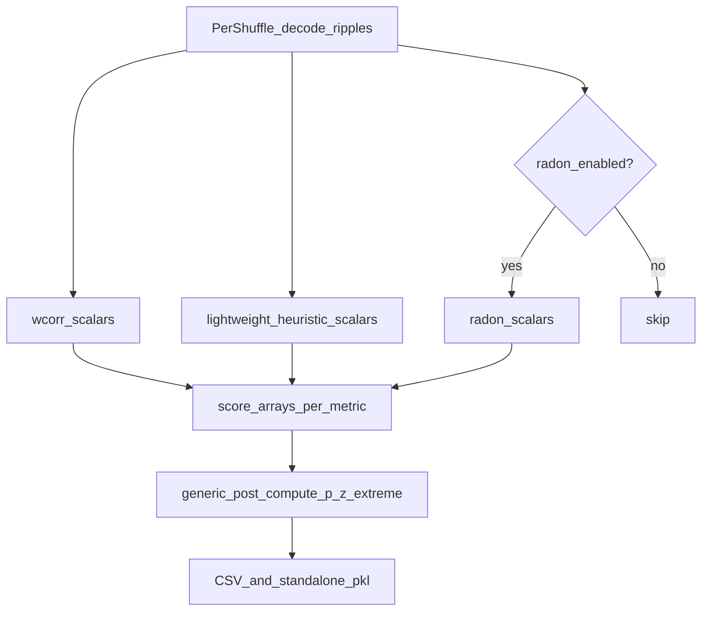

# Decoded-epoch multi-score shuffles

## Scope (committed)

- **In:** rename wcorr-centric types/APIs; add heuristic + optional radon scoring inside the shuffle loop; efficient scalar extraction; p/z/extreme stats + CSV/export on the renamed result; backward-compat aliases for old names and old pickles.
- **Out:** merging shuffle p/z into `DirectionalDecodersEpochsEvaluations` / `build_complete_all_scores_merged_df`; notebook mass-edits; renaming on-disk pickle/CSV filenames already written (parser keeps reading old names). Do **not** change cell-identity shuffle semantics in `_shuffle_pf1D_decoder`.

Defaults (now live on the class): `enable_heuristic_shuffle_scoring=True`, `enable_radon_shuffle_scoring=False`, `enable_saving_entire_decoded_shuffle_result=False`.

## Status as of 2026-10-27

Core implementation is in [`SequenceBasedComputations.py`](h:/TEMP/Spike3DEnv_ExploreUpgrade/Spike3DWorkEnv/pyPhoPlaceCellAnalysis/src/pyphoplacecellanalysis/General/Pipeline/Stages/ComputationFunctions/MultiContextComputationFunctions/SequenceBasedComputations.py) and [`heuristic_replay_scoring.py`](h:/TEMP/Spike3DEnv_ExploreUpgrade/Spike3DWorkEnv/pyPhoPlaceCellAnalysis/src/pyphoplacecellanalysis/Analysis/Decoder/heuristic_replay_scoring.py). The 2026-10-26 “nothing renamed” baseline is obsolete.

| Piece | Status | Notes |
|---|---|---|
| `DecodedEpochScoreShuffle` + `WCorrShuffle = DecodedEpochScoreShuffle` | **done** | L190, L1576 |
| Container field `wcorr_ripple_shuffle` + property `ripple_score_shuffle` | **done** | Field name kept for pickle compat; property is the preferred name (L1598–1607) |
| `perform_epoch_score_shuffle_analysis` / short_name `epoch_score_shuffle_analysis` | **done** | Wrapper `perform_wcorr_shuffle_analysis` / `wcorr_shuffle_analysis` (L1684–1771) |
| `ExportedEpochScoreShufflesPickleFilenameParser` | **done** | Alias `ExportedWCorrShufflesPickleFilenameParser` (L71, L122) |
| `finalize_output_shuffled_epoch_scores` | **done** | Alias `finalize_output_shuffled_wcorr` |
| `real_score_arrays` + `output_extracted_score_arrays_list` | **done** | L212, L217 |
| `result_version` `"2026.10.26_0"` + `__setstate__` fills missing stacks | **done** | L202, L1431–1463 |
| Cell-identity shuffle | **done** | `_shuffle_pf1D_decoder`; `tests/test_wcorr_shuffle_decoder.py` still imports via `WCorrShuffle` alias |
| Real ripple decode always stored | **done** | `real_decoder_ripple_filter_epochs_decoder_result_dict` |
| Standalone pickle | **done** | `save_data` writes **7-tuple** (old 3/4/5 still load); docstring still says 5-tuple |
| `compute_shuffle_heuristic_score_arrays` | **done** | heuristic_replay_scoring.py L3352; one partition, shared forwardicity, no OLDER path, no `filter_epochs` mutation |
| `compute_shuffle_radon_score_arrays` | **done** | L478; `score` + `velocity` only |
| `_shuffle_and_decode_scores` | **done** | L857; reuses `active_spikes_df`; no merged-decoder shuffle; discards posteriors unless flag |
| `_shuffle_and_decode_wcorrs` | **done** | Compat 2-tuple wrapper (L909) |
| `post_compute_metric` + `SCORE_EXTREME_MODE` | **done** | L170–186, L443 |
| Dual CSV keys + long scores DF | **done** | `ripple_WCorrShuffle_df`, `ripple_EpochScoreShuffle_df` (same wide DF), `ripple_EpochScoreShuffle_long_df` |
| Discover old + new pickle globs | **done** | `*_wcorr_ripple_shuffle_data_*.pkl` and `*_epoch_score_shuffle_data_*.pkl` |
| `epoch_score_shuffle_analysis_Parameters` alias + heuristic/radon flags | **done** | SpecificComputationParameterTypes.py |
| Pipeline probes both `perform_*` names | **done** | Computation.py / SpecificComputationValidation.py |
| Multi-metric z/p in `post_compute` / wide DF | **remaining** | `post_compute` still wcorr-only return; wide DF adds extra **real** metric columns only |
| Tests for new storage / scoring / pickle shapes | **remaining** | pickling tests still `WCorrShuffle`; no heuristic-array or 7-tuple tests |
| Batch includelists | **left old on purpose** | still `wcorr_shuffle_analysis` (compat short_name works) |

### Constraints to preserve (`_shuffle_pf1D_decoder`)

Do not revert this. The IndexError (`index 41` into length `33`) was ratemap positions applied to a shorter `neuron_IDs`. Current contract:

- Shuffle is **cell identity**: permute `neuron_IDs` into `shuffle_aclus` order; **do not** permute `F` or `pf.ratemap`.
- `shuffle_IDXs` from `build_shuffled_ids` indexes the **merged** decoder and is **not** applied on per-decoder shuffle. Each decoder rebuilds positions from its own `neuron_IDs` via `_positions_of_aclus`.
- Ratemap may be longer than `neuron_IDs`; never index `neuron_IDs` with ratemap positions.
- `F` stays `(n_flat_position_bins, n_neurons)` aligned with **pre-shuffle** columns. Reliability columns stay with `F`.
- Cells in `neuron_IDs` but absent from `shuffle_aclus` stay in original relative order (keeps `F` width).
- Tests in [`test_wcorr_shuffle_decoder.py`](h:/TEMP/Spike3DEnv_ExploreUpgrade/Spike3DWorkEnv/pyPhoPlaceCellAnalysis/tests/test_wcorr_shuffle_decoder.py) must keep passing (import via alias is fine).

## Remaining work

### A. Finish `post_compute` / wide export (`postcompute-export`)

`post_compute_metric` exists and `post_compute` uses it for **wcorr only** (`SCORE_EXTREME_MODE['wcorr']` = `abs_greater`). `build_all_shuffles_dataframes` concatenates extra **real** `{metric}_{decoder}` columns from `real_score_arrays` but does not add z/p for heuristics/radon. Long-format shuffle values are already exported via `build_all_shuffles_long_scores_dataframe`.

Still do:

1. Loop `post_compute_metric` over `real_score_arrays` / stacked shuffle metrics using `SCORE_EXTREME_MODE` (`avg_jump_cm`/`travel` = `less`; most others `greater`; `radon_velocity` = `abs_greater`).
2. Add `{metric}_z_{decoder}` (and optionally p / n_more_extreme) to the wide DF. Keep existing wcorr column names (`wcorr_long_LR`, `wcorr_z_long`, …).
3. Keep `post_compute`’s current 4-tuple return for callers; extra metric stats can be a new method or appended internally.
4. Update `save_data` docstring: payload is now a **7-tuple** `(wcorrs_list, real_wcorr_arr, shuffle_decoded_list, all_shuffles_wcorr_array, real_ripple_decode_dict, score_arrays_list, real_score_arrays)`. Load already accepts 3/4/5/7.

`export_csvs` already writes both CSV keys; `ripple_EpochScoreShuffle_df` currently duplicates the wide DF (acceptable once that DF has heuristic columns). Long DF is a third key.

### B. Tests (`pipeline-batch-tests`)

Wiring is done. Still missing coverage:

- `compute_shuffle_heuristic_score_arrays`: no `filter_epochs` mutation; shape `(n_epochs, 4)` per metric; does not call OLDER path.
- `post_compute_metric` for `abs_greater` / `greater` / `less`.
- `__setstate__` / `init_from_data_only_file` / `load_and_append_shuffle_data` for 3/4/5-tuple (wcorr-only) and 7-tuple.
- `WCorrShuffle(**get_dict_subset(...))` reconstruct path used in `finalize_output_shuffled_epoch_scores`.
- Keep `test_wcorr_shuffle_decoder.py` passing.

Batch lists can stay on `wcorr_shuffle_analysis` until a dedicated batch pass; the wrapper is registered.

## What landed (do not re-do)

**Rename / storage / compat**

- Class `DecodedEpochScoreShuffle`; module alias `WCorrShuffle`.
- Container kept serialized field `wcorr_ripple_shuffle` (old pickles) with getter/setter `ripple_score_shuffle`.
- Both computation short_names registered; `epoch_score_shuffle_analysis_Parameters = wcorr_shuffle_analysis_Parameters`.
- `__setstate__` fills `real_score_arrays['wcorr']`, `output_extracted_score_arrays_list` from old wcorr DF lists, and default flags.

**Shuffle loop**

- `_shuffle_and_decode_scores(..., spikes_df=, enable_heuristic_shuffle_scoring=, enable_radon_shuffle_scoring=, enable_saving_entire_decoded_shuffle_result=)`.
- `compute_shuffles` passes `self.active_spikes_df` and calls `_ensure_real_score_arrays` first (real heuristics/radon from stored real decode — no second real decode).
- Four 1D templates shuffled each iteration; merged decoder is **not** shuffled.
- Full `DecodedFilterEpochsResult` appended only when `enable_saving_entire_decoded_shuffle_result`.

**Heuristic / radon**

- One `SubsequencesPartitioningResult` per decoder×epoch via `SubsequencesPartitioningResultScoringComputations._META_build_epoch_SubsequencesPartitioningResult`.
- Partition metrics + one shared forwardicity tuple; MAP-only `travel` / `coverage` / `avg_jump_cm`.
- Radon via `DecodedFilterEpochsResult.compute_radon_transforms(..., enable_return_neighbors_arr=False)`.

## Risk notes

- Old sessions without heuristic shuffle lists must load with empty heuristic stacks and still expose wcorr (`real_decoder_ripple_weighted_corr_arr` / `output_extracted_result_wcorrs_list`). `__setstate__` already synthesizes `output_extracted_score_arrays_list` wcorr entries from old DF lists.
- Heuristic nulls increase CPU vs wcorr-only; lightweight path avoids the double-partition trap. Decode remains the dominant cost.
- Do not enable full posterior saving when heuristics are on (memory blow-up). Class field default is now False.
- `init_from_templates` still mutates pipeline state via `directional_decoders_epochs_decode_result.add_all_extra_epoch_columns`. Out of scope; do not add more in-place mutations for shuffle scoring.
- `WCorrShuffle(**get_dict_subset(...))` reconstructions in batch helpers depend on `__setstate__` / field defaults — cover that reconstruct path in tests.
