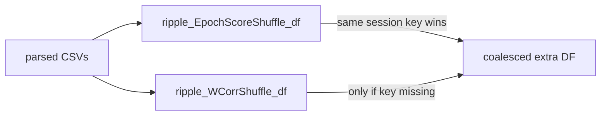

# Prefer EpochScoreShuffle CSVs and drop legacy WCorr export

## Export changes

In [`SequenceBasedComputations.py`](h:/TEMP/Spike3DEnv_ExploreUpgrade/Spike3DWorkEnv/pyPhoPlaceCellAnalysis/src/pyphoplacecellanalysis/General/Pipeline/Stages/ComputationFunctions/MultiContextComputationFunctions/SequenceBasedComputations.py) `DecodedEpochScoreShuffle.export_csvs()`:

```python
export_df_dict = {'ripple_WCorrShuffle_df': wcorr_ripple_shuffle_all_df, 'ripple_EpochScoreShuffle_df': wcorr_ripple_shuffle_all_df}
export_df_dict['ripple_EpochScoreShuffle_long_df'] = all_shuffles_scores_df
```

becomes:

```python
export_df_dict = {'ripple_EpochScoreShuffle_df': wcorr_ripple_shuffle_all_df}
export_df_dict['ripple_EpochScoreShuffle_ByShuffle_df'] = all_shuffles_scores_df
```

Keep `build_all_shuffles_long_scores_dataframe()` as the Python builder (it still means pandas long/tidy). Only the on-disk CSV key changes.

Callers that read those keys:

- [`batch_user_completion_helpers.py`](h:/TEMP/Spike3DEnv_ExploreUpgrade/Spike3DWorkEnv/pyPhoPlaceCellAnalysis/src/pyphoplacecellanalysis/General/Batch/BatchJobCompletion/UserCompletionHelpers/batch_user_completion_helpers.py): drop `ripple_WCorrShuffle_df_export_CSV_path`; rename `*_long_df_export_CSV_path` to `*_ByShuffle_df_export_CSV_path`.
- [`batch_completion_helpers.py`](h:/TEMP/Spike3DEnv_ExploreUpgrade/Spike3DWorkEnv/pyPhoPlaceCellAnalysis/src/pyphoplacecellanalysis/General/Batch/BatchJobCompletion/UserCompletionHelpers/batch_completion_helpers.py) `finalize_output_shuffled_epoch_scores`: `export_files_dict['ripple_WCorrShuffle_df']` will KeyError after this; switch to `ripple_EpochScoreShuffle_df`.

Do **not** load `ByShuffle` CSVs in the paper pipeline (they are `n_metrics × n_epochs × n_shuffles × 4` rows). Filename discovery will still list them; `_new_process_csv_files` will keep the existing “not implemented” warn unless we add a no-op skip.

## Load: prefer `ripple_EpochScoreShuffle_df`

In [`AcrossSessionResults.py`](h:/TEMP/Spike3DEnv_ExploreUpgrade/Spike3DWorkEnv/pyPhoPlaceCellAnalysis/src/pyphoplacecellanalysis/SpecificResults/AcrossSessionResults.py) `_new_process_csv_files`:

- Add `ripple_EpochScoreShuffle_df` to `final_sessions_loaded_extra_df_dict`.
- Load that `file_type` the same way as today’s `ripple_WCorrShuffle_df` (`time_key='start'`).
- Keep loading legacy `ripple_WCorrShuffle_df` as fallback.
- After the loop, for each session key `(session, custom_replay_name, time_bin_size)`, copy a WCorrShuffle entry into the EpochScoreShuffle dict **only if that key is missing**. Then concat. Result: new files win per session/replay/tbin; old files fill gaps.



## Transfer all shuffle-score columns in the notebook

The archive notebook currently hardcodes:

```python
ripple_WCorrShuffle_df = final_sessions_loaded_extra_dfs_dict.get('ripple_WCorrShuffle_df', None)
wcorr_shuffle_relevent_column_names = ['wcorr_z_long', 'wcorr_z_short', 'best_overall_wcorr_z']
```

Add a small helper on `AcrossSessionHelpers` (used by the notebook, not a rewrite of the merge):

- Require `wcorr_z_long` / `wcorr_z_short` when present.
- Build `best_overall_wcorr_z` as today.
- Discover transfer columns already on the shuffle DF: `wcorr_z_long`, `wcorr_z_short`, plus any `{metric}_z_{decoder}`, `{metric}_p_{decoder}`, `{metric}_n_extreme_{decoder}` (from `SCORE_EXTREME_MODE` / decoder names). Skip raw `{metric}_{decoder}` real-score columns; those already live on `ripple_all_scores_merged_df`.
- Optionally add `best_overall_{metric}_z` = `nanmax(abs(z columns))` when that metric has decoder z columns.

Notebook edits in [`PhoDibaPaper2024_FULL_ARCHIVE_2026-08-31.ipynb`](h:/TEMP/Spike3DEnv_ExploreUpgrade/Spike3DWorkEnv/Spike3D/EXTERNAL/PhoDibaPaper2024Book/PhoDibaPaper2024_FULL_ARCHIVE_2026-08-31.ipynb) only:

1. Merge cell: look up `ripple_EpochScoreShuffle_df` (fallback to `ripple_WCorrShuffle_df` if the extra dict still has only the old name).
2. Pass the discovered transfer list into `_subfn_perform_add_merged_complete_epoch_stats_df`.
3. Time-bin cell (~line 1064): extend `desired_transfer_col_names` with those same extra columns instead of only the three wcorr z names.
4. Inspection cell that filters `file_type == 'ripple_WCorrShuffle_df'`: also show `ripple_EpochScoreShuffle_df`.

Leave commented filename-parser examples that mention `ripple_WCorrShuffle_df` alone.

## Out of scope

- Loading `ripple_EpochScoreShuffle_ByShuffle_df`.
- Rewriting `_subfn_perform_add_merged_complete_epoch_stats_df`.
- Other notebooks (`ReviewOfWork_*`, `PostBatchCopyResults.ipynb`) unless you want those globs updated in a follow-up (`*ripple_WCorrShuffle_df*.csv` will miss the new wide files).
