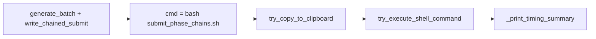

# Failsafe run chained-submit after batch generation

## Context

In [`ProcessBatchOutputs_qclus1246789_Only.ipy`](h:\TEMP\Spike3DEnv_ExploreUpgrade\Spike3DWorkEnv\Spike3D\ProcessBatchOutputs_qclus1246789_Only.ipy), the non-Windows path already builds `submit_phase_chains_{CHAIN_SUBMIT_STAMP}.sh` and copies this exact line to the clipboard:

```636:637:h:\TEMP\Spike3DEnv_ExploreUpgrade\Spike3DWorkEnv\Spike3D\ProcessBatchOutputs_qclus1246789_Only.ipy
    try_copy_to_clipboard(f"bash '{chained_submit_path}'", label='chained_submit')
    _time_checkpoint('copy_to_clipboard:chained_submit')
```

That covers **GL** (`batch_execution_target == 'slurm'`, `_phase_chain_backend == 'slurm'`) and **Lab** (`linux_standalone`, `_phase_chain_backend == 'bash'`) — same clipboard string in both cases. Windows stays clipboard-only (`powershell -File …`); no change there.

Existing clipboard helper (headless-safe) lives in [`pythonScriptTemplating.py`](h:\TEMP\Spike3DEnv_ExploreUpgrade\Spike3DWorkEnv\pyPhoPlaceCellAnalysis\src\pyphoplacecellanalysis\General\Batch\pythonScriptTemplating.py) as `try_copy_to_clipboard` (~1039).



## Implementation

### 1. Shared helper (minimal, next to clipboard helper)

**File:** [`pythonScriptTemplating.py`](h:\TEMP\Spike3DEnv_ExploreUpgrade\Spike3DWorkEnv\pyPhoPlaceCellAnalysis\src\pyphoplacecellanalysis\General\Batch\pythonScriptTemplating.py)

Add `try_execute_shell_command(code_str: str, label: str) -> None` immediately after `try_copy_to_clipboard`:

- `import subprocess` inside the function (matches lazy import style of `try_copy_to_clipboard`).
- Print one line: attempting to run `(label)` and `code_str`.
- `subprocess.run(code_str, shell=True, check=False)` — same pattern as [`ProcessBatchOutputs_NWB_WMaze_Batch.ipy`](h:\TEMP\Spike3DEnv_ExploreUpgrade\Spike3DWorkEnv\Spike3D\ProcessBatchOutputs_NWB_WMaze_Batch.ipy) `execute_bash_scripts`, but **no raise** on nonzero exit.
- On nonzero `returncode`: print `WARN: … exit {code}; continuing.`
- Broad `except Exception as e`: print `WARN: could not run … ({type}): {e}; continuing.`
- Never re-raise; notebook always reaches `_print_timing_summary()`.

No new dependencies; no changes to `try_copy_to_clipboard` behavior.

### 2. Wire into the `.ipy` (Linux/macOS chained-submit block only)

**File:** [`ProcessBatchOutputs_qclus1246789_Only.ipy`](h:\TEMP\Spike3DEnv_ExploreUpgrade\Spike3DWorkEnv\Spike3D\ProcessBatchOutputs_qclus1246789_Only.ipy)

- Extend import on line 61: add `try_execute_shell_command`.
- In the `if (platform.system() != 'Windows') and (len(phase_collections) > 0):` block (~619–637):
  - Bind once: `_chained_submit_shell_cmd = f"bash '{chained_submit_path}'"`.
  - `try_copy_to_clipboard(_chained_submit_shell_cmd, label='chained_submit')`.
  - `try_execute_shell_command(_chained_submit_shell_cmd, label='chained_submit')`.
  - Optional timing line: `_time_checkpoint('try_execute:chained_submit')` (consistent with clipboard checkpoint).

**Out of scope:** Windows branch, per-phase flat `sbatch` print blocks, other notebooks.

## Git branches (when executing)

Per workspace plan-branch rule, before edits:

- `plan/failsafe-chained-submit-run` in **Spike3D** and **pyPhoPlaceCellAnalysis** (checkout/create from each repo’s default branch).

## Verification (manual)

- On a Linux/GL login node (or Lab): run the `.ipy` through the chained-submit section; expect clipboard attempt, then `Attempting to run (chained_submit): bash '…'` and either normal submit output or a `WARN` line if `bash`/script/slurm is unavailable — notebook must still finish and print timing summary.
- On Windows: behavior unchanged (no auto-run).

## Risk note (informational)

Auto-run on GL **submits real Slurm jobs** when the script runs successfully. You chose **always try** (no opt-out flag). Failures remain non-fatal only.
