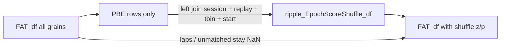

# Post-hoc shuffle merge onto FAT_df

Do this in memory after both CSVs are loaded. Do not rewrite batch FAT export, and do not put `ByShuffle` rows into FAT.

## Helper

Add `AcrossSessionHelpers.merge_epoch_score_shuffle_onto_fat_df(fat_df, shuffle_df)` next to [`prepare_epoch_score_shuffle_transfer_columns`](h:/TEMP/Spike3DEnv_ExploreUpgrade/Spike3DWorkEnv/pyPhoPlaceCellAnalysis/src/pyphoplacecellanalysis/SpecificResults/AcrossSessionResults.py).

Use a pandas `how='left'` merge (same idea as [`_helper_merge_heuristic_columns_onto_per_epoch_df`](h:/TEMP/Spike3DEnv_ExploreUpgrade/Spike3DWorkEnv/pyPhoPlaceCellAnalysis/src/pyphoplacecellanalysis/Analysis/Decoder/context_dependent.py)), not the slow itertuples path in `_subfn_perform_add_merged_complete_epoch_stats_df`.

Behavior:

- Return `fat_df` unchanged if `shuffle_df` is None/empty.
- Call `prepare_epoch_score_shuffle_transfer_columns` for transfer cols (`wcorr_z_long`/`short`, `{metric}_z/p/n_extreme_{decoder}`, `best_overall_*_z`). Skip raw `{metric}_{decoder}` scores.
- Do not overwrite columns already on FAT.
- Normalize `session_name` / `custom_replay_name` the same way as the existing merge (`_` to `-`, `ExportValueNameCleaner`).
- Left start column, first extant: `parent_epoch_start_t`, `epoch_start_t`, `ripple_start_t`, `start`. Right side uses shuffle `start`.
- Join keys: those start times plus `session_name`, `custom_replay_name`, and `time_bin_size` when both frames have it.
- Only fill rows whose `known_named_decoding_epochs_type` is `pbe` or `ripple` (avoids accidental lap-start collisions). `per_time_bin` PBE rows still match via `parent_epoch_start_t`.
- `drop_duplicates` on the right join keys. Assert FAT row count is unchanged. Print how many PBE rows matched.

## Notebook

In [`PhoDibaPaper2024_FULL_ARCHIVE_2026-08-31.ipynb`](h:/TEMP/Spike3DEnv_ExploreUpgrade/Spike3DWorkEnv/Spike3D/EXTERNAL/PhoDibaPaper2024Book/PhoDibaPaper2024_FULL_ARCHIVE_2026-08-31.ipynb), after `FAT_df` is initialized from `all_sessions_laps_time_bin_df`, call the helper with `ripple_EpochScoreShuffle_df` from `final_sessions_loaded_extra_dfs_dict` (legacy fallback `ripple_WCorrShuffle_df`).

Do not write a new FAT CSV unless you later ask for that.
