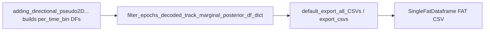

# Add measured position columns to per-time-bin FAT exports

## Goal

For `data_grain='per_time_bin'` **laps and PBEs**, attach measured position columns (`x_meas`, `y_meas`, `binned_x_meas`, plus the helper’s existing decoded companions) onto the marginal DFs that feed FAT, using the existing interpolation helper.

## Data flow (unchanged export)



## Changes

### 1. Fix multi-epoch concat in helper

File: [`DirectionalPlacefieldGlobalComputationFunctions.py`](h:/TEMP/Spike3DEnv_ExploreUpgrade/Spike3DWorkEnv/pyPhoPlaceCellAnalysis/src/pyphoplacecellanalysis/General/Pipeline/Stages/ComputationFunctions/MultiContextComputationFunctions/DirectionalPlacefieldGlobalComputationFunctions.py)

In `_helper_add_interpolated_position_columns_to_decoded_result_df` (~8232–8238), replace use of `measured_positions_dfs_list[0]` / `decoded_positions_df_list[0]` with `pd.concat(..., ignore_index=True)` over the full lists, then rename/bin as today.

This is required for multi-lap / multi-PBE time-bin DFs; current `[0]` only covers the first epoch.

### 2. Enrich per-time-bin DFs at build site

File: [`context_dependent.py`](h:/TEMP/Spike3DEnv_ExploreUpgrade/Spike3DWorkEnv/pyPhoPlaceCellAnalysis/src/pyphoplacecellanalysis/Analysis/Decoder/context_dependent.py)

In `adding_directional_pseudo2D_decoder_results_filtered_by_spikes_per_t_bin_masked` (~383):

- Add optional kwarg: `global_measured_position_df: Optional[pd.DataFrame] = None`
- After the existing `most_likely_positions_1D` block (~519–530), when **both**:
  - `a_known_data_grain == 'per_time_bin'` (covers laps and pbe via the outer loop)
  - `global_measured_position_df is not None`
- Call `_helper_add_interpolated_position_columns_to_decoded_result_df` on `a_dropping_masked_decoded_marginal_posterior_df` with `a_dropping_masked_pseudo2D_continuous_specific_decoded_result` and `all_directional_pf1D_Decoder`
- Wrap in the same try/except style as `most_likely_positions_1D` so failures warn and continue

No change for `per_epoch`. No change to export path.

### 3. Pass session position from the pipeline call site

Same file, ~1235 (caller that already has `curr_active_pipeline`):

```python
a_new_fully_generic_result = a_new_fully_generic_result.adding_directional_pseudo2D_decoder_results_filtered_by_spikes_per_t_bin_masked(
    directional_merged_decoders_result=directional_merged_decoders_result,
    global_measured_position_df=deepcopy(curr_active_pipeline.sess.position.to_dataframe()),
)
```

Also set `a_new_fully_generic_result.pos_df` to that same position df (field already exists at ~182, currently unused).

## Out of scope

- Notebook / across-session plotting overlays
- Re-exporting historical FAT CSVs (needs recompute + re-run of `generalized_decode_epochs_dict_and_export_results_completion_function`)
- Phase-4 “dropped” remask path (~1318) — leave as-is unless measured columns are missing there after validation; primary FAT build path is the method above
- Renaming to `meas_x` — keep existing `x_meas` convention from the helper
