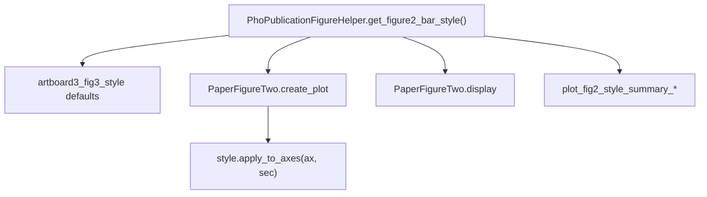

# Figure 2 bar publication styling (single style getter)

## Problem

Legacy Figure 2 (`PaperFigureTwo.create_plot` / `display`) uses `prepare_for_publication` for fonts only, while global notebook rc (e.g. NeuroPy `figPublish` `axes.linewidth=2`) controls spines. Summary bars already wrap `create_plot` in publication rc + post axis tuning, but values live in duplicated nested helpers (`_fig3_label_rc`, `_apply_fig3_axis_label_sizes`).

**Goal:** One function you open to see and change **all** Figure 2 bar styling; plot code only calls `get_figure2_bar_style()` and applies what it returns.

## Central API (primary design)

Add on [`PhoPublicationFigureHelper`](h:\TEMP\Spike3DEnv_ExploreUpgrade\Spike3DWorkEnv\pyPhoPlaceCellAnalysis\src\pyphoplacecellanalysis\SpecificResults\PhoDiba2023Paper.py) (~11028):

### `get_figure2_bar_style(prepare_for_publication: bool = True, resolution_multiplier: float = 1.0, **mpl_rc_overrides) -> Figure2BarPublicationStyle`

Use a `@define` or `@dataclass` **frozen-style** object (or `TypedDict` if you prefer minimal deps) returned by the getter. **All numeric defaults for Fig 2 bars are defined inside this function** (sourced from existing `artboard3_fig3_style` today, not scattered at call sites).

Suggested fields (single place to inspect/change):

| Field | Purpose |
|-------|---------|
| `mpl_rc` | Full dict for `mpl.rc_context(...)`: merge `rc_context_kwargs(prepare_for_publication)`, label sizes, `axes.linewidth`, `lines.linewidth`, `patch.linewidth`, `svg.fonttype`, caller `**mpl_rc_overrides` |
| `title_font_size`, `subtitle_font_size`, `bold_epochs_name` | Passed into `create_plot` / flexitext (Artboard 3 `track_title` / `title_body`, scaled by `resolution_multiplier`) |
| `tick_labelsize`, `axis_labelsize` | Tick and axis label pt sizes (scaled) |
| `axes_linewidth`, `tick_width`, `tick_length` | Spines, ticks, error bars, brackets, bar edges |
| `xtick_subgroup_labelsize`, `xtick_group_labelsize` | Grouped LdCs/SdCs tier (default both from `tick_labelsize` unless you split later in the getter only) |
| `bar_linewidth`, `errorbar_linewidth` | Explicit kwargs for `ax.bar` / `ax.errorbar` (same as `axes_linewidth`) |

When `prepare_for_publication=False`, return a **minimal** style object (empty or passthrough `mpl_rc`, no overrides) so non-publication behavior is unchanged.

### `Figure2BarPublicationStyle.apply_to_axes(ax, secondary_xaxis=None)`

Single apply helper on the style object (or module-level function taking `style`):

- `ax.tick_params(axis='both', labelsize=style.tick_labelsize, width=style.tick_width, length=style.tick_length)`
- `ax.xaxis.label.set_size(style.axis_labelsize)` / y-axis same
- `ax.spines['left'|'bottom'].set_linewidth(style.axes_linewidth)`
- If `secondary_xaxis` (group labels): `secondary_xaxis.tick_params(axis='x', labelsize=style.xtick_group_labelsize)` (match current summary-bar behavior)

### Convenience on the style object

- `create_plot_kwargs()` → dict of kwargs to splat into `PaperFigureTwo.create_plot` when publishing (`title_font_size`, `subtitle_font_size`, etc.)
- `rc_context()` → context manager wrapping `mpl.rc_context(self.mpl_rc)` (optional sugar for `display`)

**Do not** add separate `publication_bar_label_rc`, `publication_bar_figure_rc`, `publication_bar_title_kwargs` as public APIs—keep them as private helpers **inside** `get_figure2_bar_style` if splitting aids readability, or inline in the getter body.

## Call-site changes (thin)

### `PaperFigureTwo.create_plot`

When `prepare_for_publication`:

1. `style = PhoPublicationFigureHelper.get_figure2_bar_style(True, resolution_multiplier=resolution_multiplier)` (honor explicit `title_font_size` kwargs over style defaults).
2. Use `style.bar_linewidth` on `ax.bar`, `style.errorbar_linewidth` on error bars.
3. Replace inline block ~6819–6828 with values from `style` for grouped x label sizes.
4. After `_apply_publication_grouped_xticklabels`, `style.apply_to_axes(ax, text_objects.get('publication_xgroup_axis'))`.

### `PaperFigureTwo.display`

1. `style = get_figure2_bar_style(prepare_for_publication, resolution_multiplier=kwargs.get('resolution_multiplier', 1.0), svg.fonttype='none', ...)`.
2. `with style.rc_context():` (or `mpl.rc_context(style.mpl_rc)`) around theta/replay plot, optional labels, `add_significance_bars`, AnyC inset.
3. Pass `**style.create_plot_kwargs()` into `fig_2_*_matplotlib` when publishing.

### Summary bars (`plot_fig2_style_summary_four_bar`, `plot_fig2_style_summary_four_bar_by_time_bin`)

- Delete nested `_fig3_label_rc` / `_apply_fig3_axis_label_sizes`.
- Use the same `get_figure2_bar_style` + `apply_to_axes` + `mpl_rc` as legacy Fig 2.

## `add_significance_bars`

Prefer relying on `style.mpl_rc['lines.linewidth']` inside `display`'s rc_context. Add optional `linewidth` on `add_significance_bars` only if testing shows rc is not enough.

## Test

New [`pyPhoPlaceCellAnalysis/tests/test_paper_figure_two_publication_style.py`](h:\TEMP\Spike3DEnv_ExploreUpgrade\Spike3DWorkEnv\pyPhoPlaceCellAnalysis\tests\):

- Assert `get_figure2_bar_style(True).axes_linewidth == artboard3_fig3_style['axes']['linewidth']`.
- Minimal `create_plot(..., prepare_for_publication=True)` → spine linewidth equals `style.axes_linewidth`.

## Manual verification

Re-export Fig 2 SVG: spines/brackets/error bars **0.75 pt**, not 2 / 1.5; title sizes match Artboard 3.

## Files touched

- [`PhoDiba2023Paper.py`](h:\TEMP\Spike3DEnv_ExploreUpgrade\Spike3DWorkEnv\pyPhoPlaceCellAnalysis\src\pyphoplacecellanalysis\SpecificResults\PhoDiba2023Paper.py) — style type + getter + `create_plot` / `display` / summary-bar callers
- New test file under `pyPhoPlaceCellAnalysis/tests/`
- No change to NeuroPy `Fig.get_mpl_style('figPublish')` (Fig 2 overrides locally via `style.mpl_rc`)

## Future edits (document in getter docstring)

> To change Figure 2 bar line weights, fonts, or rc defaults, edit **`PhoPublicationFigureHelper.get_figure2_bar_style`** only.
