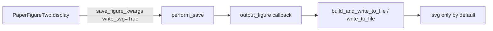

# Figure 2 default export: SVG instead of PDF/PNG

## Current behavior

[`PaperFigureTwo.display()`](h:\TEMP\Spike3DEnv_ExploreUpgrade\Spike3DWorkEnv\pyPhoPlaceCellAnalysis\src\pyphoplacecellanalysis\SpecificResults\PhoDiba2023Paper.py) saves both Laps and PBE panels via `_perform_write_to_file_callback()` → `perform_save()` → whatever was bound in `compute()`:

- Single-session: `curr_active_pipeline.output_figure` ([`Display.py`](h:\TEMP\Spike3DEnv_ExploreUpgrade\Spike3DWorkEnv\pyPhoPlaceCellAnalysis\src\pyphoplacecellanalysis\General\Pipeline\Stages\Display.py) defaults: `write_vector_format=False`, `write_png=True`, `write_svg=False`)
- Across-session: `AcrossSessionsVisualizations.output_figure` ([`AcrossSessionResults.py`](h:\TEMP\Spike3DEnv_ExploreUpgrade\Spike3DWorkEnv\pyPhoPlaceCellAnalysis\src\pyphoplacecellanalysis\SpecificResults\AcrossSessionResults.py) defaults: PDF **and** PNG on, SVG off)

`perform_save()` currently forwards **no** format kwargs, so both code paths inherit pipeline/across-session defaults (PNG always; PDF for across-session).

```7088:7091:h:\TEMP\Spike3DEnv_ExploreUpgrade\Spike3DWorkEnv\pyPhoPlaceCellAnalysis\src\pyphoplacecellanalysis\SpecificResults\PhoDiba2023Paper.py
        def _perform_write_to_file_callback():
            ## 2023-05-31 - Reference Output of matplotlib figure to file, along with building appropriate context.
            return (self.perform_save(_fig_2_theta_out.context, _fig_2_theta_out.figures[0]), 
                    self.perform_save(_fig_2_replay_out.context, _fig_2_replay_out.figures[0]))
```

SVG support already exists in [`write_to_file()`](h:\TEMP\Spike3DEnv_ExploreUpgrade\Spike3DWorkEnv\pyPhoPlaceCellAnalysis\src\pyphoplacecellanalysis\General\Mixins\ExportHelpers.py) (`write_svg=True` → `fig.savefig(..., format='svg')` with `svg.fonttype: none`).

## Target behavior (match existing paper pattern)

Reuse the same defaults as Fig-2-style summary helpers in the same file (e.g. `plot_fig2_style_summary_four_bar` ~line 2133):

- `write_vector_format=False` (no PDF)
- `write_png=False`
- `write_svg=True`

Callers can still opt back into PDF/PNG via explicit kwargs on `display()`.

## Implementation (minimal, in `PaperFigureTwo` only)

**File:** [`PhoDiba2023Paper.py`](h:\TEMP\Spike3DEnv_ExploreUpgrade\Spike3DWorkEnv\pyPhoPlaceCellAnalysis\src\pyphoplacecellanalysis\SpecificResults\PhoDiba2023Paper.py) (`PaperFigureTwo`, ~6975–7095)

1. **Extend `display()` signature** with export defaults (single line per user signature rule if it fits):

   `write_vector_format: bool = False, write_png: bool = False, write_svg: bool = True`

2. **Build `save_figure_kwargs`** near the top of `display()` (after popping `include_non_XdC_cells_as_inset`):

   - Include the three `write_*` flags.
   - Optionally merge `bbox_inches` / `pad_inches` from `kwargs` via existing `pop_dict_subset` pattern (same as `PAPER_FIGURE_figure_1_full` ~6073) so publication cropping kwargs still reach `savefig`.

3. **Pass kwargs into saves** inside `_perform_write_to_file_callback()`:

   ```python
   return (
       self.perform_save(_fig_2_theta_out.context, _fig_2_theta_out.figures[0], **save_figure_kwargs),
       self.perform_save(_fig_2_replay_out.context, _fig_2_replay_out.figures[0], **save_figure_kwargs),
   )
   ```

4. **Docstring note** on `display()`: default save formats are SVG-only; override with `write_png=True` / `write_vector_format=True` if needed.

No changes to global `output_figure` defaults, `AcrossSessionResults`, or `create_plot()` — format control stays localized to Figure 2’s save path.

## Verification

- After change, run a single-session path (e.g. `PaperFigureTwo(...).compute(...).display(save_figure=True)`) and confirm console logs show only `.svg` under the session figure output path (no `.png` / `.pdf`).
- Run `AcrossSessionsVisualizations.across_sessions_bar_graphs(..., save_figure=True)` and confirm aggregate Fig 2 saves as SVG only (callback still `cls.output_figure`, but now receives explicit kwargs from `display()`).
- Optional: `display(..., write_png=True)` still writes PNG when explicitly requested.


