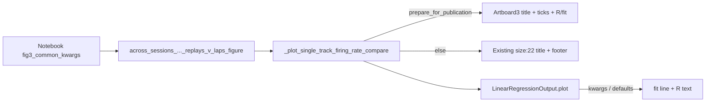

# Fig3 Artboard-3 publication styles

## Goal
Notebook call to `AcrossSessionsVisualizations.across_sessions_long_and_short_firing_rate_replays_v_laps_figure(..., prepare_for_publication=True)` should emit long/short panels matching [Artboard 3.pdf](E:\Dropbox (Personal)\Active\Kamran Diba Lab\Pho-Kamran-Meetings\Pho Diba Paper 2023\Figures\Artboard 3.pdf) without post-hoc Illustrator edits.

## Approach
Gate all new styling on `prepare_for_publication=True` inside `_plot_single_track_firing_rate_compare`. Do **not** change global `PhoPublicationFigureHelper.rc_context_kwargs` (would affect Fig2 ticks). Extend `LinearRegressionOutput.plot` with optional kwargs that default to today’s red line / black `R =` text.

## 1. Style constants on `PhoPublicationFigureHelper`
File: [PhoDiba2023Paper.py](h:\TEMP\Spike3DEnv_ExploreUpgrade\Spike3DWorkEnv\pyPhoPlaceCellAnalysis\src\pyphoplacecellanalysis\SpecificResults\PhoDiba2023Paper.py)

Add a class-level dict (names from PDF extract), e.g. `artboard3_fig3_style`:
- colors: `long=#4D69B1`, `short=#DC1E3D`, `title_body=#231F20`, `r_fit=#7900B3`, `marker=#333333`
- sizes: track title `9.087`, title body/rate `8.077`, axis `7`, ticks `6`, R `8`
- axes: linewidth/`tick` width `0.75`, tick length `3.5`
- scatter defaults for pub path documentation only (notebook may still pass `s=5`)

## 2. Make `LinearRegressionOutput.plot` kwargs-complete
Same file (~1629). Replace the lambda with a small real method/function that:
- plots the regression line with `dict(color='red', alpha=0.7, lw=0.5) | line_kwargs` (current default unchanged)
- draws `R = {r:.3f}` with `dict(fontsize=8, color='black', alpha=0.9, va='top') | r_text_kwargs`
- accepts `**kwargs` merged into the line plot (existing call sites keep working)

Call sites that pass nothing ([`_plot_long_short_firing_rate_indicies`](h:\TEMP\Spike3DEnv_ExploreUpgrade\Spike3DWorkEnv\pyPhoPlaceCellAnalysis\src\pyphoplacecellanalysis\General\Pipeline\Stages\DisplayFunctions\MultiContextComparingDisplayFunctions\LongShortTrackComparingDisplayFunctions.py) ~2319 and non-styled callers) stay red/black.

## 3. Publication styling in `_plot_single_track_firing_rate_compare`
File: [LongShortTrackComparingDisplayFunctions.py](h:\TEMP\Spike3DEnv_ExploreUpgrade\Spike3DWorkEnv\pyPhoPlaceCellAnalysis\src\pyphoplacecellanalysis\General\Pipeline\Stages\DisplayFunctions\MultiContextComparingDisplayFunctions\LongShortTrackComparingDisplayFunctions.py) (~3057–3169)

- Fix param shadowing so the named `prepare_for_publication` is honored:
  `prepare_for_publication = scatter_params.pop('prepare_for_publication', prepare_for_publication)`
- When `prepare_for_publication`:
  - Map `filter_name` / `track_name` containing `short` → color `#DC1E3D` / label `short`; else → `#4D69B1` / `long`
  - Replace pub flexitext with Artboard markup, e.g.  
    `<size:9.087><color:#4D69B1, weight:bold>long</></><size:8.077><color:#231F20> laps|PBEs </><weight:bold>rate</></>`
  - `ax.tick_params(labelsize=6, width=0.75, length=3.5)` and spine linewidth `0.75` on left/bottom
  - Call `_lin_reg.plot(ax=ax, color='#7900B3', alpha=1.0, lw=0.5, r_text_kwargs=dict(color='#7900B3', alpha=1.0, fontsize=8))`
- Keep non-publication branch (`size:22`, footer) and default `s=18` / `s=36` unchanged
- Axis label fontsize `7` already correct for pub; leave as-is

## 4. No notebook edits in this task
Library-only. Notebook already passes `prepare_for_publication=True`, `s=5`, `point_colors` default `#33333333`. After the change, regenerating with existing `fig3_common_kwargs` should pick up titles/R/ticks/spines automatically.

## Out of scope
- Panel letters `a`/`b` (added at layout/concat time in Illustrator)
- Changing `PhoPublicationFigureHelper.rc_context_kwargs` tick size for all figures
- Column-name choices (`long_non_replay_mean` vs `lap_delta_*`) — caller responsibility
