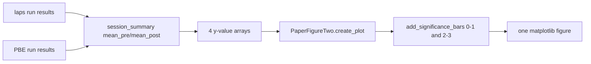

# Fig2-style 4-bar P_Short summary plot

All edits stay in [PhoDiba2023Paper.py](h:\TEMP\Spike3DEnv_ExploreUpgrade\Spike3DWorkEnv\pyPhoPlaceCellAnalysis\src\pyphoplacecellanalysis\SpecificResults\PhoDiba2023Paper.py).

Do **not** port the notebook `plot_fig4_summary_box_plot` (that pipeline drops `clear_LONG` PBEs from `InstantaneousSpikeRateGroupsComputation` and plots LxC/SxC firing rates). This plot uses `run()` `session_summary` means.



## Layout

One panel, same 4-bar geometry as Figure 2:

- Bar 0/1: Laps pre-Δ / post-Δ (blue pair)
- Bar 2/3: PBE pre-Δ / post-Δ (red pair)
- Each point is one session’s `mean_pre` or `mean_post`
- Publication x-axis: `pre-Δ` / `post-Δ` under each bar, group labels `Laps` / `PBEs` under each pair
- Significance brackets use the existing permutation `p_value` from each `run()` dict (not a new t-test)

Y-axis: `Session-mean $P_{Short}$`. Values are in `[0, 1]`; keep the existing floor at 0.

## 1. Small `PaperFigureTwo` hooks (backward compatible)

[`PaperFigureTwo.create_plot`](h:\TEMP\Spike3DEnv_ExploreUpgrade\Spike3DWorkEnv\pyPhoPlaceCellAnalysis\src\pyphoplacecellanalysis\SpecificResults\PhoDiba2023Paper.py) currently hardcodes the Long/Short subtitle, `LdCs`/`SdCs` group labels, and xlabel `"Neuron Track Dominance Classification"`. Pop optional kwargs so Fig2 callers stay unchanged:

- `_apply_publication_grouped_xticklabels(ax, group_labels=('LdCs', 'SdCs'))`
- `_build_formatted_title_string(..., subtitle=None)` — default remains the Long/Short cells line
- `create_plot` kwargs: `publication_group_labels`, `title_subtitle`, `metric_name`, `xlabel`

Existing `fig_2_Theta_FR_matplotlib` / `fig_2_Replay_FR_matplotlib` do not pass these, so Figure 2 is unchanged.

## 2. New classmethod on `PrePostDeltaDistributionComparison`

Add it after `compute_ordinal_mode_shift` (around line 1881), before `FigureS8`. Import `PaperFigureTwo` inside the method because that class is defined later in the same file.

Signature (grouped continuation lines, two blank lines around the method):

```python
@classmethod
def plot_fig2_style_summary_four_bar(cls, laps_results, pbe_results,
    pre_col: str = 'mean_pre', post_col: str = 'mean_post', animal_col: str = 'animal',
    laps_p_value: Optional[float] = None, pbe_p_value: Optional[float] = None,
    ylabel: str = 'Session-mean $P_{Short}$', title: str = 'Decoded $P_{Short}$',
    group_labels: Tuple[str, str] = ('Laps', 'PBEs'), prepare_for_publication: bool = True,
    defer_show: bool = False, save_figure: bool = False, export_folder: Optional[Path] = None,
    fig_file_name: str = 'figure4_summary_four_bar', active_context: Optional[IdentifyingContext] = None,
    enable_paired_lines: bool = True, debug_print: bool = False, **kwargs) -> Dict[str, Any]:
```

Behavior:

- Coerce each of `laps_results` / `pbe_results` from either a `run()` dict (`session_summary` + `p_value`) or a `session_summary` DataFrame. Raise if `session_summary` is missing (needs `sampling_unit='session'`).
- Drop NaNs on `pre_col`/`post_col`.
- Build four float arrays: laps pre, laps post, PBE pre, PBE post.
- Scatter markers by `animal` (same filled-marker set as `InstantaneousFiringRatesDataframeAccessor.build_shell_object_for_plot`).
- Call `PaperFigureTwo.create_plot(...)` with the new kwargs (`publication_group_labels=group_labels`, `metric_name='Session Means'`, Fig4 subtitle, empty xlabel).
- Draw optional gray paired pre→post lines using the jittered x from `plot_data`.
- `add_significance_bars` on 0–1 and 2–3 using `laps_p_value` / `pbe_p_value` (or the values pulled from the result dicts), `y = nanmax` of the four arrays.
- Optional `fig.savefig` to `export_folder / f'{fig_file_name}.pdf'` (single panel; no PDF concat).

Return dict: `fig`, `ax`, `render`, `laps_session_summary`, `pbe_session_summary`, `y_values`, `laps_p_value`, `pbe_p_value`, `saved_path`.

Usage against `FigureS8.main` outputs:

```python
out = PrePostDeltaDistributionComparison.plot_fig2_style_summary_four_bar(
    pre_post_delta_stats_results_dict['_perTimeBin_Laps'],
    pre_post_delta_stats_results_dict['_perTimeBin_PBEs'],
)
out['fig']
```

Do not wire this into `FigureS8.main` unless you ask for that next.

## 3. Check

Import-check the module. No notebook edits. No new tests file unless a tiny synthetic `session_summary` smoke call is easy via `uv run`.
