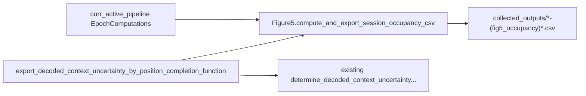

# Fig5 occupancy CSV via existing batch hook

## Goal

Keep every current export (including posteriors elsewhere and this hook’s existing context-uncertainty CSV/PNG). Extend [`export_decoded_context_uncertainty_by_position_completion_function`](h:\TEMP\Spike3DEnv_ExploreUpgrade\Spike3DWorkEnv\pyPhoPlaceCellAnalysis\src\pyphoplacecellanalysis\General\Batch\BatchJobCompletion\UserCompletionHelpers\batch_user_completion_helpers.py) so each session also writes a **`(fig5_occupancy)` CSV** directly under `self.collected_outputs_path`, ready for Globus transfer and paper-notebook stacking with `split_by_session=True`.

## Chosen defaults

- **Format:** long-form `.csv` (not H5), named via `curr_active_pipeline.build_complete_session_identifier_filename_string(..., data_identifier_str='(fig5_occupancy)', out_extension='.csv')` into **`collected_outputs` root** (same pattern as other batch CSVs; parseable by `find_most_recent_files`).
- **Decoded definition:** simultaneous, decoder-split occupancy from EpochComputations Pseudo2D flatten (`use_all_decoders_simultaneously_occupancy=True`); not most-likely-decoder gating.
- **Measured:** decode-bin-aligned `binned_x_meas` via `_helper_add_interpolated_position_columns_to_decoded_result_df` on that session’s `xbin` (no cross-session cm remap).
- **Epochs:** `laps` and `pbe` with `masked_time_bin_fill_type='nan_filled'`, `trained_compute_epochs='laps'`, matching `time_bin_size` already passed into this completion function.
- **Periods:** `pre-delta`, `post-delta`, `all` from `delta_aligned_start_t` / `find_LongShortDelta_times()`.



## 1. Add pipeline→CSV helpers on `Figure5`

File: [`PhoDiba2023Paper.py`](h:\TEMP\Spike3DEnv_ExploreUpgrade\Spike3DWorkEnv\pyPhoPlaceCellAnalysis\src\pyphoplacecellanalysis\SpecificResults\PhoDiba2023Paper.py) (`Figure5` class)

Add:

```python
@classmethod
def compute_session_occupancy_long_df_from_pipeline(cls, curr_active_pipeline, time_bin_size: float, ...) -> pd.DataFrame:

@classmethod
def export_session_occupancy_csv(cls, curr_active_pipeline, parent_output_path: Path, time_bin_size: float, output_date_str: Optional[str] = None, ...) -> Path:
```

`compute_session_occupancy_long_df_from_pipeline` will:

1. Read `EpochComputations.a_generic_decoder_dict_decoded_epochs_dict_result`.
2. For each of `laps`, `pbe`: query Pseudo2D `per_time_bin` result at `time_bin_size` + `nan_filled`; interpolate measured position; build pre/post/all masks.
3. Decoded: from `a_result.flatten()` → `(n_pos, n_decoders, n_t)`; for each decoder and period, `occupancy_seconds = nansum(p[:, d, t_mask], axis=-1) * time_bin_size`.
4. Measured: histogram `binned_x_meas` (1-indexed) with `groupby(...).size() * time_bin_size` (or `time_bin_size` column if present); for PBEs export measured only where non-null (zeros if empty).
5. Return a long DataFrame with columns:

- identity: `session_name`, `session_uid`, `format_name`, `animal`, `exper_name`, `t_delta`, `time_bin_size`, `n_pos`
- panel: `epoch_type` (`laps`/`PBEs`), `pre_post_delta` (`pre-delta`/`post-delta`/`all`), `source` (`measured` or decoder name `long_LR`/`long_RL`/`short_LR`/`short_RL`)
- values: `pos_bin_idx` (1..n_pos), `occupancy_seconds`, `occupancy_frac`
- geometry: `xbin_center` (from decoder `xbin_centers`)

`export_session_occupancy_csv` writes that DF with the standard batch filename and returns the path; also `register_output_file` when possible.

Reuse existing Figure5 helpers where cheap (`occupancy_vector_from_binned_x` pattern / normalize); do not change H5-based `compute_decoded_occupancy`.

## 2. Extend the completion function only

File: [`batch_user_completion_helpers.py`](h:\TEMP\Spike3DEnv_ExploreUpgrade\Spike3DWorkEnv\pyPhoPlaceCellAnalysis\src\pyphoplacecellanalysis\General\Batch\BatchJobCompletion\UserCompletionHelpers\batch_user_completion_helpers.py) lines ~3139–3162

- Keep the existing `determine_decoded_context_uncertainty_as_fn_of_position(...)` try/except unchanged.
- After it succeeds or fails, run a **separate** try/except that calls `Figure5.export_session_occupancy_csv(..., parent_output_path=self.collected_outputs_path.resolve(), time_bin_size=time_bin_size, output_date_str=self.BATCH_DATE_TO_USE)`.
- Merge into callback dict, e.g. `{'partition_keys': ..., 'error': ..., 'fig5_occupancy_csv_path': ..., 'fig5_occupancy_error': ...}` so Fig5 failure does not erase uncertainty results (and vice versa). Re-raise only when `self.fail_on_exception` and the failing branch is the one that raised.
- Update docstring/tags/`uses` to mention `Figure5.export_session_occupancy_csv`.
- Do **not** modify posterior H5 exporters, other completion functions, or ProcessBatchOutputs registration (this hook is already wired).

## 3. Thin paper-notebook load helper

On `Figure5`, add `load_occupancy_long_csvs_to_session_nested_dicts(csv_paths) -> (decoded_seconds_by_session, measured_seconds_by_session)` that pivots long CSVs into the session-nested shape `Figure5.main(..., split_by_session=True)` already expects (`{session: {pre/post/all: {laps|PBEs: vec|decoder-dict}}}`). No notebook edits in this change.

## Out of scope

- Removing or changing `(decoded_posteriors)` H5 export
- Changing uncertainty CSV/PNG behavior under `collected_outputs/output/`
- Cross-session cm remapping / aggregated (non-split) Fig5
- ProcessBatchOutputs `.ipy` edits (already calls this function with `time_bin_size`)
