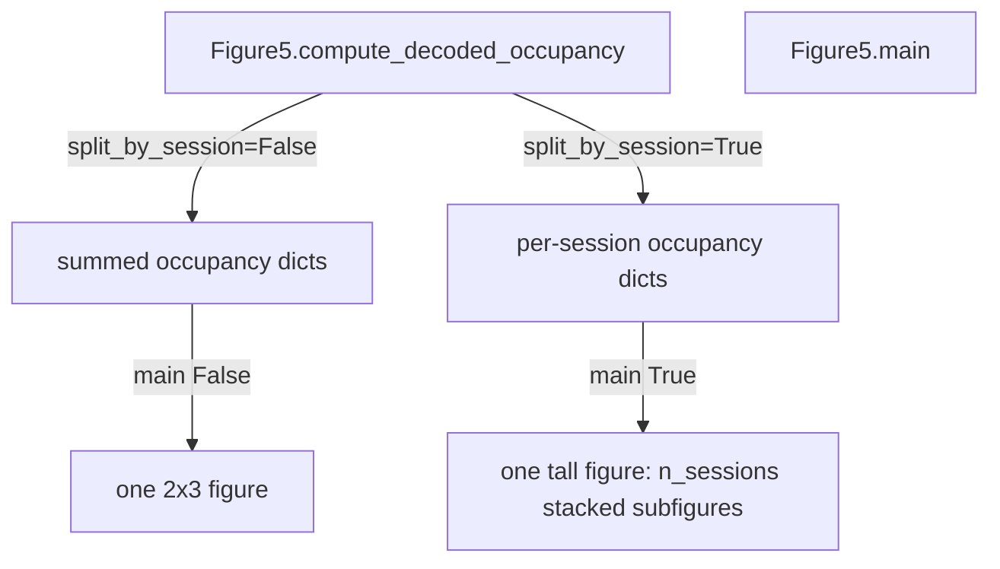

# Figure 5 `split_by_session` per-session subfigures

Motivation: sessions sit at slightly different track x-positions, so summing occupancy across sessions (current `compute_decoded_occupancy` + single 2x3 `main` figure) smears bins. `split_by_session=True` keeps occupancy per session and plots one 2x3 mosaic per session as stacked matplotlib subfigures.

Default remains **`False`** so existing aggregated occupancy cells in the notebook keep working. The Figure 5 notebook cell will pass `True`.

## Data flow



Session keys will use `a_sess_ctxt.get_description(separator='_')` (e.g. `kdiba_gor01_one_2006-6-08_14-26-15`) so they match the FAT `session_name` column already used by measured occupancy.

## 1. Keep per-session occupancy in compute

File: [PhoDiba2023Paper.py](h:\TEMP\Spike3DEnv_ExploreUpgrade\Spike3DWorkEnv\pyPhoPlaceCellAnalysis\src\pyphoplacecellanalysis\SpecificResults\PhoDiba2023Paper.py) (`Figure5.compute_decoded_occupancy`)

Today occupancy is appended into anonymous lists and then summed:

```489:515:h:\TEMP\Spike3DEnv_ExploreUpgrade\Spike3DWorkEnv\pyPhoPlaceCellAnalysis\src\pyphoplacecellanalysis\SpecificResults\PhoDiba2023Paper.py
        def _sum_period_occupancy(v_list, pre_post_delta_period, scale: float = 1.0):
            """Sum occupancy across sessions. ...
            sample = v_list[0][pre_post_delta_period]
            ...
            return np.nansum(np.vstack([v[pre_post_delta_period] for v in v_list]), axis=0) * scale
        ...
            full_epoch_occupancy_seconds_dict_dict[pre_post_delta_period] = {laps_pbe_epoch_name: _sum_period_occupancy(v_list, pre_post_delta_period, scale=float(time_bin_size)) for ...}
```

Changes:
- Add `split_by_session: bool = False` to the signature.
- Store occupancy as `{session_name: occupancy}` instead of a list (still compatible with `_sum_period_occupancy` via `.values()`).
- When `split_by_session=True`, skip the cross-session sum. Return:

```python
{
  session_name: {
    'pre-delta': {'laps': ..., 'PBEs': ...},
    'post-delta': {...},
    'all': {...},
  },
  ...
}
```

Same nesting for fractional occupancy, normalized **within each session**. Decoder-split dicts stay `{decoder_name: (n_pos,)}` per session.

When `False`, keep the current `{pre-delta|post-delta|all: {laps|PBEs: ...}}` return so later notebook cells that do `occupancy_dict['pre-delta']['laps']` still work.

## 2. Plot stacked subfigures in `main`

File: same `Figure5.main` (~line 526)

Add `split_by_session: bool = False`. Extract the existing measured-occupancy builder and 2x3 mosaic loop into nested helpers so both modes share them (current loop is ~lines 549–651).

When `split_by_session=True`:
- Assert occupancy dicts are session-nested (keys are not `pre-delta`/`post-delta`/`all`).
- Partition each measured FAT df by `session_name`.
- Build one figure: `figsize=[18, 4 * n_sessions]`, then `fig.subfigures(n_sessions, 1, wspace=0.07)` (handle `n_sessions == 1` where matplotlib returns a single `SubFigure`).
- For each session, reuse the current mosaic:

```python
[[laps_pre-delta, laps_post-delta, laps_all],
 [PBEs_pre-delta, PBEs_post-delta, PBEs_all]]
```

- Each subfigure gets `suptitle(session_name)` plus the existing per-axes titles with decoded/measured totals.
- `n_pos` / `xbin_bin_ids` computed **per session** from that session’s occupancy (avoids fake cross-session x mapping).
- Skip sessions with no decoded occupancy; warn if measured `session_name` does not overlap decoded keys.

Return a **separate result shape**:
- `False`: `(fig, ax_dict), (measured_seconds, measured_frac)` — unchanged
- `True`: `(fig, session_ax_dicts), (measured_seconds_by_session, measured_frac_by_session)` where `session_ax_dicts[session_name]` is that session’s mosaic `ax_dict`

## 3. Notebook cell

The Figure 5 cell in [PhoDibaPaper2024_FULL_ARCHIVE_2026-08-31.ipynb](h:\TEMP\Spike3DEnv_ExploreUpgrade\Spike3DWorkEnv\Spike3D\EXTERNAL\PhoDibaPaper2024Book\PhoDibaPaper2024_FULL_ARCHIVE_2026-08-31.ipynb) is already in context. Pass `split_by_session=True` to both `compute_decoded_occupancy` and `main`. Do not change later cells that still consume aggregated occupancy.

```python
full_epoch_occupancy_seconds_dict_dict, full_epoch_occupancy_fractional_dict_dict = Figure5.compute_decoded_occupancy(
    ..., split_by_session=True,
)
_fig5_outs = Figure5.main(..., split_by_session=True, num='Figure 5 - measured vs decoded - by session')
```

## Out of scope

- No new x-position remapping / zeroing-by-extent; per-session bin-index occupancy is the fix for misaligned tracks.
- Aggregated `split_by_session=False` path stays as-is.
