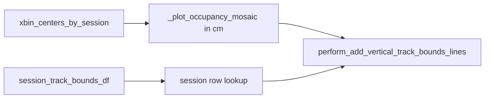

# Figure5.main session track bounds overlay

## Goal

Extend [`Figure5.main`](h:/TEMP/Spike3DEnv_ExploreUpgrade/Spike3DWorkEnv/pyPhoPlaceCellAnalysis/src/pyphoplacecellanalysis/SpecificResults/PhoDiba2023Paper.py) so callers can pass the notebook-built `session_track_bounds_df` and have each session’s mosaic axes draw long/short track platform/endcap vertical lines.

## Chosen approach

- New params on `Figure5.main`:
  - `session_track_bounds: Optional[pd.DataFrame] = None` — columns from the notebook cell: at least `session`, `long_notable_x`, `short_notable_x` (4-tuples: outer_L, inner_L, inner_R, outer_R).
  - `xbin_centers_by_session: Optional[Dict[str, NDArray]] = None` — required companion when bounds are drawn, so occupancy stairs use **cm** x-axis (today `_plot_occupancy_mosaic` hardcodes `xbin_centers = None` → bin indices, which would misplace cm vlines).
- Draw with existing `perform_add_vertical_track_bounds_lines` only (full-height dashed long/short platform lines). Do **not** call `add_track_shapes` on occupancy panels (rects would fight occupancy y-scale on the short publication mosaic).
- Only apply when `split_by_session=True` and the figure key matches a `session` row. Animal-aggregated / missing-session keys: skip with a one-line warn.



## Code changes

### 1. [`PhoDiba2023Paper.py`](h:/TEMP/Spike3DEnv_ExploreUpgrade/Spike3DWorkEnv/pyPhoPlaceCellAnalysis/src/pyphoplacecellanalysis/SpecificResults/PhoDiba2023Paper.py) — `Figure5.main`

- Add the two parameters to the signature (keep `**kwargs` pops for the other flags unchanged).
- Import `perform_add_vertical_track_bounds_lines` inside the `enable_figure` block (same pattern as `perform_plot_occupancy`).
- If `session_track_bounds is not None`:
  - Assert it has `session`, `long_notable_x`, `short_notable_x`.
  - Build `bounds_by_session = session_track_bounds.set_index('session')`.
  - Assert `xbin_centers_by_session is not None` (cannot draw cm bounds on bin-index axes).
- Thread optional `xbin_centers` into nested `_plot_occupancy_mosaic(...)`:
  - Replace the hardcoded `xbin_centers = None` with the passed-in array when present so stairs align to cm.
- In the `split_by_session` loop, after `_plot_occupancy_mosaic` returns `ax_dict`:
  - Look up `session_name` in `bounds_by_session`.
  - For each occupancy panel ax (keys in `_data_ax_keys`, skip `row_group` / label axes), call:

```python
perform_add_vertical_track_bounds_lines(
    long_notable_x_platform_positions=tuple(row.long_notable_x),
    short_notable_x_platform_positions=tuple(row.short_notable_x),
    ax=ax, include_long=True, include_short=True,
)
```

- If a session has bounds but no `xbin_centers_by_session[session_name]`, warn and skip overlay for that session.

### 2. Notebook call site — [`PhoDibaPaper2024_FULL_ARCHIVE_2026-08-31.ipynb`](h:/TEMP/Spike3DEnv_ExploreUpgrade/Spike3DWorkEnv/Spike3D/EXTERNAL/PhoDibaPaper2024Book/PhoDibaPaper2024_FULL_ARCHIVE_2026-08-31.ipynb)

Update the by-session `Figure5.main(...)` call (~lines 10–23 in the attached cell) to pass:

```python
session_track_bounds=session_track_bounds_df,
xbin_centers_by_session=_xbin_centers_by_session,
```

Leave the animal-level `Figure5.main` call unchanged (no matching per-session bounds).

## Non-goals

- No changes to `add_track_shapes` / remapping-diagram helpers.
- No animal-aggregated endcap overlay.
- No new public helper class; keep logic local to `Figure5.main`.
