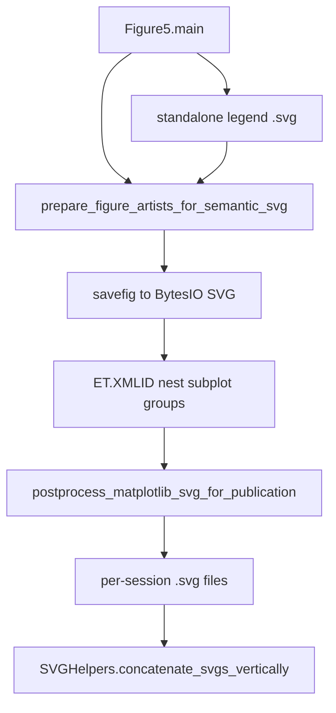

# Figure5 default semantic SVG export

## Goal
Change [`Figure5.main`](h:/TEMP/Spike3DEnv_ExploreUpgrade/Spike3DWorkEnv/pyPhoPlaceCellAnalysis/src/pyphoplacecellanalysis/SpecificResults/PhoDiba2023Paper.py) so session/legend vector outputs are **`.svg` by default**, saved through a reusable helper that assigns hierarchical Matplotlib `gid`s (gallery-style) and post-processes the SVG into nested semantic `<g>` groups for Illustrator.

## Chosen approach
- Add `savefig_svg_semantic(fig, svg_path, ...)` in [`ExportHelpers.py`](h:/TEMP/Spike3DEnv_ExploreUpgrade/Spike3DWorkEnv/pyPhoPlaceCellAnalysis/src/pyphoplacecellanalysis/General/Mixins/ExportHelpers.py) next to `postprocess_matplotlib_svg_for_publication`.
- Keep the `pdf_export_path` / `legend_export_path` kwargs for call-site compatibility, but **coerce output suffixes to `.svg`** when writing (so notebook callers that still pass `...by_session.pdf` get `...by_session.svg` without notebook edits).
- Stack per-session SVGs with existing `SVGHelpers.concatenate_svgs_vertically` (not `PDFHelpers`).
- Do **not** edit the archive notebook unless you ask later.

## 1. Reusable semantic SVG saver (`ExportHelpers.py`)

Add two small functions (single-line signatures when ≤400 chars):

1. `prepare_figure_artists_for_semantic_svg(fig) -> None`
   - Lift/generalize the prepare logic currently nested in [`NonInteractiveProcessing._perform_save_single_plotted_fig`](h:/TEMP/Spike3DEnv_ExploreUpgrade/Spike3DWorkEnv/pyPhoPlaceCellAnalysis/src/pyphoplacecellanalysis/General/Batch/NonInteractiveProcessing.py) (~L1120–1182).
   - Transparent figure/axes patches; disable clip paths.
   - Assign SVG-safe hierarchical gids using `ax.get_label()` (subplot_mosaic keys already provide these for Figure5) with category prefixes:
     - subplot root: `{ax_gid}`
     - ticks: `{ax_gid}__ticks__x|y_{i}` (+ ticklabels)
     - axes: `{ax_gid}__axes__spine_{name}`, patch
     - labels: `{ax_gid}__labels__{title|xlabel|ylabel}`
     - data: `{ax_gid}__data__{line|collection|patch|text}_{i}` (preserve existing gids / legend labels when present)
   - Twin axes (Figure5 measured twin) get `{primary_gid}__twin` root so they nest beside the primary subplot group.

2. `savefig_svg_semantic(fig, svg_path, ...) -> Path`
   - Call prepare → `savefig` to `BytesIO` under `svg.fonttype='none'` / transparent rc → `ET.register_namespace` + `ET.XMLID` (same pattern as [Matplotlib SVG Histogram](https://matplotlib.org/stable/gallery/user_interfaces/svg_histogram_sgskip.html)).
   - Restructure: for each subplot gid prefix, create nested parents
     `subplot → ticks | axes | labels | data`
     and move matching elements under those groups (no JS/CSS interactivity from the gallery — only grouping).
   - Write the tree, then run existing `postprocess_matplotlib_svg_for_publication(svg_path)` for whitespace/Illustrator text fixes.

Wire `NonInteractiveProcessing` SVG branch to call `savefig_svg_semantic` instead of duplicating prepare+savefig+postprocess (minimal call-site swap).

## 2. Figure5.main export path (`PhoDiba2023Paper.py`)

In `Figure5.main` (~L7757–8230):

- Docstring: PDF → SVG (stacked SVG + separate legend SVG).
- `_export_standalone_legend`: save via `savefig_svg_semantic` (format svg); print message says SVG.
- Split-session export block (~L8168–8182):
  - Import `SVGHelpers` instead of (or in addition to) `PDFHelpers`.
  - Coerce `merged` path suffix to `.svg`.
  - Per-session files: `{stem}.svg` under the stem folder.
  - `savefig_svg_semantic(sess_fig, sess_svg_path, bbox_inches='tight', pad_inches=0.02, dpi=dpi)` inside the existing pub-style rc_context (keep `svg.fonttype='none'` in that rc).
  - `merged_svg_path = SVGHelpers.concatenate_svgs_vertically(per_session_svg_paths, merged_svg_path, padding=8)`.
- Legend default fallback: `Figure5_legend.svg`.
- Return values stay the 4-tuple; 3rd/4th entries become the SVG paths (variable names can become `merged_svg_path` / `legend_svg_path` locally).

Optional small Figure5 plot tweak (only if needed for cleaner layers): after coloring stairs patches, set decoder/measured gids on those patches so they land in `__data__` with meaningful ids.

## 3. Compatibility

- Callers passing `pdf_export_path=.../foo.pdf` keep working; written files are `.../foo.svg` and `.../foo/<session>.svg`.
- Explicit non-`.svg` suffixes other than `.pdf` are also normalized to `.svg` for this export path (Figure5 vector export is SVG-only after this change).

## Data flow

## Files to touch
- [`ExportHelpers.py`](h:/TEMP/Spike3DEnv_ExploreUpgrade/Spike3DWorkEnv/pyPhoPlaceCellAnalysis/src/pyphoplacecellanalysis/General/Mixins/ExportHelpers.py) — add prepare + `savefig_svg_semantic`
- [`NonInteractiveProcessing.py`](h:/TEMP/Spike3DEnv_ExploreUpgrade/Spike3DWorkEnv/pyPhoPlaceCellAnalysis/src/pyphoplacecellanalysis/General/Batch/NonInteractiveProcessing.py) — delegate SVG save to the new helper
- [`PhoDiba2023Paper.py`](h:/TEMP/Spike3DEnv_ExploreUpgrade/Spike3DWorkEnv/pyPhoPlaceCellAnalysis/src/pyphoplacecellanalysis/SpecificResults/PhoDiba2023Paper.py) — Figure5.main export/legend/docstring
