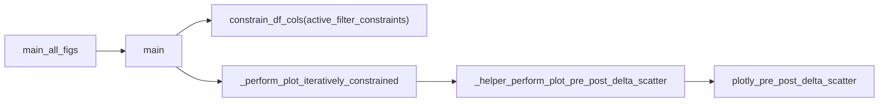

# Figure S3 multi time-bin series

## Goal

Figure S3 shows **several time-bin sizes as separate color series** on one pre/post scatter + side histograms. Figure 4, S8, and S9 must stay **single `time_bin_size` (0.075)**, **black points**, **legend off**.



## 1. New parameters on `FigureS8.main` ([PhoDiba2023Paper.py](h:\TEMP\Spike3DEnv_ExploreUpgrade\Spike3DWorkEnv\pyPhoPlaceCellAnalysis\src\pyphoplacecellanalysis\SpecificResults\PhoDiba2023Paper.py))

Add with **safe defaults** (no behavior change for existing callers):

| Parameter | Default | Purpose |
|-----------|---------|---------|
| `color_by_time_bin_size: bool` | `False` | S3: categorical colors by `time_bin_size` |
| `enabled_granularities: Optional[Sequence[str]]` | `None` → both `_perTimeBin` and `_perEpochs` | S3: `('_perTimeBin',)` only |

- Thread `color_by_time_bin_size` into every `_perform_plot_iteratively_constrained(...)` call in the granularity loop (~3666).
- Replace `for a_grainularity, base_df_dict in base_df_dict_dict.items()` with filtering when `enabled_granularities` is set.
- Document new kwargs in `main` and `main_all_figs` docstrings.

## 2. Plot pipeline: `_perform_plot_iteratively_constrained`

In the same file (~3270):

- Accept `color_by_time_bin_size: bool = False` and optional `legend_groups_to_hide: Optional[List] = None` (forwarded to `plotly_helpers._perform_plot_pre_post_delta_scatter` via `_plot_kwargs`).
- When `color_by_time_bin_size`:
  - Set `_plot_kwargs['color_by_time_bin_size'] = True`.
  - Set `common_plot_kwargs` / `hist_kwargs` / `px_scatter_kwargs` to `color='time_bin_size'` **without** `color_discrete_sequence=['black']` (let `plotly_pre_post_delta_scatter` use `_subfn_build_categorical_color_kwargs`).
- `showlegend` for `_plot_formatted_pre_post_scatter`:
  - `True` if `should_overlay_heuristic_filter` **or** (`color_by_time_bin_size` and `plot_df['time_bin_size'].nunique(dropna=True) > 1`).
- Extend `_post_hoc_format_figure` (~3042): when `showlegend` and **not** heuristic overlay, use a horizontal legend below the panel with title **"Time bin size (s)"** (reuse margin/position pattern from heuristic legend, different `legend.title.text`).

## 3. Publication helper: `_helper_perform_plot_pre_post_delta_scatter` (~7733)

Add kwarg `color_by_time_bin_size: bool = False` (pop before `plotly_pre_post_delta_scatter`).

- Today, `is_publication_ready_figure` always sets `color='time_bin_size'` + `color_discrete_sequence=['black']` and ends with `showlegend=False`.
- Branch:
  - **`color_by_time_bin_size=True`**: set `color='time_bin_size'` on scatter + hist kwargs only; **do not** set black sequence; **do not** force `showlegend=False` at the end (FigureS8 post-hoc layout controls legend).
  - **Else**: keep existing black + hidden legend (Figure 4 / S8 / S9).

Avoid duplicating black on `px_scatter_kwargs` when `color_by_time_bin_size` passes colors via `common_plot_kwargs` from FigureS8.

## 4. `main_all_figs` Figure S3 config + per-figure legend (~3756)

Update default `figures_config_dict['Figure S3']`:

```python
'active_filter_constraints': {
    # same keys as main() default, except:
    'time_bin_size': (0.025, 0.03, 0.044, 0.05, 0.058),  # overridable when you run
},
'color_by_time_bin_size': True,
'enabled_granularities': ('_perTimeBin',),
'should_compute_stats': False,  # avoid pooled multi-tbin pre/post stats + wrong summary four-bar
'legend_groups_to_hide': [],     # do not pop from fig_config into main(); handle separately
```

In the `for fig_name, fig_config_dict` loop:

- `pop('legend_groups_to_hide', None)` from config.
- If not `None`, temporarily assign `plotly_helpers.legend_groups_to_hide`, call `cls.main(...)`, restore previous value in `try/finally` (default helper hides `0.03`, `0.044`).

Update `main_all_figs` docstring to mention Figure S3 and overridable `active_filter_constraints`.

## 5. Small correctness fix (same loop, low risk)

At ~3721, `_out_figs_dict_dict_dict[an_epoch_name] = ...` uses the **last inner** epoch name instead of granularity. Change key to `a_grainularity` so outputs retain both `_perTimeBin` and `_perEpochs` when `enabled_granularities` is default `None`.

## 6. Verification (manual)

- `FigureS8.main_all_figs(..., enabled_figure_names=['Figure 4'])` → plots still single-bin black, no legend.
- `enabled_figure_names=['Figure S3']` → `base_df['time_bin_size'].nunique() > 1`, colored traces + legend, separate Laps/PBEs summary paths unchanged (`separate_laps_pbes_figures: True`), no stats/summary four-bar for S3.
- Override test: pass custom `figures_config_dict['Figure S3']['active_filter_constraints']['time_bin_size']` with a subset; confirm series count matches.

## Files touched

- Primary: [PhoDiba2023Paper.py](h:\TEMP\Spike3DEnv_ExploreUpgrade\Spike3DWorkEnv\pyPhoPlaceCellAnalysis\src\pyphoplacecellanalysis\SpecificResults\PhoDiba2023Paper.py) (`FigureS8`, `_helper_perform_plot_pre_post_delta_scatter`)
- No changes to `plotly_pre_post_delta_scatter` unless testing shows categorical helper needs a one-line guard (unlikely).
