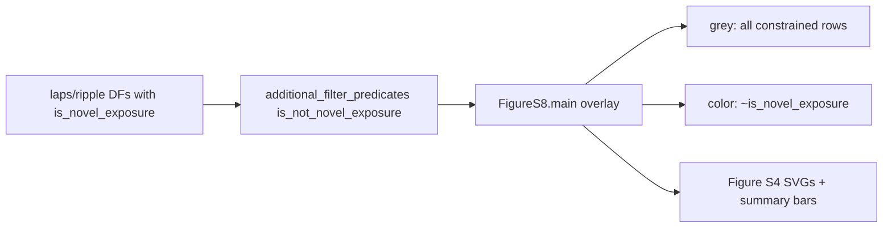

# Figure S4: Anticipation overlay on Fig 4 scatter

## Decisions (locked)
- **Layout:** S8-style overlay — all sessions grey background; colored foreground = sessions that can anticipate Short (`~is_novel_exposure`, i.e. `session_experience_rank >= 2`)
- **Predicate:** reuse existing `is_novel_exposure` column (from [`load_and_apply_session_experience_rank_csv`](h:\TEMP\Spike3DEnv_ExploreUpgrade\Spike3DWorkEnv\pyPhoPlaceCellAnalysis\src\pyphoplacecellanalysis\SpecificResults\AcrossSessionResults.py)); no hard-coded anticipation session lists

## Approach

Reuse the existing `FigureS8` scatter/stats pipeline. S4 is a new `figures_config_dict` entry plus a predicate and a small overlay-scope fix so Laps can overlay too (today overlays are PBEs-only).



## Code changes — [`PhoDiba2023Paper.py`](h:\TEMP\Spike3DEnv_ExploreUpgrade\Spike3DWorkEnv\pyPhoPlaceCellAnalysis\src\pyphoplacecellanalysis\SpecificResults\PhoDiba2023Paper.py)

### 1. Register display label for the new predicate key
In `FigureS8.FILTER_PREDICATE_DISPLAY_LABELS` (~5597), add:
- `'is_not_novel_exposure': 'prior Short exposure'` (or similar short legend text)

### 2. Allow `overlay_filter_panels` on Laps (not only PBEs)
In `FigureS8.main` (~6425), change panel resolution so that when `overlay_filter_panels` is set it applies to **all** enabled epoch kinds; keep the `enable_heuristic_filtered_outputs` fallback PBEs-only for S8 backward compatibility:

```python
if overlay_filter_panels is not None:
    panel_specs = list(overlay_filter_panels)
elif enable_heuristic_filtered_outputs and epoch_kind.startswith('PBEs'):
    panel_specs = [(None, 'is_heuristic_passing')]
else:
    panel_specs = [(None, None)]
```

### 3. Add `'Figure S4'` to `main_all_figs` default config (~6594)
Sibling of Figure 4 / S8 / S9:

```python
'Figure S4': {
    'figures_parent_folder': figures_root.joinpath(
        f'Figure S4 - Effect of Prior Short Exposure on P_Short Scatter over Time/Inputs/{figures_date}'
    ).resolve(),
    'enable_heuristic_filtered_outputs': False,
    'enabled_granularities': ('_perTimeBin',),
    'enabled_epoch_kinds': ('Laps', 'PBEs'),  # Fig 4–like
    'overlay_filter_panels': (
        ('S4a', 'is_not_novel_exposure'),
    ),
    'pub_fig_size_key': 'full_width',  # overlay legend like S8
},
```

Also update class docstring / `FULL_WIDTH_FIGURE_NAMES` to include `'Figure S4'`.

### 4. Ensure predicate is available inside `main` / `main_all_figs`
At the start of `main` (or `main_all_figs` before the figure loop), if `'is_not_novel_exposure'` is missing from `additional_filter_predicates`, inject:

```python
additional_filter_predicates['is_not_novel_exposure'] = (
    lambda df: (~df['is_novel_exposure'].astype(bool))
)
```

Assert / clear error if `is_novel_exposure` is missing from the plot DFs (already expected from experience-rank CSV join).

## Notebook usage (no notebook edits unless you ask)
Caller remains:

```python
figures_out_dict = FigureS8.main_all_figs(
    ..., enabled_figure_names=['Figure S4']
)
```

Optional: also put the same lambda in the notebook’s `additional_filter_predicates` dict for interactive filtering; code injection above makes that unnecessary for the figure export path.

## Out of scope
- Hard-coded `high_anticipation_sessions` / `moderate_anticipation_sessions` lists
- Changing `novel_experience_rank_requirement` (keep default `2`)
- New plotting stack / matplotlib path
