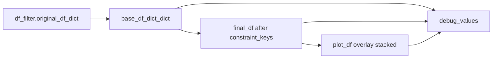

# FigureS8 `store_debug_values` mode

Add an optional debug payload to [`PhoDiba2023Paper.py`](h:\TEMP\Spike3DEnv_ExploreUpgrade\Spike3DWorkEnv\pyPhoPlaceCellAnalysis\src\pyphoplacecellanalysis\SpecificResults\PhoDiba2023Paper.py) `FigureS8` so callers can recover the DataFrames that actually went into the scatter (not the raw `df_filter` inputs).

## Why this is missing

`main` currently builds `base_df_dict_dict` (column-constrained + MLD/heuristic columns), then `_perform_plot_iteratively_constrained` further filters that into `active` / `plot_df`. Those objects are discarded; only figures, paths, and stats come back.

```python
return _out_figs_dict, _out_paths_dict, _out_stats_dict  # inner
return _out_figs_dict_dict_dict, _out_paths_dict, (comparison_dict, results_dict, _stats_params_kwargs)  # main
```

## API

Add `store_debug_values: bool = False` to both `FigureS8.main` and `_perform_plot_iteratively_constrained` (default **False** so existing 3-unpacks in notebooks keep working; pass `True` when you want the DFs).

Return shape:

- **Inner** always returns 4 items: `figs, paths, stats, debug_dict`. `debug_dict` is `{}` when the flag is False (avoids copying large DFs).
- **`main`**: keep the current 3-tuple when False; when True, append a 4th item:

```python
_out_figs, _out_paths, _out_stats_tuple, _out_debug_values = FigureS8.main(..., store_debug_values=True)
```

Also assign `cls.last_debug_values` so the payload is available even if the caller still unpacks 3 items.

Update the `main` docstring usage to show the 4-unpack. Do not edit notebooks unless asked.

## What to store (only when True)

Skip extra `deepcopy` of the DFs: hold the objects already built in the pipeline.

**From `main` (shared):**

- `active_filter_constraints`
- `base_constraint_keys_dict`
- `columns_to_add`
- `base_df_dict_dict` — after `constrain_df_cols`, `adding_mld_columns`, and `add_parent_epoch_heuristic_columns_to_time_bin_df`

**From each inner call, keyed like stats (`_perTimeBin_Laps`, `_perTimeBin_PBEs`, …):**

- `base_df` — unconstrained (post-`main` processing)
- `final_df` — `active` after all `constraint_keys` masks (this is the plotted source)
- `plot_df` — overlay-stacked DF passed to `_plot_formatted_pre_post_scatter` (same as `final_df` unless heuristic overlay)
- `heuristic_passing_df` — `final_df` subset when overlay is on, else `None`
- `n_rows` — counts after Initial, each constraint key, Final, and heuristic-passing
- `constraint_keys`, `should_overlay_heuristic_filter`, `split_by_column`, `export_suffix`
- `groups` — only if `split_by_column` is set: `{group_key: {'group_df', 'plot_df', 'n_rows'}}`

Do not duplicate stats objects already in `_out_stats_tuple`.



## Implementation notes

- In `_export_stage`, when the flag is True, record `group_df` / `plot_df` for the plotted stage (Final is the one `main` always exports).
- In the constraint loop, record `len(active)` into `n_rows` regardless; store `final_df` after the loop (same object later passed as `_export_stage(..., active, ...)`).
- `main` merges inner debug dicts under `plot_data` and attaches the shared `base_df_dict_dict` / constraint params.
- Keep signatures on grouped continuation lines (existing style, ≤400 chars per `def` line).
