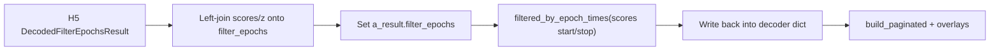

# Filter H5 epochs to scores/shuffle set

## Verdict

Your approach is **correct**:

1. Left-join score/z columns onto full H5 `filter_epochs`.
2. Assign that enriched DF onto `a_result.filter_epochs` (so the following deepcopy keeps the merged columns).
3. `a_result = a_result.filtered_by_epoch_times(scores_df[['start','stop']].to_numpy())` returns a **new** subset that slices **all** epoch-aligned fields (`p_x_given_n_list`, `time_bin_containers`, etc.), not just the dataframe.
4. [`enrich_ripple_decoder_results_with_score_shuffle_dfs`](h:\TEMP\Spike3DEnv_ExploreUpgrade\Spike3DWorkEnv\pyPhoPlaceCellAnalysis\src\pyphoplacecellanalysis\SpecificResults\PhoDiba2023Paper.py) already **reassigns** the return value into `decoder_ripple_filter_epochs_decoder_result_dict[decoder_name]`, and `plot_session` / `add_score_shuffle_overlays` consume that dict — so the filtered object is what gets plotted.

## Gaps to harden (same function)

File: [`PhoDiba2023Paper.py`](h:\TEMP\Spike3DEnv_ExploreUpgrade\Spike3DWorkEnv\pyPhoPlaceCellAnalysis\src\pyphoplacecellanalysis\SpecificResults\PhoDiba2023Paper.py) `merge_score_and_shuffle_onto_decoder_result` (~295–404)

- **None / empty guards:** only run the scores↔shuffle `allclose` and the `filtered_by_epoch_times` + `Assert.same_length` when `scores_df` is non-empty. Skip filter when no scores.
- **Epoch-time columns:** resolve `start`/`stop` (or `ripple_start_t` + stop) via existing helpers rather than hard-coding `scores_df[['start','stop']]`.
- **Same-object modern path:** when `scores_df is shuffle_df`, skip the redundant `allclose` (or keep a cheap identity/same-length check).
- **Missing H5 matches:** `find_data_indicies_from_epoch_times` defaults to `not_found_action='skip_index'`, so `Assert.same_length(a_result.filter_epochs, scores_df)` can fail if some score epochs are absent from H5. After filter, assert against the **matched** count (or assert `len(a_result.filter_epochs) == len(found_indicies)` and print how many score rows were skipped).
- **Cleanup:** remove the dead commented `_subfun_filter_epochs_to_matching_scores_df_epochs` block; keep a short docstring note that merge-then-filter is intentional so overlays keep score columns while posterior lists stay aligned.

## Post-filter wiring check (no structural change needed)

Confirm these already use the enriched/filtered dict (they do; leave as-is unless a bug shows up):

- `enrich_ripple_decoder_results_with_score_shuffle_dfs` assigns `merge_...` return value
- `plot_session` builds the window from that dict
- `add_score_shuffle_overlays` sets `a_ctrl.plots_data.filter_epochs_decoder_result = decoder_ripple_...[decoder_name]`

## Out of scope

Do not change `filtered_by_epoch_times` / `filtered_by_epochs` themselves. Do not reintroduce filtering via the commented dataframe-only helper (that would leave posterior lists out of sync).
