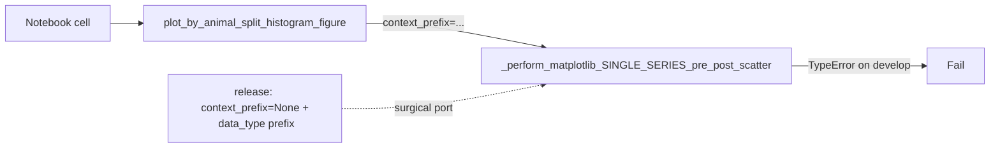

# Fix `context_prefix` for Fig4 animal-split histograms

## Cause
[`plot_by_animal_split_histogram_figure`](h:/TEMP/Spike3DEnv_ExploreUpgrade/Spike3DWorkEnv/pyPhoPlaceCellAnalysis/src/pyphoplacecellanalysis/SpecificResults/PendingNotebookCode.py) (already on develop) calls:

```python
_perform_matplotlib_SINGLE_SERIES_pre_post_scatter(..., context_prefix=f'{an_animal_name} - ')
```

Develop’s [`_perform_matplotlib_SINGLE_SERIES_pre_post_scatter`](h:/TEMP/Spike3DEnv_ExploreUpgrade/Spike3DWorkEnv/pyPhoPlaceCellAnalysis/src/pyphoplacecellanalysis/SpecificResults/PhoDiba2023Paper.py) (~L2199) does **not** accept `context_prefix`. Release does.



## Change (minimal)
Edit only [`PhoDiba2023Paper.py`](h:/TEMP/Spike3DEnv_ExploreUpgrade/Spike3DWorkEnv/pyPhoPlaceCellAnalysis/src/pyphoplacecellanalysis/SpecificResults/PhoDiba2023Paper.py) in `_perform_matplotlib_SINGLE_SERIES_pre_post_scatter`:

1. Add `context_prefix=None` to the signature (default preserves existing callers).
2. Replace the hardcoded `data_type=f'PBEs ({grainularity_desc})'` (~L2325) with the release logic:

```python
epoch_identifer: str = 'EPOCHS'
if context_prefix is not None:
    data_type = f'{context_prefix}'
else:
    data_type = ''
data_type = f'{data_type}{epoch_identifer} ({grainularity_desc})'
_epochs_histogram_out = plot_pre_scatter_post_matplotlib(..., data_type=data_type, ...)
```

Do **not** merge `PendingNotebookCode.py`, do **not** bring `MatplotlibPrePostScatterFlexibleFigures`, do **not** merge the release branch.

## Verify
Re-run the notebook cell that calls `plot_by_animal_split_histogram_figure(...)` with `laps_df` / `ripple_df` from `df_filter`. The `context_prefix` TypeError should be gone.

## Likely next issue (out of this fix)
`plot_by_animal_split_histogram_figure` still re-applies hardcoded `constrain_df_cols(..., custom_replay_name="withNormalComputedReplays-qclu_[1, 2, 4, 6, 7, 8, 9]-frateThresh_2.0", ...)`. With already-filtered `df_filter` frames that may empty the animal subset. If that happens after this fix, patch that helper to filter by `animal` only (no hardcoded replay constraint). Not included unless it fails next.