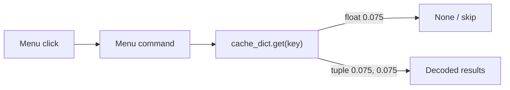

# Fix SpikeRasterWindow continuous-decode menu cache-key mismatch

## Root cause

Sliding-window decode work changed `DirectionalDecodersContinuouslyDecodedResult.continuously_decoded_result_cache_dict` keys from float `W` to `DecodingContinuousCacheKey = (W, slideby)` (e.g. `(0.075, 0.075)`). Helpers already exist:

- `decoding_continuous_cache_key` / `normalize_continuous_decoding_cache_lookup_key`
- `get_continuously_decoded_dict(key, slideby=None)`
- `most_recent_continuously_decoded_dict` / `most_recent_continuous_decoding_cache_key`

But several SpikeRasterWindow menu paths still do float `.get(time_bin_size)` lookups. Confirmed by [Trace continuously decoded dict](17e653dd-d589-42bf-91f2-699aa3a23391): recompute stores under `(0.075, 0.075)`, while readers still `.get(0.075)`.



## Exact failure matching your traceback

[`AddNewDirectionalDecodedEpochs_MatplotlibPlotCommand.add_directional_decoder_decoded_epochs`](h:/TEMP/Spike3DEnv_ExploreUpgrade/Spike3DWorkEnv/pyPhoPlaceCellAnalysis/src/pyphoplacecellanalysis/General/Pipeline/Stages/ComputationFunctions/MultiContextComputationFunctions/DirectionalPlacefieldGlobalComputationFunctions.py) (~10506–10517):

```python
time_bin_size = directional_decoders_decode_result.most_recent_decoding_time_bin_size  # float W only
a_continuously_decoded_dict = ...cache_dict.get(time_bin_size, None)  # misses (W, H)
assert a_continuously_decoded_dict is not None  # your error
```

Note: that assert text implies a recompute; this command does **not** recompute — it only reads the cache. Menu id `DirectionalDecodedEpochsDockedMatplotlibView` is wired in [`DockedWidgets_MenuProvider.py`](h:/TEMP/Spike3DEnv_ExploreUpgrade/Spike3DWorkEnv/pyPhoPlaceCellAnalysis/src/pyphoplacecellanalysis/GUI/Qt/Menus/SpecificMenus/DockedWidgets_MenuProvider.py) and still callable even though `validate_can_display()` currently hard-returns `False`.

## Related silent breakage (marginals / Pseudo2D positions)

Per-bin menus come from `get_all_computed_time_bin_sizes()`, which currently converts tuple keys to **lists** `[0.075, 0.075]`, then stores them in `active_time_bin_sizes_whitelist`. Iteration over the cache still yields **tuple** keys `(0.075, 0.075)`, so whitelist membership fails and those menus add nothing instead of asserting.

Also fragile: `isinstance(..., (Tuple, List, np.array, Set))` — should use concrete `(tuple, list)`.

## Additional same-bug sites

[`SpecificDockWidgetManipulatingMixin.py`](h:/TEMP/Spike3DEnv_ExploreUpgrade/Spike3DWorkEnv/pyPhoPlaceCellAnalysis/src/pyphoplacecellanalysis/GUI/PyQtPlot/DockingWidgets/SpecificDockWidgetManipulatingMixin.py):

- `compute_if_needed_and_add_continuous_decoded_posterior` — float `.get` after recompute
- `perform_add_continuous_decoded_posterior` — same pattern

Reference correct lookup pattern: `PendingNotebookCode.py` ~17796–17814 (`normalize_continuous_decoding_cache_lookup_key` then indexed read).

## Concrete fix (single approach)

Update menu/plot command code in [`DirectionalPlacefieldGlobalComputationFunctions.py`](h:/TEMP/Spike3DEnv_ExploreUpgrade/Spike3DWorkEnv/pyPhoPlaceCellAnalysis/src/pyphoplacecellanalysis/General/Pipeline/Stages/ComputationFunctions/MultiContextComputationFunctions/DirectionalPlacefieldGlobalComputationFunctions.py) to treat cache keys as `DecodingContinuousCacheKey` end-to-end:

1. **Directional epochs command** (`add_directional_decoder_decoded_epochs`):
   - Use `most_recent_continuous_decoding_cache_key` (or `most_recent_continuously_decoded_dict`)
   - Lookup split-1D results with that same key, not bare float `W`
   - Keep info string showing both W and slideby (e.g. `t_bin=(0.075, 0.075)`)
   - Restore `validate_can_display()` to the real `validate_has_directional_decoded_continuous_epochs` check (remove hard `return False`)

2. **`get_all_computed_time_bin_sizes`**:
   - Return `List[DecodingContinuousCacheKey]` via `normalize_continuous_decoding_cache_lookup_key(k)` for each cache key
   - Drop list conversion / broken `np.array` isinstance check

3. **Whitelist paths** in `AddNewDecodedPosteriors_MatplotlibPlotCommand` and `AddNewDecodedEpochMarginal_MatplotlibPlotCommand`:
   - Type as `Optional[List[DecodingContinuousCacheKey]]`
   - Compare with normalized keys: `normalize_continuous_decoding_cache_lookup_key(time_bin_size) not in normalized_whitelist`

4. **Menu labels** in [`DockedWidgets_MenuProvider.py`](h:/TEMP/Spike3DEnv_ExploreUpgrade/Spike3DWorkEnv/pyPhoPlaceCellAnalysis/src/pyphoplacecellanalysis/GUI/Qt/Menus/SpecificMenus/DockedWidgets_MenuProvider.py):
   - Keep action names/labels using the full key string (already looks like `(0.075, 0.075)`)
   - Pass that same tuple into `active_time_bin_sizes_whitelist=[a_time_bin_size]`

5. **Dock mixin helpers**: replace float `.get` with `get_continuously_decoded_dict(...)` / normalized cache keys for split-dict lookups.

No computation recomputation changes needed; data is already present under the tuple key.

## Verification

- With a pipeline that has `DirectionalDecodersDecoded` keyed by `(0.075, 0.075)`:
  - Docked Widgets → Directional Decoded Epochs should add tracks without the assert
  - Pseudo2D Marginals `(0.075, 0.075)` should add marginal rows (not silently skip)
  - Pseudo2D Positions `(0.075, 0.075)` should likewise add tracks
