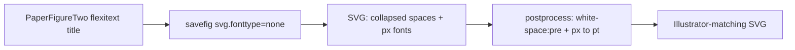

# Fix Figure 2 SVG spaces and font sizes

## Root cause (verified)

`PaperFigureTwo` titles use **flexitext**, which emits one SVG `<text>` per style run. For the publication title this becomes:

- `'Lap'`
- `' Firing Rates'` (leading space)
- `'for the '` / `'Long'` / `'/'` / `'Short'` / `' dominant Cells on each track'`

[`write_to_file`](h:\TEMP\Spike3DEnv_ExploreUpgrade\Spike3DWorkEnv\pyPhoPlaceCellAnalysis\src\pyphoplacecellanalysis\General\Mixins\ExportHelpers.py) saves with `svg.fonttype: 'none'` and a style block of only:

```css
*{stroke-linejoin: round; stroke-linecap: butt}
```

SVG/CSS default whitespace collapsing drops those leading spaces → `LapFiring Rates`, `Shortdominant…`. PDF/Qt keep glyph positions, so the live window (3rd screenshot) and PDF look correct.

Separately, matplotlib writes fonts as `font: 18px 'DejaVu Sans'…` while the SVG page size is in **pt**. Illustrator’s type UI treats `px` as CSS pixels (`18px` ≈ `13.5pt`), so publication text looks undersized even though the numeric size matched the figure.



## Approach

Add a small SVG post-processor and run it after every matplotlib SVG write in `write_to_file` (covers Fig 2 via `PaperFigureTwo.display` → `output_figure`). Do **not** change flexitext title strings or global figure creation (on-screen already looks right).

### 1. Helper in [`ExportHelpers.py`](h:\TEMP\Spike3DEnv_ExploreUpgrade\Spike3DWorkEnv\pyPhoPlaceCellAnalysis\src\pyphoplacecellanalysis\General\Mixins\ExportHelpers.py)

Add something like `postprocess_matplotlib_svg_for_publication(svg_path: Path) -> Path` that:

1. Parses the SVG with `xml.etree.ElementTree`
2. Sets `class="mplsvg"` on the root `<svg>` (matplotlib community workaround for scoped CSS)
3. Updates the auto-generated `<style>` to:
   - Scope selectors as `svg.mplsvg…`
   - Append `white-space:pre` so leading/trailing spaces in `<text>` are preserved
4. Rewrites **font** size units only: within `font:` / `font-size:` style values, replace `(\d+(?:\.\d+)?)px` → `\1pt` (do not touch unrelated lengths)
5. Writes the file back (UTF-8)

Reference behavior: [matplotlib#13200 / #14283 workaround](https://github.com/matplotlib/matplotlib/issues/13200) (`white-space:pre` + `mplsvg` class).

### 2. Call site

In `write_to_file`’s matplotlib `write_svg` branch (~1475–1480), after successful `savefig`:

```python
with plt.rc_context({'svg.fonttype': 'none'}):
    a_fig.savefig(fig_svg_save_path, format='svg', **svg_savefig_kwargs)
postprocess_matplotlib_svg_for_publication(fig_svg_save_path)
```

Also use the same helper after the direct `fig.savefig(..., format='svg')` calls in [`PhoDiba2023Paper.py`](h:\TEMP\Spike3DEnv_ExploreUpgrade\Spike3DWorkEnv\pyPhoPlaceCellAnalysis\src\pyphoplacecellanalysis\SpecificResults\PhoDiba2023Paper.py) Fig4-style SVG saves (~2402, ~2710, ~3038) so those exports stay consistent.

### 3. Verification

Re-run a minimal flexitext title SVG (same string as Fig 2) through save + postprocess and assert:

- Style contains `white-space:pre`
- Title runs still contain leading spaces in the XML (`' Firing Rates'`, `' dominant Cells…'`)
- Font shorthand uses `18pt` / `14pt`, not `px`

No notebook edits.