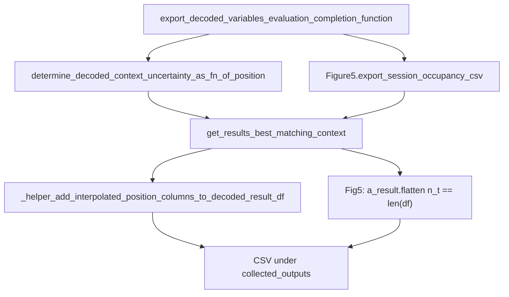

# Fix GL CSV export failures

## Diagnosis (pin01 + gor01)

Both sessions reach `COMPLETED` and save global pickles; only the completion-function CSV exports fail:

| Export | Error | Cause |
|--------|--------|--------|
| uncertainty | `too many values to unpack (expected 2)` | Stale 2-value unpack of `_helper_add_interpolated_position_columns_to_decoded_result_df` (returns one DF) |
| fig5_occupancy | `additional_cols_df[0]: N != original_df[0]: M` (e.g. 1621≠21458) | Helper builds measured cols from `a_result` timebins while the marginal DF has a different row count (best-match context / grain mismatch) |

Already applied locally (not yet on GL at log time):

- [`PendingNotebookCode.py`](h:/TEMP/Spike3DEnv_ExploreUpgrade/Spike3DWorkEnv/pyPhoPlaceCellAnalysis/src/pyphoplacecellanalysis/SpecificResults/PendingNotebookCode.py) ~14446–14450: single return + `pre_post_delta_category`
- [`DirectionalPlacefieldGlobalComputationFunctions.py`](h:/TEMP/Spike3DEnv_ExploreUpgrade/Spike3DWorkEnv/pyPhoPlaceCellAnalysis/src/pyphoplacecellanalysis/General/Pipeline/Stages/ComputationFunctions/MultiContextComputationFunctions/DirectionalPlacefieldGlobalComputationFunctions.py) ~8261–8292: on length mismatch, interpolate measured onto DF `t_bin_center`

Those two alone stop the logged WARNs. After the helper succeeds, Fig5 still has [`assert n_t == len(df)`](h:/TEMP/Spike3DEnv_ExploreUpgrade/Spike3DWorkEnv/pyPhoPlaceCellAnalysis/src/pyphoplacecellanalysis/SpecificResults/PhoDiba2023Paper.py) at ~7605, which will fail if `get_results_matching_contexts` keeps returning a mismatched `a_result`.

## Implementation

### 1. Align single-context lookup on the posterior key

In [`context_dependent.py`](h:/TEMP/Spike3DEnv_ExploreUpgrade/Spike3DWorkEnv/pyPhoPlaceCellAnalysis/src/pyphoplacecellanalysis/Analysis/Decoder/context_dependent.py) `get_results_matching_contexts` (~1657–1679):

- When `return_multiple_matches=False`, treat `posterior_context` as the source of truth (`best_matching_context = posterior_context` when present).
- Re-resolve `a_result` and `a_decoder` with that same `posterior_context` via `_subfn_get_value_with_context_matching` (exact key first — `updating_results_for_context` already stores grain+fill-type keys at ~543/1978).
- Always print the “Different contexts matched” warning when the three matched keys disagree (not only when `debug_print`).

This fixes Fig5’s post-helper flatten assert and makes uncertainty/helper see the same grain.

### 2. Fig5 defensive re-check

In [`PhoDiba2023Paper.py`](h:/TEMP/Spike3DEnv_ExploreUpgrade/Spike3DWorkEnv/pyPhoPlaceCellAnalysis/src/pyphoplacecellanalysis/SpecificResults/PhoDiba2023Paper.py) `compute_session_occupancy_long_df_from_pipeline` (~7583–7605):

- After lookup, if `a_result.flatten()` `n_t != len(a_decoded_marginal_posterior_df)`, re-fetch `a_result`/`a_decoder` from `best_matching_context` (the posterior key) before calling the helper.
- Keep `masked_time_bin_fill_type='nan_filled'` (required for measured occupancy).

### 3. Uncertainty export hardening

In [`PendingNotebookCode.py`](h:/TEMP/Spike3DEnv_ExploreUpgrade/Spike3DWorkEnv/pyPhoPlaceCellAnalysis/src/pyphoplacecellanalysis/SpecificResults/PendingNotebookCode.py) `determine_decoded_context_uncertainty_as_fn_of_position` (~14446–14450):

- Keep the single-return + `pre_post_delta_category` fix.
- Mirror Fig5: if `delta_aligned_start_t` missing, derive from `t_bin_center - t_delta` (else raise a clear `KeyError`).

### 4. Keep helper fallback as-is

Leave the `t_bin_center` fallback in `_helper_add_interpolated_position_columns_to_decoded_result_df`. It covers mask-time and export-time measured-column adds when `a_result` bins still diverge; after (1) it should rarely trigger for Fig5.

No change needed in [`batch_user_completion_helpers.py`](h:/TEMP/Spike3DEnv_ExploreUpgrade/Spike3DWorkEnv/pyPhoPlaceCellAnalysis/src/pyphoplacecellanalysis/General/Batch/BatchJobCompletion/UserCompletionHelpers/batch_user_completion_helpers.py) — separate try/except per export is already correct.

## Deploy / re-run

Redeploy the touched `pyPhoPlaceCellAnalysis` files to GL (`Spike3D_ExploreEnv`), then re-run `--only` for affected sessions. EpochComputations already exist in the new global pickles from these runs, so a full force-recompute is not required for CSV-only recovery.