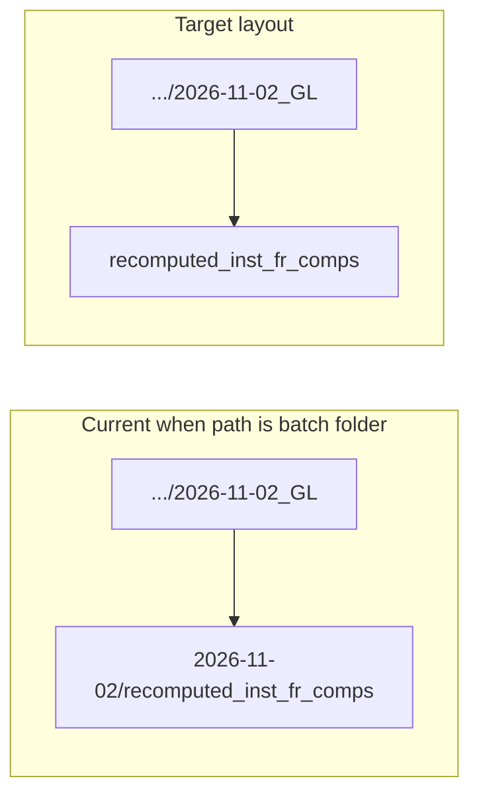

# Fix inst-FR staging double date folder

## Root cause

[`copy_session_inst_fr_data_to_across_session_pkl`](h:\TEMP\Spike3DEnv_ExploreUpgrade\Spike3DWorkEnv\pyPhoPlaceCellAnalysis\src\pyphoplacecellanalysis\SpecificResults\AcrossSessionResults.py) always builds staging as:

```1902:1906:h:\TEMP\Spike3DEnv_ExploreUpgrade\Spike3DWorkEnv\pyPhoPlaceCellAnalysis\src\pyphoplacecellanalysis\SpecificResults\AcrossSessionResults.py
    if dry_run:
        out_parent_path = target_dir.joinpath(f'{RESULT_DATE_TO_USE}/{custom_file_type_name}').resolve()
    else:
        out_parent_path = AcrossSessionTables.make_all_combined_output_directory(override_output_parent_path=target_dir, output_path_suffix=f'{RESULT_DATE_TO_USE}/{custom_file_type_name}')
```

Your instructions pass `collected_outputs_path=.../2026-11-02_GL`, so you get:

`.../2026-11-02_GL` + `2026-11-02/recomputed_inst_fr_comps` → **undesired extra segment**.

H5 copy in [`PostBatchCopyResults.run_main`](h:\TEMP\Spike3DEnv_ExploreUpgrade\Spike3DWorkEnv\Spike3D\PostBatchCopyResults.py) already uses `collected_outputs/{batch_date_to_use}/` as the dated batch root **without** a second `{result_date}` layer.



Merged across-session pkls should stay in the **same batch folder** as staging (your choice): `{batch_folder}/across_session_result_long_short_recomputed_inst_firing_rate_{date}_{tbin}.pkl` — already true when `collected_outputs_path` is the batch folder; no change needed to `_subfn_combine` save path beyond using that same `collected_outputs_path`.

## Implementation

### 1. Add staging layout control on `copy_session_inst_fr_data_to_across_session_pkl`

In [`AcrossSessionResults.py`](h:\TEMP\Spike3DEnv_ExploreUpgrade\Spike3DWorkEnv\pyPhoPlaceCellAnalysis\src\pyphoplacecellanalysis\SpecificResults\AcrossSessionResults.py) (~1803):

- Add parameter (single-line signature):  
  `nested_result_date_staging: bool = True`  
  (or `staging_output_path_suffix: Optional[str] = None` — if `None`, use `{RESULT_DATE_TO_USE}/recomputed_inst_fr_comps`; if `'recomputed_inst_fr_comps'`, flat under parent). **Prefer the bool** for clarity and fewer footguns.

- Compute staging suffix once:

  - `True` (default): `f'{RESULT_DATE_TO_USE}/{custom_file_type_name}'` — preserves legacy notebook behavior when `collected_outputs_path` is the **root** `.../collected_outputs`.
  - `False`: `custom_file_type_name` only (`recomputed_inst_fr_comps`).

- Use that suffix in **both** dry-run `joinpath` and `make_all_combined_output_directory`.

- Update docstring: document the two layouts and when to set `nested_result_date_staging=False` (parent is already `.../{batch_date_to_use}`).

### 2. Wire `PostBatchCopyResults.run_copy_sess_inst_fr_data_to_across_session_pkl`

In [`PostBatchCopyResults.py`](h:\TEMP\Spike3DEnv_ExploreUpgrade\Spike3DWorkEnv\Spike3D\PostBatchCopyResults.py) (~768):

- Resolve batch folder: `active_outputs_path = ctx.collected_outputs_path.joinpath(ctx.batch_date_to_use)` (mkdir if not dry-run, or always mkdir exist_ok like H5 path).

- Call `copy_session_inst_fr_data_to_across_session_pkl` with:
  - `collected_outputs_path=active_outputs_path`
  - `nested_result_date_staging=False`
  - `full_custom_suffix` derived from `ctx` (e.g. `f"{ctx.override_custom_pickle_suffix}-tbin_25ms"` or reuse the tbin segment from `ctx.job_suffix` — match on-disk pickle names; document that tbin string must align with batch phase in `configure_run_main`).

- Optional one-line print of resolved staging path for dry-run logs.

This aligns CLI `--run-copy-sess-inst-fr` with H5 dated-folder convention without requiring users to hand-build paths.

### 3. Update [`2026-09-14_GreatlakesBatchRunInstructions.md`](h:\TEMP\Spike3DEnv_ExploreUpgrade\Spike3DWorkEnv\Spike3D\2026-09-14_GreatlakesBatchRunInstructions.md) Inst Fr section (~262)

- Keep `collected_outputs_day_date_folder` as `collected_outputs_path`.
- Add `nested_result_date_staging=False` to the call.
- Fix comment for merged pkls: `{collected_outputs_day_date_folder}/across_session_...pkl` (not root `ctx.collected_outputs_path`).
- Prefer `pbcr.run_copy_sess_inst_fr_data_to_across_session_pkl(ctx)` as the canonical one-liner once wrapper is updated.

### 4. Backward compatibility check

| Caller | `collected_outputs_path` | `nested_result_date_staging` | Staging path |
|--------|--------------------------|------------------------------|--------------|
| Old notebook / default | `.../collected_outputs` | `True` (default) | `.../collected_outputs/2026-11-02/recomputed_inst_fr_comps` |
| PostBatch + GL instructions | `.../collected_outputs/2026-11-02_GL` | `False` | `.../2026-11-02_GL/recomputed_inst_fr_comps` |

No change to per-session rename in `copy_session_folder_files_to_target_dir` (`{RESULT_DATE}_{session}_{basename}`) or suffixed/legacy `_resolve_recomputed_inst_fr_comps_pkl` logic.

## Verification (manual)

- Dry-run: confirm printed `out_parent_path` is `K:\scratch\collected_outputs\2026-11-02_GL\recomputed_inst_fr_comps` with no intermediate `2026-11-02`.
- Execute on one batch: staging copies + merged `across_session_*.pkl` both under `2026-11-02_GL`.
- Quick grep: no other callers of `copy_session_inst_fr_data_to_across_session_pkl` need updates unless they also pass a batch-dated parent (notebook cell can add the flag explicitly).
