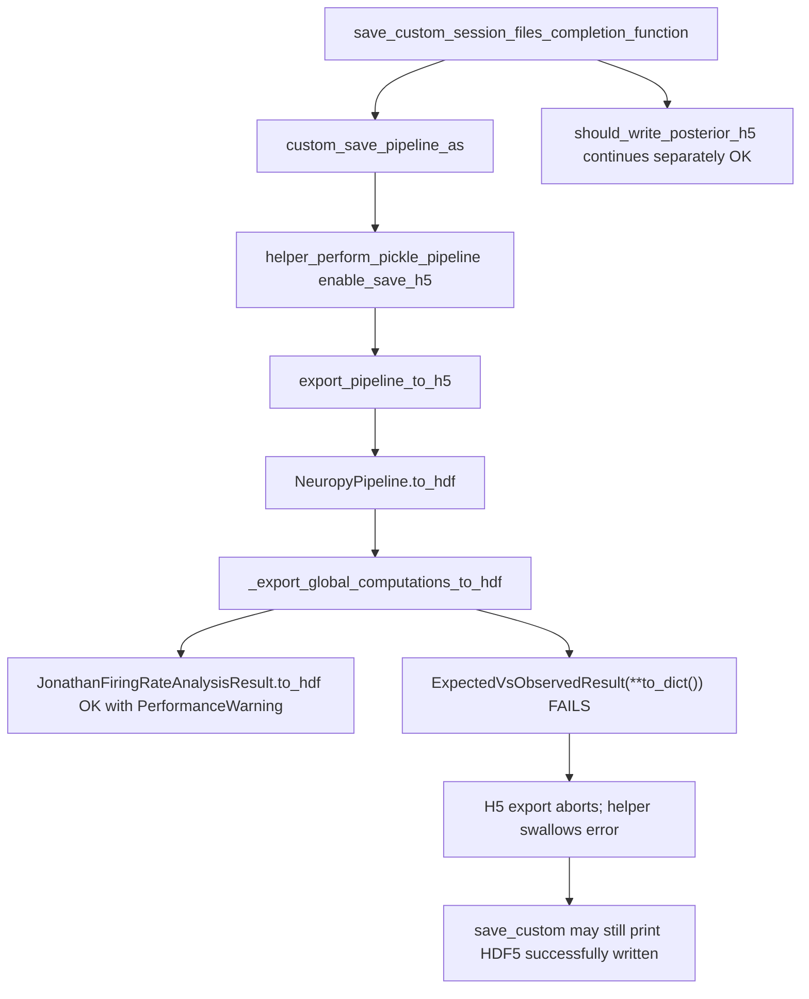

# Fix pipeline H5 export (`_VersionedResultMixin_version`)

## Diagnosis

Confirmed by [Trace VersionedResultMixin HDF error](9e387d31-e07f-41a2-8b6e-14b54751d540): the session pipeline H5 fails at **reconstruction**, not inside HDF field packing.

```1049:1052:H:/TEMP/Spike3DEnv_ExploreUpgrade/Spike3DWorkEnv/pyPhoPlaceCellAnalysis/src/pyphoplacecellanalysis/General/Pipeline/NeuropyPipeline.py
if not isinstance(expected_v_observed_result, ExpectedVsObservedResult):
    expected_v_observed_result = ExpectedVsObservedResult(**expected_v_observed_result.to_dict())

expected_v_observed_result.to_hdf(...)
```

Why `**to_dict()` breaks (attrs):

- Field name stored in `asdict` / `to_dict()`: `_VersionedResultMixin_version`
- `__init__` kwarg alias: `VersionedResultMixin_version` (leading `_` stripped)
- So `ExpectedVsObservedResult(**obj.to_dict())` raises `TypeError: unexpected keyword argument '_VersionedResultMixin_version'`

`isinstance` is often False after Jupyter autoreload / pickle class-identity mismatch, so reconstruction runs even when the object is notionally the same type.

Call chain:



Non-issues from the same log (do not block success):

- **PyTables `NaturalNameWarning`** for session folder name — cosmetic.
- **`PerformanceWarning` on `firing_rates` object columns** in [`LongShortTrackComputations.py`](H:/TEMP/Spike3DEnv_ExploreUpgrade/Spike3DWorkEnv/pyPhoPlaceCellAnalysis/src/pyphoplacecellanalysis/General/Pipeline/Stages/ComputationFunctions/MultiContextComputationFunctions/LongShortTrackComputations.py) 262/268 — non-fatal; write still succeeds via pickle.
- **Posteriors H5** — independent; completed successfully in the log.

False-positive success: [`helper_perform_pickle_pipeline`](H:/TEMP/Spike3DEnv_ExploreUpgrade/Spike3DWorkEnv/pyPhoPlaceCellAnalysis/src/pyphoplacecellanalysis/General/Pipeline/NeuropyPipeline.py) catches the exception and `pass`es (184–186), while `pipeline_h5` may remain a pre-seeded filename string. [`save_custom_session_files_completion_function`](H:/TEMP/Spike3DEnv_ExploreUpgrade/Spike3DWorkEnv/pyPhoPlaceCellAnalysis/src/pyphoplacecellanalysis/General/Batch/BatchJobCompletion/UserCompletionHelpers/batch_user_completion_helpers.py) then sets `was_write_good=True` and can print “HDF5 successfully written” incorrectly (2916–2917).

## Fix

### A. Reconstruction + resilient to_hdf (fatal bug)

**File:** [`NeuropyPipeline.py`](H:/TEMP/Spike3DEnv_ExploreUpgrade/Spike3DWorkEnv/pyPhoPlaceCellAnalysis/src/pyphoplacecellanalysis/General/Pipeline/NeuropyPipeline.py) in `_export_global_computations_to_hdf`

1. Import locally: `from neuropy.utils.mixins.indexing_helpers import get_dict_subset` (same as [`Loading.py`](H:/TEMP/Spike3DEnv_ExploreUpgrade/Spike3DWorkEnv/pyPhoPlaceCellAnalysis/src/pyphoplacecellanalysis/General/Pipeline/Stages/Loading.py) / [`ComputedResult._reload_class`](H:/TEMP/Spike3DEnv_ExploreUpgrade/Spike3DWorkEnv/pyPhoPlaceCellAnalysis/src/pyphoplacecellanalysis/General/Model/ComputationResults.py)).

2. Replace broken reconstruction:

```python
if not isinstance(expected_v_observed_result, ExpectedVsObservedResult):
    expected_v_observed_result = ExpectedVsObservedResult(**get_dict_subset(expected_v_observed_result.to_dict(), subset_excludelist=['_VersionedResultMixin_version']))
```

3. Wrap `expected_v_observed_result.to_hdf(...)` in try/except mirroring the `InstantaneousSpikeRateGroupsComputation` block (`NotImplementedError` / `TypeError` → log + skip; other errors re-raise) so secondary MaskedArray/list serialization issues cannot abort filtered-session writes.

4. Update the `ExpectedVsObservedResult` docstring example in [`LongShortTrackComputations.py`](H:/TEMP/Spike3DEnv_ExploreUpgrade/Spike3DWorkEnv/pyPhoPlaceCellAnalysis/src/pyphoplacecellanalysis/General/Pipeline/Stages/ComputationFunctions/MultiContextComputationFunctions/LongShortTrackComputations.py) (~495) to use the same exclusion.

### B. False-positive success reporting (H5-only; do not break pkl saves)

**File:** [`NeuropyPipeline.py`](H:/TEMP/Spike3DEnv_ExploreUpgrade/Spike3DWorkEnv/pyPhoPlaceCellAnalysis/src/pyphoplacecellanalysis/General/Pipeline/NeuropyPipeline.py) `helper_perform_pickle_pipeline`

- Only set `custom_save_filepaths_dict['pipeline_h5']` when `export_pipeline_to_h5` returns a real `Path` and no error; on H5 failure `pop('pipeline_h5', None)` if a pre-seeded filename string was present.
- Do **not** change the `enable_save_pipeline_pkl` / `enable_save_global_computations_pkl` branches, their return Paths, or `save_pipeline` / `save_global_computation_results` call signatures.
- Prefer isolating the H5 try so a failed H5 does not look like a failed pickle in the log message (optional clarity: catch H5 separately and print `failed HDF5 export` instead of `failed pickling`). Still do not re-raise if current callers rely on swallow-and-continue.

**File:** [`batch_user_completion_helpers.py`](H:/TEMP/Spike3DEnv_ExploreUpgrade/Spike3DWorkEnv/pyPhoPlaceCellAnalysis/src/pyphoplacecellanalysis/General/Batch/BatchJobCompletion/UserCompletionHelpers/batch_user_completion_helpers.py)

- Print “HDF5 successfully written” only when `isinstance(hdf5_output_path, Path)` (and preferably `.exists()`).
- Do **not** set `was_write_good=False` solely because H5 failed when pkls were requested and may have succeeded — keep `was_write_good` as “`custom_save_pipeline_as` returned without raising”; H5 success is a separate check on the `pipeline_h5` Path.

## Non-regression / pickle safety (hard constraints)

These fixes must not change how existing pipelines or `ComputedResult` subclasses pickle/unpickle:

1. **Call-site only.** Strip `_VersionedResultMixin_version` only at the H5 reconstruction line (and docstring). Do **not** change:
   - `VersionedResultMixin` / `ComputedResult` field definitions
   - `__getstate__` / `__setstate__` / `_VersionedResultMixin__setstate__`
   - `AttrsBasedClassHelperMixin.to_dict()` / attrs `asdict` globally
   - `PickleSerializableMixin` or `ComputedResult._reload_class` (already correct; leave alone)

2. **Do not mutate live computation state.** The reconstruction rebinds a **local** `expected_v_observed_result` for `to_hdf` only. Do **not** assign the new instance back into `curr_long_short_post_decoding.expected_v_observed_result` or `global_computation_results` — that would risk changing what the next `save_pipeline` / `save_global_computation_results` pickles.

3. **Reuse the existing modernization pattern.** `get_dict_subset(..., subset_excludelist=['_VersionedResultMixin_version'])` is already how unpickle/reload paths modernize objects (`_reload_class`, `PickleSerializableMixin`, Loading). Matching that keeps H5 modernization consistent with pickle paths without inventing a new protocol.

4. **try/except around `to_hdf` only.** Skipping a failed H5 subsection must not alter in-memory objects or pickle behavior; it only affects what nodes appear in the `.h5` file (same as the existing `InstantaneousSpikeRateGroupsComputation` skip).

5. **Helper false-success fix is H5-keyed.** Touch only `pipeline_h5` bookkeeping and the HDF5 success print. Leave `pipeline_pkl` / `global_computation_pkl` keys and pkl save behavior unchanged so enable_save_h5=False / pkl-only runs behave as today.

## Out of scope

- Changing `firing_rates` column storage / silencing PerformanceWarnings.
- Posterior export path (already working).
- Mass-refactor of every `**obj.to_dict()` call site.
- Changing attrs aliasing of `_`-prefixed fields or making `_VersionedResultMixin_version` a `ClassVar` (would be a broader attrs/pickle migration).

## Verify

Re-run `save_custom_session_files_completion_function(..., enable_save_h5=True, ...)` for `kdiba_gor01_one_2006-6-09_1-22-43` and confirm:

- No `_VersionedResultMixin_version` TypeError
- Real `pipeline_withNormalComputedReplays-qclu_...-frateThresh_2.0.h5` under session `output/`
- Success message only when that Path exists; on failure, no false “successfully written”
- With `enable_save_h5=False` (pkl-only), pipeline/global pkl saves still work unchanged
- After H5 export, in-memory `curr_long_short_post_decoding.expected_v_observed_result` identity/type is unchanged (local rebind only); a subsequent pickle save still round-trips as before
