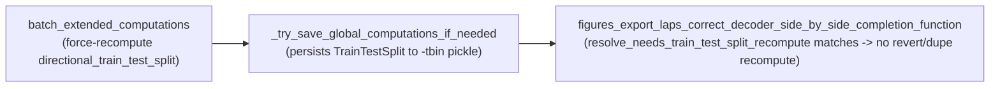

# Force `TrainTestSplit` recompute with `should_filter_inactive_bins_before_split=False`

## Context & Flow

In [`ProcessBatchOutputs_qclus1246789_Only.ipy`](h:/TEMP/Spike3DEnv_ExploreUpgrade/Spike3DWorkEnv/Spike3D/ProcessBatchOutputs_qclus1246789_Only.ipy), the `figures_export_laps_correct_decoder_side_by_side` `--only` recipe currently sets `force_recompute_override_computations_includelist: []` and omits both `should_filter_inactive_bins_before_split` and `active_laps_decoding_time_bin_size` from the completion kwargs.

In [`BatchCompletionHandler.py`](h:/TEMP/Spike3DEnv_ExploreUpgrade/Spike3DWorkEnv/pyPhoPlaceCellAnalysis/src/pyphoplacecellanalysis/General/Batch/BatchJobCompletion/BatchCompletionHandler.py), execution order is:

Forcing `directional_train_test_split` during `batch_extended_computations` persists the new `TrainTestSplit` into the global `-tbin` pickle, while passing `active_laps_decoding_time_bin_size=laps_decoding_time_bin_size` and `should_filter_inactive_bins_before_split=False` to `figures_export_laps_correct_decoder_side_by_side_completion_function` ensures `TrainTestLapsSplitting.resolve_needs_train_test_split_recompute` sees a match (rather than defaulting to `0.025` / `True` and recomputing it back).

## Changes

All edits are localized to [`ProcessBatchOutputs_qclus1246789_Only.ipy`](h:/TEMP/Spike3DEnv_ExploreUpgrade/Spike3DWorkEnv/Spike3D/ProcessBatchOutputs_qclus1246789_Only.ipy):

1. **Update `_ONLY_MODE_RECIPES['figures_export_laps_correct_decoder_side_by_side']` (lines 235-247)**:
   - Set `'force_recompute_override_computations_includelist': ['directional_train_test_split']` (keeping `split_to_directional_laps`, `merged_directional_placefields`, and `directional_decoders_evaluate_epochs` compute-if-missing).
   - Add `'force_recompute_override_computation_kwargs_dict': {'directional_train_test_split': dict(should_filter_inactive_bins_before_split=False, min_num_spikes_per_bin_to_be_considered_active=1, min_num_unique_active_neurons_per_time_bin=1)}`.
   - Update `'completion_fn_override_kwargs'` to include `should_filter_inactive_bins_before_split=False` alongside the existing low-firing thresholds.
   - Update `'description'` and inline comments to reflect the forced `TrainTestSplit` recompute with `should_filter_inactive_bins_before_split=False`.

2. **Forward `--tbin` to the figure completion function (line 558)**:
   - Add `active_laps_decoding_time_bin_size=laps_decoding_time_bin_size` to `custom_user_completion_function_override_kwargs_dict['figures_export_laps_correct_decoder_side_by_side_completion_function']` (matching `compute_and_export_kdiba_train_test_position_error_completion_function` on line 557) so non-25ms `--tbin` runs do not mismatch against the function's `0.025` default.

3. **Apply per-recipe `force_recompute_override_computation_kwargs_dict` in the `--only` overlay block (lines 593-600)**:
   - Shallow-merge `_only_recipe.get('force_recompute_override_computation_kwargs_dict', None)` into `force_recompute_override_computation_kwargs_dict`.
   - When `'directional_train_test_split'` is present and lacks `'laps_decoding_time_bin_size'` (since `_ONLY_MODE_RECIPES` is defined before `--tbin` is parsed at line 496), inject `laps_decoding_time_bin_size=laps_decoding_time_bin_size`.
   - Print the merged recipe computation kwargs override alongside `completion_fn_override_kwargs`.

## Verification

- Inspect the modified sections in [`ProcessBatchOutputs_qclus1246789_Only.ipy`](h:/TEMP/Spike3DEnv_ExploreUpgrade/Spike3DWorkEnv/Spike3D/ProcessBatchOutputs_qclus1246789_Only.ipy) and syntax-check with Python (`ast.parse`) to confirm no syntax issues and that non-`--only` runs remain unaffected.
